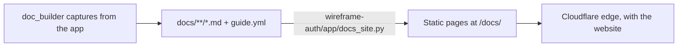

# WireFrame EDA — User Guide

The WireFrame user guide: installation, tutorials, schematic, PCB layout, high-speed and power integrity, simulation, the AI Copilot, libraries, multi-board products, import/export, and reference pages. Published at **<https://wireframe.com.vn/docs/>** (the app's **Help → Documentation**).

This repository holds the **content** — Markdown, the media WireFrame records of itself, and the capture briefs. The pages are drawn by the website, [`wireframe-auth`](../wireframe-auth), with its own header, footer, theme and search (`app/docs_site.py`). Until October 2026 the guide was a separate MkDocs site; it is now one site with wireframe.com.vn, at the same URLs.



## Read it while you write it

From the `wireframe-auth` checkout next to this one:

```bash
python main.py                      # http://127.0.0.1:8000/docs/ — rendered on request from this repo
python scripts/build_docs.py build/docs-site --strict   # the static build the deploy makes; fails on a broken link
```

`WF_DOCS_DIR=/path/to/wireframe-docs` points the site at a checkout somewhere else. The deploy (`scripts/build_worker.py`) builds the guide on every Worker build.

## Layout

| Path | Purpose |
|---|---|
| `guide.yml` | The order of the guide (sections and pages) and the words on its home page |
| `docs/**/*.md` | The pages. A page's URL is its path: `docs/pcb/routing.md` → `/docs/pcb/routing/` |
| `docs/assets/wf/` | Screenshots and clips captured by WireFrame's `doc_builder` (with a manifest) |
| `docs/assets/app/` | Pictures drawn by the app's own lab tools (`wf-panel-shot`) — see `docs/assets/app/README.md` |
| `.wf-docs.yaml` | Per-scene settings for `doc_builder` (sample files, hints, skipped scenes) |
| `boards.yaml` | The real open-hardware boards the media is recorded on |
| `samples/` | Sample projects used by capture scenes |

## Writing a page

- Front matter: `description:` (the search snippet, 50–300 characters). Optional `status: new|beta`.
- Markdown with admonitions (`!!! note`), collapsible blocks (`??? question`), tabs (`=== "Tab"`), keys (`++ctrl+s++`), tables, definition lists and code blocks.
- Link pages by their relative `.md` path; the build turns them into URLs and fails on a missing one.
- Name the app's menus and buttons exactly as the app spells them. A page that promises a button the app does not have is worse than no page.
- Add the page to a section in `guide.yml`, or it is not published.

## Images and videos

Sections titled `### Image — …`, `### Short video — …` or `### Diagram — …` are capture slots. Each carries a brief (`!!! note "… brief"`) and, once captured, the media. The website hides the briefs and turns a captured slot into a figure; a slot without media is left out until it is captured. Capture with WireFrame's `doc_builder`:

```bash
python3 -m doc_builder docs-scan ../wireframe-docs
python3 -m doc_builder docs-fill ../wireframe-docs
```

Every picture is drawn by the app itself, on the boards in `boards.yaml` — never mocked up, never the 7805 test project.
