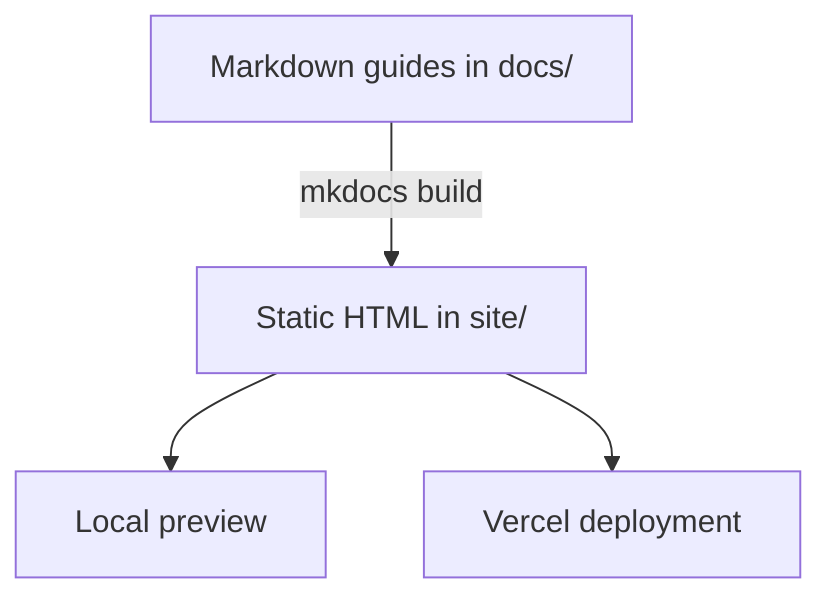

# WireFrame EDA — User Guide

The WireFrame user guide: installation, tutorials, schematic, PCB, simulation, AI Copilot, libraries, and reference pages. It is a static site built with **MkDocs** and the **Material for MkDocs** theme, published at <https://guideline-one.vercel.app/> (the app's **Help → Documentation**).



## Run locally

Requires Python 3.9 or later.

**macOS / Linux**

```bash
./run_dev.sh
```

The script creates `.venv`, installs `requirements.txt`, and serves the site with live reload at <http://127.0.0.1:8001>. Set `PORT=8002 ./run_dev.sh` to use another port.

**Windows (PowerShell)**

```powershell
py -m venv .venv
.venv\Scripts\Activate.ps1
pip install -r requirements.txt
mkdocs serve --dev-addr 127.0.0.1:8001
```

## Build the static site

```bash
mkdocs build --strict
python3 -m http.server -d site 8002   # preview the build at http://127.0.0.1:8002
```

`--strict` fails on broken links or missing pages. Vercel runs `npm run build` (see `package.json`), which builds into `site/`.

## Layout

| Path | Purpose |
|---|---|
| `mkdocs.yml` | Site configuration: navigation, theme, plugins, Markdown extensions |
| `docs/` | The pages (Markdown), stylesheets, scripts, and images |
| `docs/assets/wf/` | Screenshots and videos captured from the app by WireFrame's `doc_builder` |
| `hooks/hide_capture_briefs.py` | Build hook: hides capture briefs, turns captured slots into figures, drops empty slots |
| `.wf-docs.yaml` | Per-scene settings for `doc_builder` (sample files, hints, skipped scenes) |
| `samples/` | Fictional sample files used by the capture scenes |
| `run_dev.sh` | Local live preview |
| `package.json`, `vercel.json` | Build command and Vercel static deployment |
| `site/` | Build output |

## Images and videos

Sections titled `### Image — …`, `### Short video — …`, or `### Diagram — …` are capture slots. Each carries a brief (a `!!! note "… brief"` block) and, once captured, the media. The build hook hides the briefs; a slot without media is left out of the page until it is captured. Capture with WireFrame's `doc_builder` from the WireFrame repository:

```bash
python3 -m doc_builder docs-scan ../wireframe-docs
python3 -m doc_builder docs-fill ../wireframe-docs
```

## Guide sections

- **Start Here** — learning paths and two tutorials (LED board, AI-assisted design).
- **Getting Started** — installation, first session, user interface, projects and files.
- **Schematic Design**, **Simulation**, **AI Copilot**, **PCB Layout**, **Libraries**, **Advanced Features**.
- **Reference** — configuration and session, file formats, FAQ, release notes.
