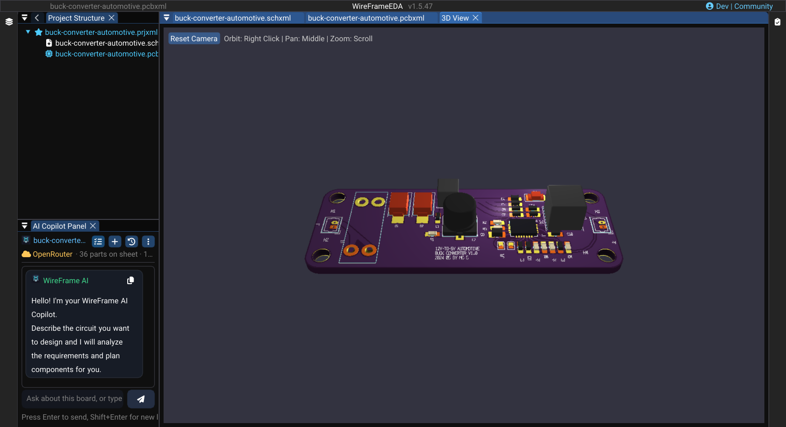

# 3D Viewer

The 3D Viewer renders a three-dimensional representation of your PCB — showing component placement, board geometry, and spatial relationships — so you can validate your design before manufacturing.

---

## Opening the 3D Viewer

From an open PCB document:

1. Go to **View → 3D Viewer**, or press ++3++ with the PCB active
2. The **3D View** panel opens; to make room, the Design Rules, Zone Manager, Layers, and DFM panels are closed
3. It renders:
    - The **board** as a 3D extruded shape derived from the Edge.Cuts outline
    - **Footprints** with 3D models (STEP/OBJ) if available
    - **Simple colored boxes** for footprints without 3D models

### Image — 3D Viewer

!!! note "Image capture brief"
    1. **Prepare:** Open the sample PCB and press **3**.
    2. **Build the frame:** Capture the 3D Viewer with the board in an isometric view, component models visible, and **Reset Camera** readable.
    3. **Clean the frame:** Close unrelated panels and tooltips, move the pointer away from key text, and hide credentials, usernames, customer data, and private paths.
    4. **Capture and finish:** Capture a native-resolution PNG, crop without cutting titles or primary actions, and add at most three subtle callouts without altering engineering content.
    5. **Approve:** Check the image at 100% zoom for current labels, readable evidence, correct release branding, and absence of sensitive information.

<!-- wf:shot id=3d-viewer
caption: 'The 3D Viewer: the buck converter board with its component models'
project: board:h730duino
setup:
- open_project
- ensure_pcb
- wait: 1
- keys:
  - '3'
- wait: 3
- action:
    action: mouse_move_to
    x: 1000
    y: 12
brief_sha256: 1f97eea2e9acd5ff
-->
<!-- wf:out id=3d-viewer sha=20faa772e05f -->

<!-- /wf:out -->

---

## Camera Controls

| Action | Input | Effect |
|---|---|---|
| **Orbit** | Left or right mouse button drag | Rotate the camera around the board |
| **Pan** | Middle mouse button drag | Move the camera parallel to the screen |
| **Zoom** | Mouse scroll wheel | Zoom in / out |
| **Reset** | **Reset Camera**, or ++home++ | Back to the default view |

The panel shows the frame rate and the hint *Orbit: Right Click \| Pan: Middle \| Zoom: Scroll*.

---

## How Components Are Rendered

### With a 3D model (STEP / OBJ)

- The actual 3D mesh from the STEP or OBJ file is rendered
- Colors and materials come from the model file

### Without a 3D model

- A simple **colored bounding box** approximating the footprint size is drawn
- Color is determined by the designator prefix:

| Prefix | Color | Component type |
|---|---|---|
| R | Beige | Resistor |
| C | Dark grey | Capacitor |
| L | Dark grey | Inductor |
| U | Near-black | IC |
| J, P | Green | Connector |
| D | Orange-red | Diode |
| Q | Black | Transistor |
| S | Red | Switch |
| H | Tan | Mechanical hole |

Board materials — solder mask, copper under mask, pad plating, silkscreen — are set in **Preferences → 3D Viewer**.

---

## Bottom-Side Components

Footprints flipped to **B.Cu** are rendered on the underside of the board with the same orientation shown in the 2D editor.

Use the underside camera view to confirm that flipped models, silkscreen, pad plating, and board clearances match the 2D layout.

---

## Practical Use Cases

| Use case | How |
|---|---|
| **Verify component placement** | Orbit around the board, zoom into areas of interest |
| **Check physical clearances** | Zoom into tall components (connectors, relays) to check they don't interfere |
| **Inspect bottom-side components** | Orbit below the board to view B.Cu placement |
| **Capture for documentation** | Position the view and take a screenshot with your operating system's tool |

!!! tip "STEP files load slowly the first time"
    First-time loading of STEP files may take several seconds due to mesh tessellation and GPU upload. Subsequent frames use the cached mesh and are fast.

---

## Assigning 3D Models to Footprints

To display an accurate 3D model instead of a coloured box, attach a STEP model to the footprint:

1. Open **View → Local Library Manager**, select the part, and open its **3D** tab
2. Choose **Edit 3D model & alignment**
3. In **Model Alignment**, use **Import 3D File...**, adjust **Translation**, **Rotation**, and **Scale**, then **Save to .kicad_mod**

See: [Footprint Libraries — Align a 3D model](../libraries/footprints-library.md#align-a-3d-model)

In a 3D preview (Library panel or Library Manager), **Load Colors** reloads the model with its full STEP colours (slower), **No Model** means the footprint has none, and **Load Failed** means a model file could not be read.

---

## See Also

- [PCB Editor](../pcb/index.md) — the 2D PCB workspace
- [Fabrication & Export](../pcb/fabrication-and-export.md) — export after 3D verification
