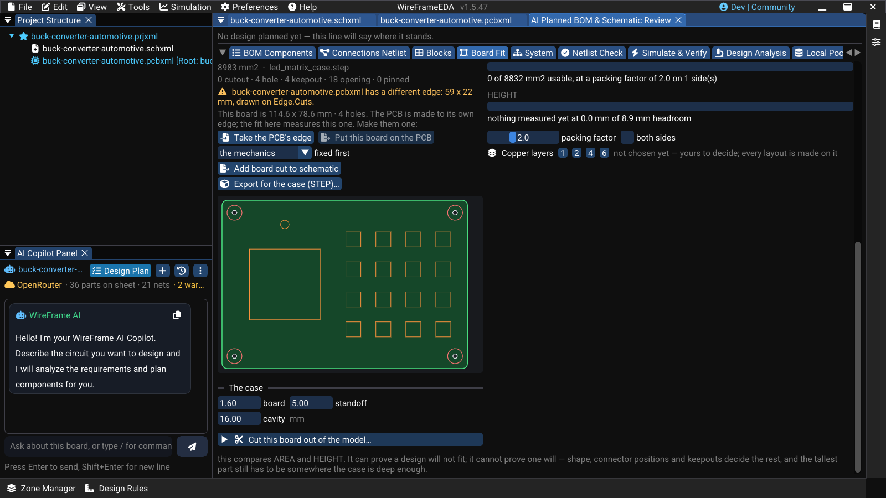

# Enclosure Fit and Board Stacks

Two tabs of the Component Review window deal with the physical product rather than the circuit:

| Tab | Answers |
|---|---|
| **Board Fit** | What shape is the board, does the BOM fit on it, and does it fit the case? |
| **System** | When the product is several boards, how are they stacked and wired to each other, and is anything wrong between them? |

Open them from AI Copilot's review window. Both are saved with the project. A design with no enclosure is not a design with a problem: nothing on these tabs is a fault until you give the board a case or a second board.

## Board Fit

**Board Fit** works from the BOM and the mechanics alone — before the schematic is drawn and long before placement — so a board that cannot hold its parts is found early.

### First: what is fixed already?

The tab opens on one question, kept with the project, which decides where the board's size comes from:

| Answer | What follows |
|---|---|
| **The mechanics** | A case, a frame, a standard board or a drawing gives the shape; the parts have to fit it (below) |
| **Nothing yet** | The circuit decides: the board is sized from the BOM, and the case is made around it |
| **Only limits** | A largest size is fixed — a pocket, a slot, a product — and the board is sized from the BOM inside it |

**Copper layers** (1, 2, 4 or 6) are chosen here too, before any size: they change how much room the parts need. The count belongs to the project — every layout is made on it, and **Update PCB** builds the board on that many copper layers.

**Sizes from the BOM.** With nothing mechanical to follow, the tab offers sizes built from the parts, each one grown until the fit check agrees: **Compact** (the least square), **Edge row** (long enough for every part that must stand at one edge, when Compact's side is too short) and **Roomy** (more room, 4:3). Beside each: its area, aspect, the fit verdict, how much of one side the edge parts take, and whether it stays inside your limits. **Use this size** makes it the board — a plain rectangle you then shape on this tab or with `/board`.

### Give the board a shape

Pick one of these on the tab:

| Button | Use it for |
|---|---|
| **3D model(s)…** | A case, frame, tube, or a board you will stack on, as STEP, IGES, STL, 3MF, or OBJ — one file or several. The outline, holes, and heights are already in it |
| **Standard board…** | Raspberry Pi HAT / micro-HAT, Arduino UNO shield, or FPV stacks 30.5 / 25.5 / 20 / 16 mm, each from its published drawing |
| **Board outline (SVG / DXF)…** | The shape only; heights are typed afterwards. See [Board Shape and Outline](../pcb/board-outline.md) |

Or describe it in chat: `/board 100x80 mm, M3 holes 4 mm in from each corner`, or `/board two boards on the 30.5 stack, 6 mm apart`.

The board preview is drawn from above, +Y down as on the PCB: **green** the board, **white** holes and cutouts, **red** keepouts, **orange** openings in the lid, **purple** parts the case pins in place.

### 3D files

**Add 3D files…** copies each file into the project so it reopens with it. For each file you can set:

- **which way is up** in the file;
- the **unit** — STL and OBJ carry none and are read as millimetres; a board 25× too small or too large means the file was in inches or centimetres;
- what the file **is** — a case, a lid, a frame, a board. Mark the **lid** file: its openings decide where the display and the keys go, and those parts are pinned under them.

**Cut this board out of the model…** lists the model's upward-facing surfaces so you can use one as the board. When a model already contains boards — a flight stack, a Raspberry Pi — **Use the boards in the model** takes them as the stack, with their outlines, holes, thicknesses, and spacers.

For the screw holes, the hole a screw passes the board through is what counts. Leaving it at zero takes the bore under it, which in a plastic boss is usually the pilot hole the screw bites into (2.5 mm for M3) — too small for the board.

### Stacks of boards

**Board above…** adds another board on top: a HAT, the flight controller over the ESC, the next board in a tube. A HAT or shield is moved so its holes land on the holes of the board below. Each board has a spacer below it — a standoff's length or a stacking header's mated height, which only you can state. What caps the tower (the lid's underside, a top plate) is set from the base; leave it at 0 and the top board's headroom is not checked.

Each board in the stack can be bound to a PCB file. **Update PCB** then gives that file the board's outline, holes, and heights.

`/topology` in the chat compares one board against a tower, and which parts go on which board, side by side.

### Does the BOM fit?

**What it has to hold** measures the area each part really needs against the board, with the height of each part against the case. The area factor is a multiple of the courtyard for clearance, routing channels, and fanout — a judgement, not a measurement: a hand-assembled two-layer board needs more room than a dense four-layer module. **both sides** is off by default, because a design that only fits by using both faces is a decision to make on purpose.

With several boards, **BOM across the boards** proposes which block goes on which board: blocks are kept whole, parts the case pins and parts already assigned stay where they are, and each remaining block — largest first — goes where most of its signals already are, on a board with room. The proposal is shown with the reason for each block; nothing moves until you accept it.

### Export the board for the case maker

**Export for the case (STEP)…** writes what a mechanical CAD tool needs to draw a case around the board: the board itself (outline, cutouts and holes, at its thickness), named and coloured, and

- once the board is laid out, every part on it as its courtyard box at its stated height, on its side;
- before layout, one **keep-in** block as tall as the tallest part — only when every part states a height.

A part with no known height is never given a guessed one: it goes in as a thin red marker named **HEIGHT UNKNOWN**, and the export says how many there are. The thickness is the board's, the PCB's stated stack-up, or 1.6 mm said as the fab default.

### Put the board on the schematic

The board can be added to the schematic as a part: a **BOARD CUT** box on the root sheet, with a footprint that carries the outline and cutouts on Edge.Cuts, the holes as NPTH pads, and courtyards around them. **Update PCB** then carries it like any other part, and it follows any later change to the board shape.

### Image — Board Fit with a case and lid

!!! note "Image capture brief"
    1. **Prepare:** Open a sample project with a BOM, and load a case STEP and its lid STEP on the **Board Fit** tab.
    2. **Build the frame:** Capture the **Board Fit** tab with the board preview (board, holes, keepouts, lid openings, and pinned parts in their colours) and the **What it has to hold** fit summary readable. Suggested size: **1400 × 820 px**.
    3. **Clean the frame:** Close unrelated panels and tooltips, move the pointer away from key text, and hide credentials, usernames, customer data, and private paths.
    4. **Capture and finish:** Capture a native-resolution PNG, crop without cutting titles or primary actions, and add at most three subtle callouts without altering engineering content.
    5. **Approve:** Check the image at 100% zoom for current labels, readable evidence, correct release branding, and absence of sensitive information.

<!-- wf:shot id=board-fit-with-a-case-and-lid
caption: 'Board Fit with the demo LED-matrix case and lid: the board cut from the case floor (114.6 ×
  78.6 mm, 4 holes, 4 keepouts, 18 lid openings), and a warning that the open project''s PCB has a different,
  59 × 22 mm edge'
setup:
- open_project
- panel: ai
- wait: 2
- click: //AI Copilot Panel/{fa:tasks} Design Plan
- wait: 2
- tab: Board Fit
- wait: 2
- click: '**/{fa:cube}  The mechanics'
- wait: 1
- open_file: $OUT/prepared/case/led_matrix_case.step
- click: '**/{fa:cube}  3D model(s)…'
- wait: 6
- open_file: $OUT/prepared/case/led_matrix_lid.step
- click: '**/{fa:cube} Lid…'
- wait: 6
- click: '**/{fa:check}  Use this plane as the board'
- wait: 4
- action:
    action: mouse_move_to
    x: 900
    y: 500
- scroll: -10
- wait: 1
- action:
    action: mouse_move_to
    x: 1000
    y: 12
- wait: 1
brief_sha256: 7bba4f5d3f64ddf6
-->
<!-- wf:out id=board-fit-with-a-case-and-lid sha=ca0b380c5d66 -->

<!-- /wf:out -->

## System: products made of several boards

A product of several boards — a flight stack, a HAT on a Pi, a display cabled to the main board — is one project with a PCB per board, each on a level of the board stack above, and one **assembly** (`.asmxml`) that says which boards make the product and how they are wired to each other. The **System** tab of this window shows that assembly: the boards, the connections pin by pin, the findings between boards, and the tower in 3D.

Everything about it — creating an assembly, bought boards such as a Raspberry Pi or a BeagleBone, the checks between boards, and splitting one design into several boards with the Copilot — is on its own page: [Multi-Board Products](multi-board.md).

### Short video — Connect two boards in an assembly

!!! note "Video production brief"
    1. **Prepare:** Create a sample assembly with two WireFrame board projects that share a 4-pin connector.
    2. **Opening shot (1–2 s):** Show the **System** tab with both boards listed and no connection yet.
    3. **Action shot (6–10 s):** Select **Connect two boards…**, name the connection, choose **Pin for pin**, and confirm.
    4. **Result shot (3–4 s):** Hold on the connection with its pin-by-pin view and the blocker/warning summary readable.
    5. **Deliver:** Export a **12–18 second** 1080p MP4.

<!-- wf:video id=connect-two-boards-in-an-assembly
caption: 'System tab with the demo drone: ESC, flight controller and a bought VTX; cable X1 read pin by
  pin — the ESC''s CURR meets the controller''s CURRENT, and the mismatch is flagged'
setup:
- open_project
- panel: ai
- wait: 2
- click: //AI Copilot Panel/{fa:tasks} Design Plan
- wait: 2
- tab: System
- wait: 2
- open_file: $OUT/prepared/drone/drone.asmxml
- click: '**/{fa:folder-open}  Open assembly…'
- wait: 8
- action:
    action: mouse_move_to
    x: 1000
    y: 12
steps:
- wait: 2.5
- click_at:
  - 490
  - 616
- wait: 1
- action:
    action: mouse_move_to
    x: 1000
    y: 760
- wait: 2
- scroll: -4
- wait: 2.5
- scroll: -6
- wait: 2.5
- action:
    action: mouse_move_to
    x: 1000
    y: 12
- wait: 1
brief_sha256: 2fc69558f82527ec
-->
<!-- wf:out id=connect-two-boards-in-an-assembly sha=beb88684216f -->
<video controls muted playsinline preload="metadata" src="../../assets/wf/docs/advanced/enclosure-and-assembly/connect-two-boards-in-an-assembly.mp4" title="System tab with the demo drone: ESC, flight controller and a bought VTX; cable X1 read pin by pin — the ESC&#x27;s CURR meets the controller&#x27;s CURRENT, and the mismatch is flagged"></video>
<!-- /wf:out -->

## See also

- [Board Shape and Outline](../pcb/board-outline.md)
- [3D Viewer](3d-viewer.md)
- [Placement and Routing Assistant](../ai/auto-placer-router.md)
