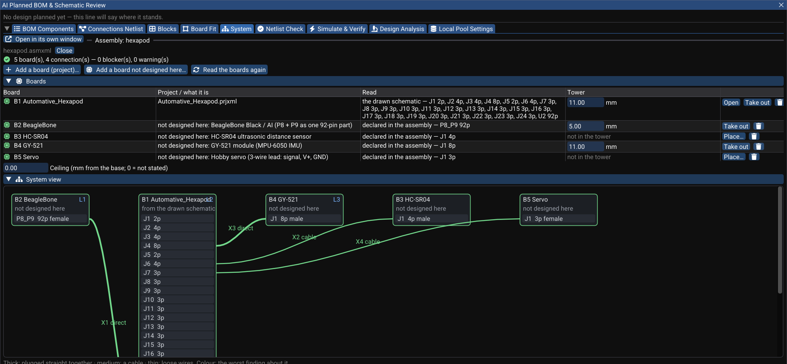

# Multi-Board Products

A product is often more than one board: a HAT on a Raspberry Pi, a cape on a BeagleBone, a flight controller on an ESC, a front panel cabled to a main board. In WireFrame such a product is **one project**:

```text
hexapod.prjxml
├── main.pcbxml   ← main.schxml  (+ main_… sheets)     level L1 of the board stack
├── panel.pcbxml  ← panel.schxml (+ panel_… sheets)    level L2
└── hexapod.asmxml ← the boards, the bought boards, and how they are wired to each other
```

- each board is a **`.pcbxml`**, drawn from **its own root sheet**;
- each board sits on a **level of the project's board stack** — the tower Board Fit draws, with the spacer under each board;
- one **assembly** (`.asmxml`) names the product's boards — the project's PCBs, a PCB of another project (an open-source shield), and boards you buy rather than design — and every **connection** between them.

The problems no single board can show are checked here: a 5 V pin meeting a 3.3 V pin, SDA wired to SCL, a cable turned round, signals crossing without a ground beside them.

## Create and open an assembly

| Menu | What it does |
|---|---|
| **File ▸ New ▸ New Assembly (.asmxml)…** | Makes the active project's assembly: its PCBs as its boards, each named after its board-stack level |
| **File ▸ Open Assembly (.asmxml)…** | Opens an assembly and its project (**File ▸ Open File…** takes an `.asmxml` too) |
| **File ▸ Close Assembly** | Closes it |
| **View ▸ Assembly View** | The assembly in its own centre window, like the 3D view |

The assembly sits under its project in **Project Structure**, follows the project you work in (activating the project opens its assembly) and reopens with the session. The **System** tab of the AI review window shows the same content while the Assembly view is not on screen.

## The Assembly view



**Boards** lists each board: what it is, **how it was read** (*the drawn schematic*, its share of the design plan before its sheets exist, or *declared in the assembly* for a bought board), and where it sits in the tower. **Open** opens a board's project; **Take out** removes it from the tower; **Place…** puts it in.

- **Add a board (project)…** — a PCB of this project or of another one.
- **Add a board not designed here…** — a bought board, from its published pinout (below).
- **Read the boards again** — after you edit a board.

**System view** draws the boards as blocks and their connectors as entries. Line **thickness** is the kind of link — thick: plugged straight together, medium: a cable, thin: loose wires — and **colour** is the worst finding on it. Each connection opens pin by pin.

**Assembly 3D** shows the tower in its case, built in the background: **Boards**, **3D files** and **See through the case** toggles, **Explode** to lift the boards apart for looking (the checks always use the real spacers), and **Fit**. A spacer changed here is changed in Board Fit, and the other way round.

## Connections

Each connection joins a connector on one board to a connector on another:

| Kind | Example |
|---|---|
| **direct** | A stacking header pair; a HAT socket on the Pi's 40-pin header |
| **cable** | A JST or FFC lead, with its length |
| **wire** | Loose wires soldered to pads |

The pin map is **pin for pin** unless you state it (an FFC with contacts on opposite sides reverses it: 1 meets N). A shield whose header block is drawn as **one part** over several headers (an Arduino shield's 28 pins over four headers) is connected **in parts**: one connection per header, each listing its pins, and no pin used twice. A host's pin named for **where it is** (`A0`, `D7`, `GPIO17`, `PA5`) meeting the name of what the plugged-in board uses it for (`XSTEP`) is what a header is for, not a naming conflict.

## Bought boards

Boards nobody designs here come from their **published pinouts**: which pins are fixed (rails and grounds), which take a signal, which take a supply in a range, which are spare — so they are checked pin by pin like your own.

| Template | What it is |
|---|---|
| `rpi-40` | Raspberry Pi 40-pin GPIO header (Pi 2, 3, 4, 5, 400 and Zero) |
| `beaglebone` / `beaglebone-92` | BeagleBone Black / AI P8 + P9 headers (as two connectors, or as one 92-pin part) |
| `hc-sr04` | HC-SR04 ultrasonic sensor (its ECHO is a 5 V output) |
| `servo` | Hobby servo lead (signal, V+ 4.8–7.4 V, GND) |
| `gy-521` | GY-521 module (MPU-6050 IMU) |
| `pololu-a4988` | Pololu A4988 stepper driver carrier (and pin-compatible StepStick / DRV8825 carriers) |

Standard board **shapes** — Raspberry Pi HAT and µHAT, Arduino UNO shield, FPV 30.5 / 25.5 / 20 / 16 stacks — are in Board Fit (**Standard board…**), see [Enclosure fit](enclosure-and-assembly.md).

## What is checked between boards

| Finding | Example |
|---|---|
| Two different rails joined | A 5 V pin on a 3.3 V pin |
| A supply or ground meeting a signal | GND on a GPIO; 5 V on a sensor's GND |
| Pins trading places | SDA on SCL, TRIG named on ECHO — reported as one finding |
| A pin order reversed end to end | An FFC turned round — one blocker |
| One wire under two names | Reported as a note when it is the same rail (`VDD_3V3` meets `+3.3V`) |
| A pin open on one side | A signal that goes nowhere on the other board |
| Signals with no ground beside them | A cable carrying fast signals without a return |
| Two connections shorting one board's nets | The same net reached twice through different connectors |
| A direct pair that cannot mate | Same gender, not over each other, mated height ≠ spacer |
| Supply voltage not stated | A rail whose name states no voltage meets a pin with a range — said so, not guessed |

The summary reads *N board(s), N connection(s) — N blocker(s), N warning(s)*. The hexapod in the picture reads with **no blocker and no warning** — four notes that the BeagleBone's `VDD_3V3`/`VDD_5V` are the cape's `+3.3V`/`+5V`, and one that the servo rail's name states no voltage. Turn the HC-SR04 lead round and cross the GY-521's SDA/SCL, and it reports two blockers (5 V on its GND, ground on its VCC) and both crossings.

## From one design to several boards

When a design should become several boards, ask the Copilot — `/topology`, or in plain words (*"one board or a tower?"*). It:

1. reads the design's blocks and **the nets a cut between two blocks would carry**;
2. proposes two to four genuinely different splits and measures each the same way — each board's parts against its room, what crosses between each pair of boards and how many connector pins that costs, the tower against its ceiling — and argues from those numbers;
3. applies a split **only with your words**: connectors from real families (stacking headers, JST-SH/GH/PH/XH, IDC, FFC, wire pads), a pinout you can state, written **into the project** — each board's connectors in the plan, the board stack, a `.pcbxml` per board, and the project's `.asmxml`;
4. **Build Sheets** then draws a root sheet per board with only that board's parts, and **Update Schematic to PCB** from each root makes its board.

## Limits today

- Pins have no logic level yet: a 3.3 V host driving a 5 V-supplied part's input is not caught.
- System-on-module connectors (CM4/CM5, Jetson SO-DIMM) are declared by pin count only.
- Only the A4988 and BeagleBone templates say where their pins are; other bought boards are not checked for alignment.
- No interference check between the boards and the case: the Assembly 3D shows it, nothing reports it yet.

## See also

- [Enclosure Fit](enclosure-and-assembly.md) — the board stack and shapes from a case
- [3D Viewer](3d-viewer.md)
- [File formats](../reference/file-formats.md) — `.asmxml`
