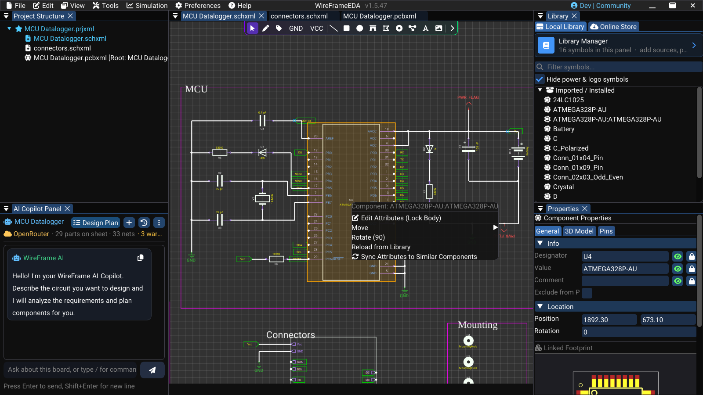
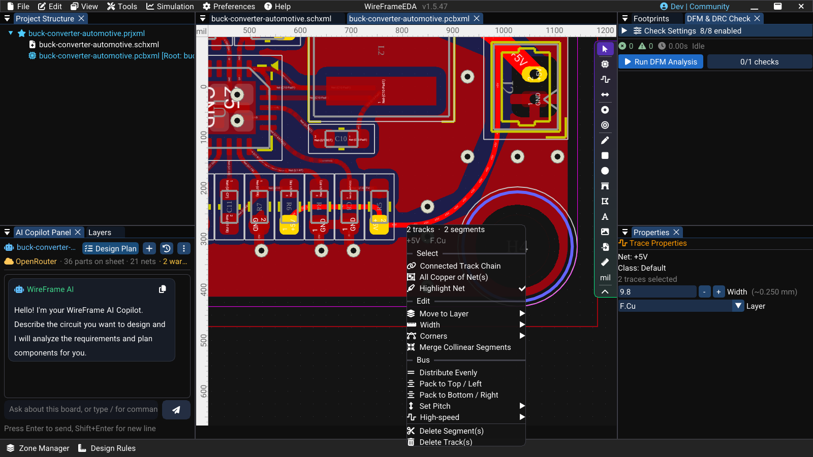
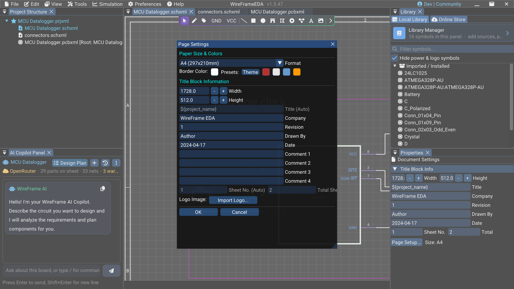

# Selection, Context Menus, and Popups

Use this page as the interaction reference for the schematic canvas, PCB canvas, library surfaces, and AI review windows. A click selects or starts the primary action; a right-click opens actions for the object under the pointer. Menus are contextual, so an action appears only when the current object and selection support it.

## Select items

| Goal | Action |
|---|---|
| Select one item | Left-click it |
| Add or remove an item from the selection | Hold ++ctrl++ while left-clicking |
| Select an area | Drag a selection box on empty canvas |
| Clear selection | Left-click empty canvas without ++ctrl++, or press ++esc++ |
| Select a whole PCB net | Double-click one of its traces |

++ctrl+a++ selects all rows in the Project Structure and the Library Manager lists; it does not select everything on the canvas.

Before a group edit, zoom in and confirm every highlighted object. Hidden or locked layers may affect what can be selected on a PCB.

## Move and transform

Drag a selected object or group to move it, or nudge it with the arrow keys (5 px on a schematic, 5 mil on a PCB). Rotate with ++space++ (on a schematic, ++r++ also rotates while something is selected) by the step set in **Preferences → Editing**. Press ++f++ to move a selected PCB footprint to the other side of the board.

After a transform, inspect connected wires or tracks, pad endpoints, text orientation, and board-side layer mapping. Use ++ctrl+z++ immediately if the result is not intended.

## Copy, cut, and paste

| Operation | Shortcut |
|---|---|
| Copy | ++ctrl+c++ |
| Cut | ++ctrl+x++ |
| Paste | ++ctrl+v++ |
| Delete | ++delete++ or ++backspace++ |
| Undo | ++ctrl+z++ |
| Redo | ++ctrl+y++ |

Pasted groups preserve their relative geometry and follow the cursor until placed. WireFrame assigns new object identities; review component designators, net attachment, and footprint references after copying between design areas.

### Short video — Copy, place, and undo a group

!!! note "Video production brief"
    1. **Prepare:** Place three simple components in a clear schematic area and note their current designators.
    2. **Opening shot (1–2 s):** Hold on the unselected group at a useful zoom.
    3. **Action shot (8–12 s):** Box-select the group, copy, paste, and left-click to place the copy. Pause so the new selection and designators can be read.
    4. **Result shot (3–4 s):** Press Undo once and hold on the restored schematic state.
    5. **Deliver:** Export a **15–20 second** 1080p MP4 and replace older media when selection styling or behavior differs.

<!-- wf:video id=copy-place-and-undo-a-group
caption: Box-select the two EEPROMs, copy, paste and click to place the copy (29 → 31 parts) — then undo
setup:
- open_project
- ensure_schematic
- wait: 1
- canvas_fit:
    box:
    - 250
    - 1040
    - 1350
    - 1900
- wait: 1
- action:
    action: mouse_move_to
    x: 1000
    y: 12
steps:
- wait: 1
- canvas_box:
  - U2
  - U3
- wait: 1
- keys:
  - Ctrl
  - C
- keys:
  - Ctrl
  - V
- wait: 1
- canvas_click:
  - 600
  - 1720
- wait: 2
- keys:
  - Ctrl
  - Z
- wait: 2
brief_sha256: 8cd5372ce5390660
-->
<!-- wf:out id=copy-place-and-undo-a-group sha=030ddfc71404 -->
<video controls muted playsinline preload="metadata" src="../../assets/wf/docs/advanced/selection-and-editing/copy-place-and-undo-a-group.mp4" title="Box-select the two EEPROMs, copy, paste and click to place the copy (29 → 31 parts) — then undo"></video>
<!-- /wf:out -->

## Schematic object interactions

When you right-click a component that is not already selected, WireFrame selects it before opening the menu. Hold ++ctrl++ if you need to preserve the rest of the selection. A right-click on empty canvas clears the selection unless ++ctrl++ is held.

| Pointer target | Left-click | Right-click menu |
|---|---|---|
| Component body | Select the component | **Component: _name_**, **Edit Attributes (Lock Body)**, **Move**, **Rotate (90)**, **Reload from Library**, **Sync Attributes to Similar Components** |
| Component attribute while normal editing | Select its component | Opens the component menu |
| Attribute while **Edit Attributes** is active | Select and move that attribute; the component body remains locked | **Finish Editing** is available from the component menu |
| Empty schematic canvas | Clear the selection | **Canvas Actions**; **Paste** appears when copied components are available |

The **Move** submenu nudges a component **Up**, **Down**, **Left**, or **Right** by 10 px. Arrow keys nudge the current selection by 5 px. Press ++esc++ to leave attribute editing or cancel the active drawing tool.

!!! tip "Edit a reference or value without moving the symbol"
    Right-click the component, choose **Edit Attributes (Lock Body)**, then left-click the reference, value, or other attribute you want to move. Click outside the selected attribute to clear that attribute selection; use **Finish Editing** or ++esc++ when done.

### Image — Schematic component context menu

!!! note "Image capture brief"
    1. **Prepare:** Open a clean release-build workspace with fictional or public sample data and prepare the requested state.
    2. **Build the frame:** Capture a selected schematic component with its actual context menu open. Show **Edit Attributes (Lock Body)**, the expanded **Move** submenu, **Rotate (90)**, **Reload from Library**, and **Sync Attributes to Similar Components**. Keep the Properties panel visible but crop out unrelated desktop content. Suggested size: **1200 × 760 px**.
    3. **Clean the frame:** Close unrelated panels and tooltips, move the pointer away from key text, and hide credentials, usernames, customer data, and private paths.
    4. **Capture and finish:** Capture a native-resolution PNG, crop without cutting titles or primary actions, and add at most three subtle callouts without altering engineering content.
    5. **Approve:** Check the image at 100% zoom for current labels, readable evidence, correct release branding, and absence of sensitive information.

<!-- wf:shot id=schematic-component-context-menu
caption: Right-click the ATmega328P (U4) for its component menu
setup:
- open_project
- ensure_schematic
- wait: 1
- canvas_fit:
    refs:
    - U4
    margin: 0.4
- canvas_click:
    target: U4
    button: right
- wait: 0.5
capture:
  popups: true
brief_sha256: 0b1830046fdd9add
-->
<!-- wf:out id=schematic-component-context-menu sha=98dc3a3193ed -->

<!-- /wf:out -->

### Short video — Move a component attribute safely

!!! note "Video production brief"
    1. **Prepare:** Select a component whose reference text has room to move; keep the Properties panel visible.
    2. **Opening shot (1–2 s):** Hold on the component body and reference before editing.
    3. **Action shot (5–8 s):** Right-click, choose **Edit Attributes (Lock Body)**, select the reference, and move only the text.
    4. **Result shot (2–3 s):** Right-click and choose **Finish Editing**; hold on the unchanged body and corrected reference position.
    5. **Deliver:** Export a **10–14 second** 1080p MP4 with a restrained click highlight.

<!-- wf:video id=move-a-component-attribute-safely
caption: Edit Attributes (Lock Body) moves only the R1 designator of the RTC pull-up; Finish Editing leaves
  the body where it was
setup:
- open_project
- ensure_schematic
- wait: 2
- canvas_fit:
    refs:
    - R1
    margin: 2.5
- wait: 1
- action:
    action: mouse_move_to
    x: 1000
    y: 12
steps:
- wait: 1.5
- canvas_click:
    target: R1
    button: right
- wait: 1.5
- click: '**/{fa:edit} Edit Attributes (Lock Body)'
- wait: 1
- canvas_drag:
    from: text:R1
    by:
    - 6
    - 14
- wait: 1.5
- canvas_click:
    target:
    - 930
    - 560
    button: right
- wait: 1.5
- click: '**/{fa:check} Finish Editing'
- wait: 1
- action:
    action: mouse_move_to
    x: 1000
    y: 12
- wait: 2.5
brief_sha256: 4b4c7c8fc06f2235
-->
<!-- wf:out id=move-a-component-attribute-safely sha=a79cc838c462 -->
<video controls muted playsinline preload="metadata" src="../../assets/wf/docs/advanced/selection-and-editing/move-a-component-attribute-safely.mp4" title="Edit Attributes (Lock Body) moves only the R1 designator of the RTC pull-up; Finish Editing leaves the body where it was"></video>
<!-- /wf:out -->

## PCB context menus

PCB context actions depend on the item under the pointer and the current selection. Do not expect schematic component actions in the PCB editor, and there is no context menu on a footprint — use the keys (++space++, ++f++, ++delete++) or **Properties** for footprints.

| Right-click target | Menu | Use |
|---|---|---|
| Selected **traces** | A header with the track and segment count, net, and layer; **Select** (**Connected Track Chain**, **All Copper of Net(s)**, **Highlight Net**); **Edit** (**Move to Layer ▸**, **Width ▸**, **Corners ▸**, **Merge Collinear Segments**); **Bus** (**Distribute Evenly**, **Pack to Top / Left**, **Pack to Bottom / Right**, **Set Pitch ▸**); **High-speed ▸**; **Delete Segment(s)**, **Delete Track(s)** | See [the trace context menu](../pcb/routing.md#the-trace-context-menu) |
| Two or more **designators** | **Align Designators ▸** → **Align Left**, **Align Right**, **Align Center (H)**, **Align Top**, **Align Bottom**, **Align Center (V)** | Align reference text as a group |
| A **polygon or rectangle** graphic | **Shape Operations** — **Fillet Radius** (mils) and **Apply to All Corners**; **Delete** | Round every corner by the entered radius; a rectangle becomes a polygon |

An action can be absent when too few compatible items are selected — **Bus** needs several parallel tracks. Select the intended items first, then right-click one of them.

### Image — PCB trace context menu

!!! note "Image capture brief"
    1. **Prepare:** Open a clean release-build workspace with fictional or public sample data and prepare the requested state.
    2. **Build the frame:** Capture at least two selected trace segments with the complete context menu open. Show **Segment Alignment**, **Arc Mitering**, **Trace Consolidation**, and **Delete Selected Traces**. In a second inset, expand **Trace Consolidation** so **Merge Collinear Segments** is readable. Suggested combined size: **1400 × 850 px**.
    3. **Clean the frame:** Close unrelated panels and tooltips, move the pointer away from key text, and hide credentials, usernames, customer data, and private paths.
    4. **Capture and finish:** Capture a native-resolution PNG, crop without cutting titles or primary actions, and add at most three subtle callouts without altering engineering content.
    5. **Approve:** Check the image at 100% zoom for current labels, readable evidence, correct release branding, and absence of sensitive information.

<!-- wf:shot id=pcb-trace-context-menu
caption: Trace context menu with two +5V traces selected
setup:
- open_project
- ensure_pcb
- wait: 1
- canvas_click: trace:44
- canvas_click:
    target: trace:46
    mods:
    - Ctrl
- canvas_click:
    target: trace:44
    button: right
- wait: 0.5
capture:
  popups: true
brief_sha256: 03f91b6ac02a4b69
-->
<!-- wf:out id=pcb-trace-context-menu sha=a5c227e8f824 -->

<!-- /wf:out -->

## Library clicks and context menus

In **Component Library → Local Library**, a left-click selects an item for preview. Drag an approved symbol onto the schematic canvas to place it. Use ++ctrl++ or ++shift++ for multi-selection; **Remove Selected** and **Clear** then appear above the tree. Clicking empty tree space clears the selection when no modifier is held.

Right-click actions are deliberately narrow:

| Library target | Context action |
|---|---|
| Imported or converted library | **Remove Library** |
| Loaded folder | **Remove Folder** |
| One symbol | **Remove Symbol** |
| A selected symbol within a multi-selection | **Remove _n_ Selected** |

These actions remove a source or item from the active library pool; they are not placement commands. Confirm that no active project relies on the definition before removing it. See [Library Import and Management](../libraries/library-converter.md) for the manager window.

## Modal and popup behavior

- A modal blocks interaction with the windows behind it until it is closed.
- Use its named **Cancel** or **Close** action when available; do not assume a click outside will dismiss it.
- AI repairs (`/fix`) run in the AI Copilot panel, not in a modal: the chat shows the plan with **Apply**, **Attach datasheet...**, and **Cancel**, and nothing changes until you apply.
- File pickers opened by **Import** or library source buttons do not change the project until you choose a file and complete the relevant workflow.

### Common confirmation windows

| Window | Actions | Guideline |
|---|---|---|
| **Unsaved Changes?** | **Yes, Save**, **No, Discard**, **Cancel** | Use **Yes, Save** to preserve changes. **No, Discard** closes the affected document, project, or app without saving; use it only when that loss is intentional. |
| **Page Settings** | **OK**, **Cancel** | **OK** applies and persists the page changes. **Cancel** closes the modal without completing the update. |
| **AI OCR Manager** | **Add Images**, **Paste from Clipboard**, **Remove**, **Generate Pins**, **Cancel** | Add only clear pin-table images, remove irrelevant pages, and review every generated pin against the datasheet. |

The **Gerber Viewer** is a normal tool window, not a blocking modal. In the current release it is a preview that does not draw layer geometry yet — see [Check the Gerbers before ordering](../pcb/fabrication-and-export.md#check-the-gerbers-before-ordering).

### Image — Modal versus docked panel

!!! note "Image capture brief"
    1. **Prepare:** Open a clean release-build workspace with fictional or public sample data and prepare the requested state.
    2. **Build the frame:** Create a two-panel screenshot: the **Page Settings** modal on the left and the docked **Component Library** on the right. Add subtle callouts for the modal close action and panel collapse control. Do not cover UI labels with annotations. Suggested size: **1500 × 850 px**.
    3. **Clean the frame:** Close unrelated panels and tooltips, move the pointer away from key text, and hide credentials, usernames, customer data, and private paths.
    4. **Capture and finish:** Capture a native-resolution PNG, crop without cutting titles or primary actions, and add at most three subtle callouts without altering engineering content.
    5. **Approve:** Check the image at 100% zoom for current labels, readable evidence, correct release branding, and absence of sensitive information.

<!-- wf:shot id=modal-versus-docked-panel
caption: A modal (Page Settings) in front of the docked panels
setup:
- open_project
- ensure_schematic
- wait: 1
- menu:
  - File
  - Page Settings...
- wait: 1
- action:
    action: mouse_move_to
    x: 1000
    y: 12
brief_sha256: fa87a731de55cf82
-->
<!-- wf:out id=modal-versus-docked-panel sha=4f43c5b309b5 -->

<!-- /wf:out -->

## Safe editing checklist

- Confirm the active document and PCB layer before editing.
- Save before a large multi-object operation.
- Review wire/track endpoints after moving connected objects.
- Re-run ERC or DFM/DRC after structural edits.
- Avoid treating Undo history as a substitute for a saved revision.

## Related guidelines

- [Keyboard Shortcuts](shortcuts.md)
- [Schematic Editor](../schematic/index.md)
- [PCB Editor](../pcb/index.md)
