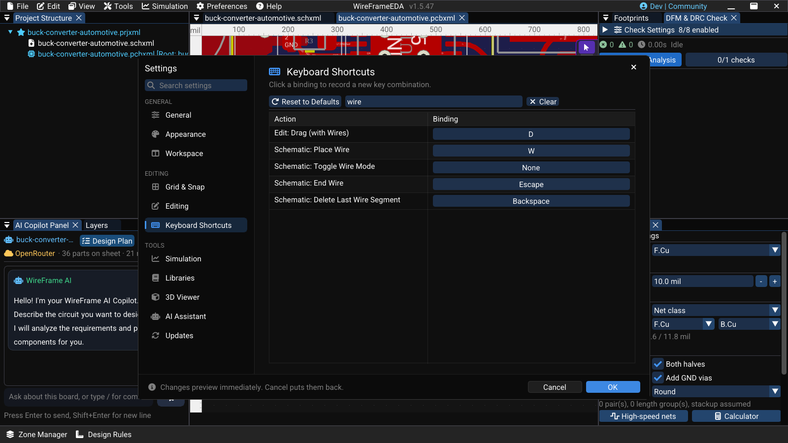

# Keyboard Shortcuts and Key Map

WireFrame lets you change the shortcut of every action. The tables below list the **default** bindings that do something in the current build. If you have changed a binding, the menus and toolbar tooltips show your binding instead.

!!! note "One key, several meanings"
    The same letter can mean different things in the schematic and the PCB editor — ++o++ is **Draw Polygon** on a schematic but **Place Footprint** on a board. A shortcut only acts in the editor of the active document.

---

## Change a shortcut

1. Open **Preferences → Preferences...** (++ctrl+comma++) and select **Keyboard Shortcuts**.
2. Type in **Search action or binding** to find an action, or scroll the **Action / Binding** table. Actions are named by area, for example `Schematic: Place Wire` or `PCB: Measure`.
3. Click the binding of the action. The button reads **[ Press keys... ]**.
4. Press the new key combination, then:
    - ++enter++ confirms it;
    - ++esc++ cancels;
    - ++delete++ or ++backspace++ clears the binding.
5. Select **OK** to keep the change.

A binding that is already used by another action in the same editor turns amber. Hover it to see **Warning: This keybinding conflicts with: …**. The other action keeps its binding — change one of the two. **Reset to Defaults** restores every binding.

Bindings are saved in the user configuration and restored on the next launch.

### Image — Keyboard Shortcuts page

!!! note "Image capture brief"
    1. **Prepare:** Open a clean release-build workspace with a sample schematic active.
    2. **Build the frame:** Open **Preferences → Keyboard Shortcuts**, type `wire` in **Search action or binding**, and capture the filtered **Action / Binding** table with **Reset to Defaults** visible.
    3. **Clean the frame:** Close unrelated panels and tooltips, move the pointer away from key text, and hide credentials, usernames, customer data, and private paths.
    4. **Capture and finish:** Capture a native-resolution PNG, crop to the Preferences dialog, and add at most three subtle callouts.
    5. **Approve:** Check the image at 100% zoom for current labels and readable bindings.

<!-- wf:shot id=keyboard-shortcuts-page
caption: Preferences → Keyboard Shortcuts, filtered to “wire”
setup:
- open_project
- wait: 1
- menu:
  - Preferences
  - Preferences...
- wait: 1
- click_at:
  - 380
  - 437
- wait: 1
- click_at:
  - 780
  - 190
- type:
    text: wire
- wait: 1
- action:
    action: mouse_move_to
    x: 1000
    y: 12
brief_sha256: ebfd641c410ab5d3
-->
<!-- wf:out id=keyboard-shortcuts-page sha=63d2c3a35b0b -->

<!-- /wf:out -->

---

## Mouse

| Action | Input |
|---|---|
| Pan | Middle-drag, or right-drag |
| Zoom at the cursor | Mouse wheel (Windows, Linux); ++ctrl++ + wheel on every platform |
| Pan on a trackpad (macOS) | Two-finger scroll; zoom with pinch or ++cmd++ + scroll |
| Select | Click; drag on empty canvas for a box selection |
| Context menu | Right-click an object |

---

## Global

| Action | Default | Notes |
|---|---|---|
| New schematic | ++ctrl+n++ | Opens a new, unsaved schematic tab |
| Open file | ++ctrl+o++ | `.schxml` or `.pcbxml` |
| Open project | ++ctrl+p++ | `.prjxml` |
| Save | ++ctrl+s++ | |
| Save As | ++ctrl+shift+s++ | |
| Preferences | ++ctrl+comma++ | |
| Undo / Redo | ++ctrl+z++ / ++ctrl+y++ | Per document |
| Cut / Copy / Paste | ++ctrl+x++ / ++ctrl+c++ / ++ctrl+v++ | |
| Delete | ++delete++ or ++backspace++ | |
| Show Properties panel | ++ctrl+e++ | |
| Show / hide AI Copilot | ++ctrl+space++ | |
| Toggle unit mm / mil | ++shift+u++ | |
| Toggle grid | ++shift+g++ | |
| Toggle crosshair | ++shift+c++ | |
| Zoom 100% | ++ctrl+0++ | |
| Rotate selection | ++space++ | Step set in **Preferences → Editing** (90° by default) |
| Show / hide the floating toolbar | ++tab++ | In the PCB editor ++tab++ also switches the active copper layer — see below |
| Cancel the current tool | ++esc++ | Returns to Select |

!!! warning "Shortcuts shown in the File menu"
    The **File** menu prints ++ctrl+p++ beside **Page Settings...**, ++ctrl+e++ beside **Fabrication Outputs**, and ++ctrl+w++ beside **Close Document**. In this build those keys do what the table above says (open a project, show Properties) or nothing (++ctrl+w++). Use the menu items themselves.

---

## Schematic editor

| Action | Default | Notes |
|---|---|---|
| Fit to screen | ++home++ | |
| Zoom to selection | ++ctrl+shift+f++ | |
| Rotate selection | ++space++, or ++r++ while something is selected | With nothing selected, ++r++ is **Draw Rectangle** |
| Nudge selection | Arrow keys | 5 px per press |
| Align selected components / text horizontally | ++shift+y++ | |
| Align selected components / text vertically | ++shift+x++ | |
| Wire | ++w++ | ++space++ while drawing flips which way the first bend goes |
| Net label | ++n++ | |
| Power port (VCC) | ++p++ | |
| GND | ++g++ | |
| Junction | ++j++ | |
| Net harness | ++h++ | |
| Text | ++t++ | |
| Line | ++shift+l++ | |
| Rectangle | ++r++ | |
| Circle | ++e++ | |
| Arc | ++a++ | |
| Polygon | ++o++ | |
| Probe signal (simulation) | ++v++ | |
| Run simulation | ++f5++ | Opens the SPICE Simulation Panel and runs the current setup |

---

## PCB editor

| Action | Default | Notes |
|---|---|---|
| Place footprint | ++o++ | |
| Route trace | ++x++ | |
| Place via | ++v++ | While routing, ++v++ drops a via instead |
| Place mounting hole | ++h++ | |
| Measure | ++m++ | |
| Line / Rectangle / Circle / Arc | ++shift+l++ / ++r++ / ++e++ / ++a++ | |
| Text | ++t++ | |
| Rotate selection | ++space++ | |
| Flip footprint to the other side | ++f++ | |
| Nudge selection | Arrow keys | 5 mil per press |
| Align selected designators or footprints | ++shift+y++ / ++shift+x++ | Several selected designators are aligned first; otherwise the selected footprints |
| Trace width down / up | ++bracket-left++ / ++bracket-right++ | While routing: 1 mil per press, kept within the net class minimum and maximum. The next route starts again at the class width |
| Switch active copper layer | ++tab++ | To its via pair (F.Cu ↔ B.Cu by default). While routing, ++tab++, ++v++, or ++space++ drops a via and continues on the other layer |
| Next / previous copper layer | ++equal++ / ++minus++ | While routing (also keypad ++num-plus++ / ++num-minus++) it drops a via to that layer |
| Top layer / bottom layer | ++page-up++ / ++page-down++ | While routing it drops a via to F.Cu / B.Cu |
| Via to a chosen layer | ++shift+v++ | Opens the layer picker |
| Show / hide 3D Viewer | ++3++ | |

## 3D Viewer

| Action | Default |
|---|---|
| Reset camera | ++home++ |

---

## Customization tips

!!! tip "Match your workflow"
    Coming from KiCad, Altium, or Eagle, you can rebind WireFrame's shortcuts to match. Search for the action in **Preferences → Keyboard Shortcuts** and record your preferred key.

---

## See Also

- [Selection & Editing](selection-and-editing.md) — keyboard operations for selection and clipboard.
- [Schematic Editor](../schematic/index.md) — schematic-specific tool modes.
- [PCB Editor](../pcb/index.md) — PCB-specific tool modes.
