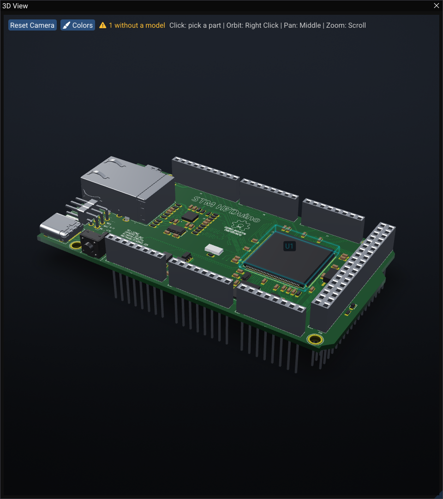
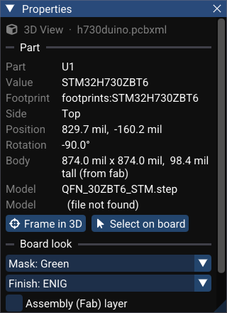

# Schematic, Board and 3D Side by Side

Most questions about a board involve more than one view of it: *which of these resistors is R14 on the sheet?*, *what is that tall part next to the connector?*, *does this footprint I just moved collide in 3D?* WireFrame can show the sheet, the board and its 3D model at the same time, and keeps them pointing at the same part.

## Open the three views

**View ▸ Schematic | PCB | 3D** splits the centre of the window into three columns — the sheet, the board and the 3D view of that board. Documents you open afterwards open into the centre column you are working in.

**View ▸ Views as Tabs** puts them back into one tabbed area. Either layout is kept for the next session; **Preferences ▸ Reset to Default Layout** restores the factory one.

The 3D view always shows the board you are working on — or the last one you worked on — so clicking the sheet beside it does not close it or empty it.

## Cross-probing

Pick a part in any of the three views and the other two show it:

| You pick | The board canvas | The 3D view | The sheet |
|---|---|---|---|
| A symbol on the sheet | rings the footprint | boxes the part and labels it with its designator | — |
| A footprint on the board | — | boxes the part | rings the symbol |
| A part in 3D (click without dragging) | rings the footprint | — | rings the symbol |

- Parts are linked by **designator** — the name **Update Schematic to PCB** gives footprints — so a symbol drawn in units (U1A, U1B) probes U1.
- A probe is a **highlight, not a selection**: nothing on the other views is selected or moved, and their own selection is left alone.
- When the probed part is off screen, the view **pans** to it; the zoom stays where you left it.
- Only the view you are working in speaks, and only when its selection changes; a view never pans to its own probe.
- In 3D, hovering a part names it; parts behind the board are not picked through it.

**Preferences ▸ Workspace** has two switches: **Cross-probe between views**, and **Bring a probed part into view** (the panning).

## The panels follow the view you work in

The Properties, Layers and Library panels belong to the drawing you are working in. With one drawing in the main window they behave as before; with several side by side, they follow the one you clicked last.

When the 3D view is the one in front, **Properties** shows the 3D view's own page:

- **Part** — the probed or picked part: designator, value, footprint, side, position, rotation, body size and where the height came from, and its 3D model (or *file not found*).
- **Frame in 3D** zooms the camera to it; **Select on board** selects its footprint on the PCB.
- **Board look** — solder **Mask** colour, surface **Finish** (ENIG, HASL or bare copper), the **Assembly (Fab) layer**, and **Pin 1** highlighting. The same settings are under **Preferences ▸ 3D Viewer** and are saved with the session.

While you drag a footprint on the board, the 3D view follows: part models every frame, copper and pads as often as the board's size allows.

## See also

- [3D Viewer](3d-viewer.md)
- [Selection, context menus and popups](selection-and-editing.md)
- [Projects & files](../projects.md) — Update Schematic to PCB, which names the footprints
