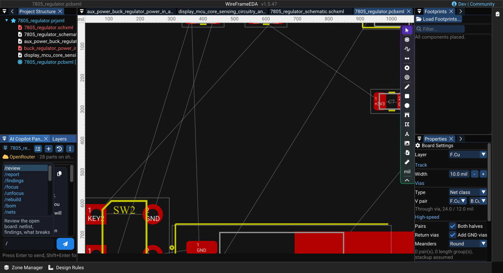
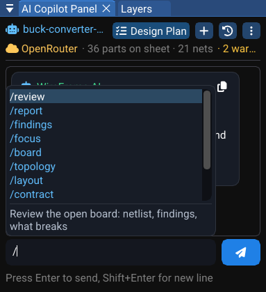
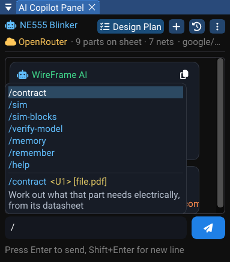
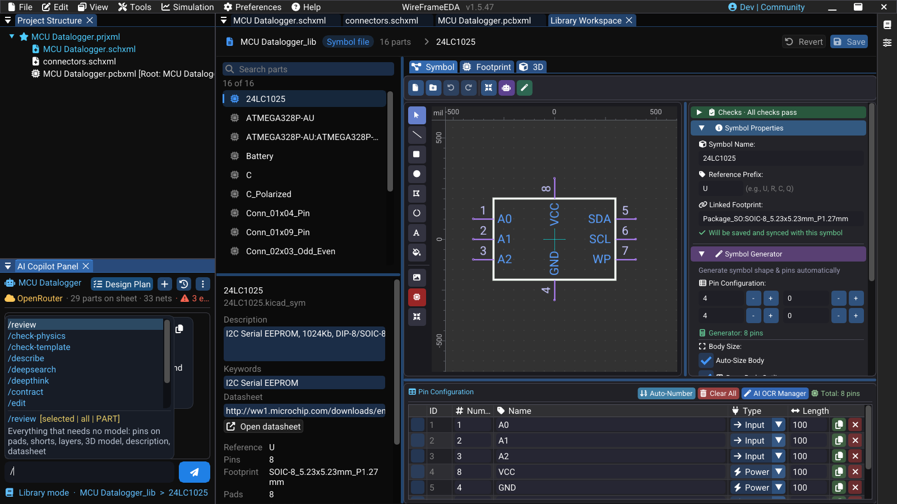

# Copilot Commands

Type `/` in the AI Copilot chat box to open the command list. The list filters as you type; use the arrow keys and **Enter** to pick a command, or keep typing its arguments. Anything that does not start with `/` is an ordinary question — mention a reference designator (`U1`) or a net name (`VBUS`) and only that part of the design is sent with it.

The commands are not one long list. **What `/` offers depends on the panel in front of the chat**: a schematic, a PCB, the simulation workbench, the Library Workspace, or nothing at all while a design is still being planned in the chat. A command that cannot do anything where you are is not offered there.

<!-- wf:shot id=copilot-command-list
caption: Typing / in the Copilot chat lists the commands
project: samples/ne555-blinker/NE555 Blinker.prjxml
setup:
- open_project
- panel: ai
- wait: 1
- click: //AI Copilot Panel/##ChatInput
- type:
    text: /
- wait: 1
brief_sha256: 7b6bb049dcfb2f4c
-->
<!-- wf:out id=copilot-command-list sha=b5edb0b043a9 -->

<!-- /wf:out -->

## How the list is chosen

- **The panel in front decides.** The schematic offers the schematic's commands, the PCB the board's, the Library Workspace the library's. From the PCB, the commands that read a design being planned in the chat are not offered — there is nothing for them to read.
- **What the last answer told you to run comes first.** When a reply says "run `/retry-bom`", that command is the first row of the list, wherever it would normally be.
- **Recovery steps stay out of the way.** `/retry-research`, `/retry-bom`, `/retry-bom-all`, `/retry-netlist`, `/rebuild` and `/forget` are only offered when a reply names them, or when you type their name.
- **Typing a name always finds it.** A command typed in full works from any panel; the list only decides what is *suggested*.
- **`/help`** prints the commands of the panel you are on, and where the others work.

Commands marked **no model call** read WireFrame's own data. They answer instantly, cost nothing and give the same answer every time — try them before asking an open question.

## Where each command is offered

| Command | Planning (no tab) | Schematic | PCB | Simulation | Library Workspace |
|---|:-:|:-:|:-:|:-:|:-:|
| `/bom` `/nets` `/missing` `/issues` `/specs` | ✓ | ✓ | | | |
| `/pins` `/fix` `/symbol` | ✓ | ✓ | | | |
| `/footprint` | ✓ | ✓ | ✓ | | ✓ |
| `/review` | | ✓ | ✓ | | ✓ |
| `/report` `/findings` `/focus` `/unfocus` | | ✓ | ✓ | | |
| `/arrange` | | ✓ | | | |
| `/board` `/topology` `/layout` | | | ✓ | | |
| `/contract` | | ✓ | ✓ | ✓ | ✓ |
| `/sim` `/corners` `/sim-blocks` `/sim-why` `/sim-explain` `/model` `/verify-model` | | | | ✓ | |
| `/check-physics` `/check-template` `/describe` `/deepsearch` `/deepthink` `/edit` `/stop` | | | | | ✓ |
| `/memory` `/remember` `/help` | ✓ | ✓ | ✓ | ✓ | ✓ |

In the Library Workspace, `/review`, `/contract`, `/symbol` and `/footprint` work on a **library part**, not on a design — see [Library Workspace](#library-workspace) below.

## Planning a design in the chat

Before a schematic exists, the Copilot holds a **draft**: the requirements, the BOM it chose and the netlist it is wiring. These commands read and repair that draft. They are offered with no document open and on the schematic.

| Command | What it does | Why it is there |
|---|---|---|
| `/bom` | The planned BOM and which rows are still unresolved. **No model call.** | The fastest way to see what the run chose and what it is still missing |
| `/nets` | Every net in the planned design and its pins. **No model call.** | Check the wiring before it becomes a sheet |
| `/missing` | Parts with no library symbol. **No model call.** | These cannot be placed; each needs a library decision |
| `/issues` | Numbered review findings: why each matters and what its fix would do | Answer them by number — `fix 2`, `accept 3 because the LED is decorative` |
| `/specs` | The requirements the design was built from, and what was assumed for you | An assumption you did not make is the first thing to check |
| `/pins [U1]` | Name a bound symbol's blank pins from the datasheet, keeping the pin numbers | A symbol with `Pin_1…Pin_8` cannot be wired by name |
| `/fix <U1> <what is wrong> [file.pdf]` | Repair one part: describe it, attach a datasheet if you have one; WireFrame proposes before it changes anything | One wrong part, fixed with evidence, without redrawing the design |
| `/symbol <U1> <describe it> [image \| pdf]` | Design one part's symbol from a description, pinout images or a datasheet, built live in the Symbol editor | When the library has no symbol for the part |
| `/footprint <U1> <describe it> [image \| pdf]` | Design one part's land pattern the same way, held against its symbol so every pin has a pad | When the library has no land pattern for the part |

<!-- wf:video id=bom-of-the-planned-design
caption: /bom on the NE555 blinker's planned design — the BOM and what is unresolved, with no model call
project: samples/ne555-blinker/NE555 Blinker.prjxml
setup:
- open_project
- panel: ai
- wait: 2
steps:
- wait: 1
- type:
    ref: //AI Copilot Panel/##ChatInput
    text: /bom
- keys:
  - Enter
- wait: 5
-->
<!-- wf:out id=bom-of-the-planned-design sha=a3a6632a6317 -->
<video controls muted playsinline preload="metadata" src="../../assets/wf/docs/ai/commands/bom-of-the-planned-design.mp4" title="/bom on the NE555 blinker&#x27;s planned design — the BOM and what is unresolved, with no model call"></video>
<!-- /wf:out -->

### Resume a design run

If a long run stops — the provider failed, a quota ran out, you changed the model — resume it instead of starting over. These are offered when a reply names them.

| Command | Resumes from |
|---|---|
| `/retry-research` | The retained original request, after you fix the provider |
| `/retry-bom` | The retained research; only unresolved BOM rows are chosen again |
| `/retry-bom-all` | The retained research; every BOM row is chosen again, confirmed parts included |
| `/retry-netlist` | The current saved BOM; the wiring is generated again |

## Schematic

On a schematic, the Copilot answers from WireFrame's **design graph** — the parts, pins and nets read from your sheets, rebuilt whenever they change. The draft commands above are offered here too.

| Command | What it does | Why it is there |
|---|---|---|
| `/review` | Review the open design: netlist, findings, what is likely to break | A second pair of eyes before you lay the board out |
| `/report` | Write a full design report | Something to read or hand over, rather than a chat answer |
| `/findings` | List what WireFrame's own checks found. **No model call.** | Free and often enough on its own — run it before `/review` |
| `/focus <U1 \| NET \| U1:3>` | Pin every later question to that part, net or pin | Long sessions stay about the thing you are working on |
| `/unfocus` | Clear the pinned focus | |
| `/arrange [BLOCK] [how]` | Lay one functional block out again as you describe it: `/arrange STM32 MCU crystal left of U1` | Fix a layout you dislike without redrawing it by hand |
| `/contract <U1> [file.pdf]` | Work out what the part needs electrically — supply range, decoupling, pull-ups, strapping — from its datasheet, and store it | Later checks hold the design to it; see [Datasheets, Repairs and Project Memory](datasheets-and-memory.md) |
| `/rebuild` | Rebuild the design graph from the project files and list what it found | Offered on request, when an answer looks out of date |

## PCB

On a board the Copilot reads the same design graph plus the board itself.

| Command | What it does | Why it is there |
|---|---|---|
| `/review`, `/report`, `/findings`, `/focus`, `/unfocus` | As on the schematic, with the board included | |
| `/board <describe the board>` | Set the board's shape from a sentence: `/board 100x80 mm, 3 mm corners, M3 holes 4 mm from each corner` | See [Board Shape and Outline](../pcb/board-outline.md) |
| `/topology [what you want]` | One board or a tower of boards, the options measured side by side from the design and the 3D files | Decide the stack before any copper is drawn |
| `/layout [stages \| fix \| apply \| discard \| rules \| check \| request]` | Lay the PCB out — place, planes, vias, route — and watch it live; `fix` runs, measures every failure and runs again; nothing changes until you apply | See [Placement and Routing Assistant](auto-placer-router.md) |
| `/footprint <U1> <describe it>` | Design a part's land pattern, held against its symbol | |
| `/contract <U1>` | As on the schematic | |

<!-- wf:shot id=copilot-commands-on-the-pcb
caption: On the PCB, / offers the board's commands — review, findings, board, topology, layout
project: board:buck-converter
setup:
- open_project
- ensure_pcb
- wait: 3
- panel: ai
- wait: 1
- click: //AI Copilot Panel/##ChatInput
- type:
    text: /
- wait: 1
capture:
  window: AI Copilot Panel
-->
<!-- wf:out id=copilot-commands-on-the-pcb sha=88f42d75dcd4 -->

<!-- /wf:out -->

<!-- wf:video id=findings-on-the-board
caption: /findings on the automotive buck converter — WireFrame's own checks, listed with no model call
project: board:buck-converter
setup:
- open_project
- ensure_pcb
- wait: 3
- panel: ai
- wait: 1
steps:
- wait: 1
- type:
    ref: //AI Copilot Panel/##ChatInput
    text: /findings
- keys:
  - Enter
- wait: 6
-->
<!-- wf:out id=findings-on-the-board sha=f61d27764cb3 -->
<video controls muted playsinline preload="metadata" src="../../assets/wf/docs/ai/commands/findings-on-the-board.mp4" title="/findings on the automotive buck converter — WireFrame&#x27;s own checks, listed with no model call"></video>
<!-- /wf:out -->

## Simulation workbench

A design's sheets are not simulated: a simulation is a file of its own (`.simxml`), made with **Simulation → New Simulation** or **Simulation → Simulate a Block of This Sheet…**. With one in front, the Copilot works on its circuits and on the last run.

| Command | What it does | Why it is there |
|---|---|---|
| `/sim-blocks` | The circuits on this sheet: which can run, and what each is missing. **No model call.** | Know what can be simulated before you ask |
| `/sim [N \| U1 \| all] [board]` | Run the simulation — one block, the block holding U1, every block that can run — and report what it measured against the testbench; `board` puts the routed board's copper in series with each supply | |
| `/corners [N \| U1 \| all]` | The testbench at the ends of every part's tolerance and at −40 / 25 / 85 °C, each part pushed in its own worst direction | A design that only works at 25 °C is not finished |
| `/sim-why` | Why the last run failed, read from the engine log and the netlist deck | |
| `/sim-explain [NET]` | What the last run's waveforms mean — or one signal's — against the testbench | |
| `/model <U1> [file.lib \| draft]` | A SPICE model for a part: the manufacturer's, found, downloaded and wired to the symbol's pins; one you have; or `draft` to build one from the datasheet's numbers and measure it against them | A part with no model cannot be simulated honestly |
| `/verify-model <U1> [datasheet.pdf]` | Measure the model the way the datasheet measures the part, at the table's own conditions, and say number by number whether the model is the part | A model is only as good as its agreement with the datasheet |
| `/contract <U1>` | As on the schematic | |

<!-- wf:shot id=copilot-commands-in-the-simulation-workbench
caption: In the simulation workbench, / offers the simulation commands
project: samples/ne555-blinker/NE555 Blinker.prjxml
setup:
- open_project
- ensure_schematic
- wait: 1
- menu:
  - Simulation
  - Simulate a Block of This Sheet...
- wait: 1
- click: //Simulate a Block/{fa:copy} Copy to New Simulation
- wait: 3
- panel: ai
- wait: 1
- click: //AI Copilot Panel/##ChatInput
- type:
    text: /
- wait: 1
capture:
  window: AI Copilot Panel
-->
<!-- wf:out id=copilot-commands-in-the-simulation-workbench sha=eb8cd5d2b756 -->

<!-- /wf:out -->

## Library Workspace

When a library is open for editing in the [Library Workspace](../libraries/library-workspace.md), the Copilot works on **library parts**. Each command runs on the open part, on the parts selected in the list (`selected`), or on the whole library (`all`).

| Command | What it does | Why it is there |
|---|---|---|
| `/review [selected \| all \| PART]` | Everything that needs no model: pins on pads, shorts, layers, 3D model, description, datasheet | A library audit in one pass, free |
| `/check-physics [selected \| all \| PART]` | The land pattern as copper: pin to pad by number, pads that short, the measured pad geometry | A footprint is wrong on every board that uses it |
| `/check-template [selected \| all \| PART]` | The land pattern against the standard drawing of the package it names | `SOIC-8` should look like SOIC-8 |
| `/describe [selected \| all \| PART]` | Write a description and search keywords from what the part is; a batch only fills empty ones | Parts with no keywords are hard to find — for you and for the matcher |
| `/deepsearch [selected \| all \| PART]` | Find the datasheet: the model names a URL, WireFrame downloads it; only a link that downloaded is written | A datasheet field that points nowhere is worse than an empty one |
| `/deepthink [selected \| all \| PART]` | Read the datasheet pin by pin, citing a page for each, and hold it against the symbol | Catches a swapped or misnamed pin before it is placed |
| `/contract [selected \| all \| PART]` | What the part needs electrically, from its datasheet, stored with the part | Every board that uses the part is then checked against it |
| `/edit <what to change>` | Change the open part — symbol or land pattern, chosen from your words; asks when unsure | |
| `/symbol <what to change>` | Edit the open part's symbol, placed live in the Symbol tab | |
| `/footprint <what to change>` | Edit the open part's land pattern, placed live in the Footprint tab | |
| `/stop` | Stop the running batch; what is done stays done | Batches over `all` can be long |

<!-- wf:shot id=copilot-commands-in-the-library-workspace
caption: In the Library Workspace, / offers the library commands — they work on the open part, the selection
  or the whole library
project: board:klp4e-datalogger
setup:
- open_project
- ensure_schematic
- wait: 1
- menu:
  - View
  - Local Library Manager
- wait: 2
- click: //Library Manager/{fa:pen}  Edit
- wait: 3
- panel: ai
- wait: 1
- click: //AI Copilot Panel/##ChatInput
- type:
    text: /
- wait: 1
-->
<!-- wf:out id=copilot-commands-in-the-library-workspace sha=c9c3429d8656 -->

<!-- /wf:out -->

## Everywhere: project memory and help

| Command | What it does |
|---|---|
| `/memory` | What this project has established across all conversations |
| `/remember <text>` | Pin something the assistant must not forget: `/remember no electrolytic capacitors` |
| `/forget <id>` | Drop one remembered fact; the id comes from `/memory` (offered on request) |
| `/help` | The commands of this panel, and where the others work |

Memory belongs to the project, not to one chat session, so it outlives every conversation about that project. A fix you apply is remembered the same way, so a later run does not undo it.

## Tips

- Use `/findings` before `/review`: it is free and often answers the question.
- `/fix` repairs **one** part. For the whole design's errors and warnings, use `/findings` or `/issues`.
- Commands answer in the language of the conversation. Ask for another — "answer in English", "trả lời bằng tiếng Việt" — and every later answer, question and option follows it.

## See also

- [AI Copilot](index.md)
- [Placement and Routing Assistant](auto-placer-router.md)
- [Datasheets, Repairs and Project Memory](datasheets-and-memory.md)
- [How a part is found](../libraries/how-parts-are-found.md)
- [Library Workspace](../libraries/library-workspace.md)
