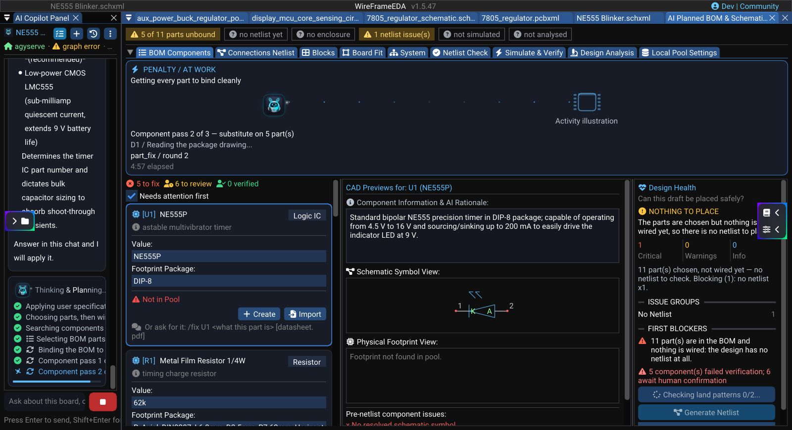

# Fix or Create a Component

When the AI design needs a part your libraries do not have — or a part whose symbol or land pattern is wrong — WireFrame repairs it **through the AI panel**, with the datasheet as evidence, and shows you every change before it is saved. There is no separate generator window: you ask for the fix in the chat, review the plan, and apply it.

!!! warning "A generated or repaired part is a starting point"
    Compare the result with the exact manufacturer part number, pin table, package drawing and recommended land pattern before you use it on a board you will order.

## Find the parts that need work

Open the design's **Component Review** (**Design Plan** in the AI Copilot panel) and stay on **BOM Components**. Keep **Needs attention first** ticked: cards that block the design come to the top.

A card needs work when it shows one of these:

| Card shows | Meaning |
|---|---|
| **Not in Pool** | No symbol + footprint in your libraries matches this row yet |
| A pin or pad count mismatch | The symbol and the land pattern disagree about the part's contacts |
| **Inspect both previews, then confirm** | The pair was bound automatically and is waiting for a person |

Each card has three ways forward:

- **Create** searches WireFrame's published library for this exact part first — most common parts already ship a checked symbol, footprint and 3D model — and opens the Symbol Library Editor only when it is not there.
- **Import** adds a library file you already have (KiCad, or an Altium library).
- **`/fix <refdes> …`** in the AI panel asks the Copilot to repair or build the part. The card tells you the exact form to type.

### Image — Missing component card and AI Gen action

!!! note "Image capture brief"
    1. **Prepare:** Open a clean release-build workspace with fictional or public sample data and prepare the requested state.
    2. **Build the frame:** Capture **Component Review** with one component card marked **Not in Pool**. Include the component name, **Value**, **Footprint Package**, the `/fix` hint, **Create**, and **Import** controls. Crop tightly enough that the warning and the action buttons remain readable. Suggested size: **1200 × 700 px**.
    3. **Clean the frame:** Close unrelated panels and tooltips, move the pointer away from key text, and hide credentials, usernames, customer data, and private paths.
    4. **Capture and finish:** Capture a native-resolution PNG, crop without cutting titles or primary actions, and add at most three subtle callouts without altering engineering content.
    5. **Approve:** Check the image at 100% zoom for current labels, readable evidence, correct release branding, and absence of sensitive information.

<!-- wf:shot id=missing-component-card-and-ai-gen-action
caption: U1 (NE555P) marked Not in Pool, with Create and Import, and the /fix hint
setup:
- pick_folder: tutorials
- menu:
  - File
  - New
  - New Project (.prjxml)...
- wait: 1
- type:
    text: NE555 Blinker
- click_at:
  - 634
  - 485
- wait: 2
- menu:
  - File
  - New
  - New Schematic (.schxml)
- wait: 1
- save_file: tutorials/NE555 Blinker.schxml
- keys:
  - Ctrl
  - S
- wait: 2
- panel: ai
- wait: 1
- type:
    ref: //AI Copilot Panel/##ChatInput
    text: Design a 9 V NE555 astable LED blinker. Target 1 Hz, use a red LED, include current limiting
      and supply decoupling, and identify every assumption that needs my confirmation.
- keys:
  - Enter
- wait: 25
- menu:
  - View
  - Project Structure
- action:
    action: mouse_move_to
    x: 120
    y: 500
- scroll: -400
- wait: 1
- action:
    action: mouse_move_to
    x: 1000
    y: 12
- click: //AI Copilot Panel/Use all suggestions & continue
- wait: 300
- action:
    action: mouse_move_to
    x: 1000
    y: 12
brief_sha256: 37b6ba5839330c49
-->
<!-- wf:out id=missing-component-card-and-ai-gen-action sha=a2890f8c5313 -->

<!-- /wf:out -->

## Repair a part with `/fix`

Type the reference designator and what is wrong, in plain words:

```text
/fix U1 the symbol's pins have no names, take them from the datasheet
/fix D1 use a 3 mm LED instead of 5 mm
/fix J1 this is a 2-pin 2.54 mm header, not a screw terminal
```

What happens next:

1. **Evidence.** WireFrame looks for the part's datasheet: a file you attached, then the published index, then the web. Only pages WireFrame downloads and reads itself count as evidence.
2. **Plan.** The Copilot proposes a repair — the pin table, the package, the land pattern — and WireFrame validates it against that evidence and its package rules before showing it to you.
3. **Review.** The plan appears in the chat with **Apply**, **Attach datasheet...** and **Cancel**. Nothing has changed yet.
4. **Apply.** WireFrame writes the symbol and footprint to the project library, opens the editor and replays the repair so you can watch the pins and pads being drawn, then re-checks the card.

Attach the manufacturer's PDF with **Attach datasheet...** whenever the part is not a common one: a clean datasheet is the best evidence there is.

### Build every missing part at once

When several parts have no symbol or footprint, ask for it in the chat — for example *"fix the parts that cannot be used yet"*. Copilot answers *Running **AI Verify & Fix** on the parts that cannot be used yet* and builds a symbol and footprint for each, then re-checks the findings against the parts it produced. Each result still needs the inspection and confirmation below.

### Short video — Generate all missing components

!!! note "Video production brief"
    1. **Prepare:** Use a public demo design with two unambiguous components marked **Not in Pool**; preconfigure the AI connection and hide keys.
    2. **Opening shot (1–2 s):** Hold on both missing cards marked **Not in Pool** beside the AI Copilot chat.
    3. **Action shot (3–5 s):** Type *fix the parts that cannot be used yet* in the chat, send it, and show the **AI Verify & Fix** status. Cut out only inactive waiting time; do not accelerate or fabricate progress.
    4. **Result shot (2–3 s):** Hold on the refreshed cards showing **Found in Pool** and readable pin counts.
    5. **Deliver:** Export an **8–12 second**, 16:9, 1080p MP4; keep the pointer visible and exclude unrelated panels.

### Image — Review a repair plan

!!! note "Image capture brief"
    1. **Prepare:** Open a clean release-build workspace with fictional or public sample data and prepare the requested state.
    2. **Build the frame:** After `/fix U1 …` with the WF-DEMO8 datasheet attached, capture the plan in the AI Copilot chat with its pin table, package, and the **Apply**, **Attach datasheet...**, and **Cancel** buttons readable. Suggested size: **1000 × 740 px**.
    3. **Clean the frame:** Close unrelated panels and tooltips, move the pointer away from key text, and hide credentials, usernames, customer data, and private paths.
    4. **Capture and finish:** Capture a native-resolution PNG, crop without cutting titles or primary actions, and add at most three subtle callouts without altering engineering content.
    5. **Approve:** Check the image at 100% zoom for current labels, readable evidence, correct release branding, and absence of sensitive information.

## Inspect the result

After a repair, select **Manage** on the card to open the part in the library editors. Check, against the datasheet:

**Symbol**

- the pin count, and every pin number against its name;
- power, ground, no-connect and exposed-pad pins;
- the reference prefix and the default footprint.

**Footprint**

- pad count, pitch, pad size and drill;
- pin 1 position and the package outline;
- courtyard, silkscreen and fabrication layers.

Save corrections in the editor; Component Review re-checks the card on its own.

### Image — Inspect the generated symbol and footprint

!!! note "Image capture brief"
    1. **Prepare:** Open a clean release-build workspace with fictional or public sample data and prepare the requested state.
    2. **Build the frame:** Use a two-panel composite or two clearly labeled screenshots: **Generated symbol review** and **Generated footprint review**. Show matching pin/pad numbers, the pin-1 marker, package outline, and editor properties. Use a real example with at least eight pins. Suggested combined size: **1400 × 800 px**.
    3. **Clean the frame:** Close unrelated panels and tooltips, move the pointer away from key text, and hide credentials, usernames, customer data, and private paths.
    4. **Capture and finish:** Capture a native-resolution PNG, crop without cutting titles or primary actions, and add at most three subtle callouts without altering engineering content.
    5. **Approve:** Check the image at 100% zoom for current labels, readable evidence, correct release branding, and absence of sensitive information.

## Confirm the part

A repaired or automatically bound part is not trusted until a person confirms it. Select the card, look at the **Schematic Symbol View** and **Physical Footprint View**, then press **Confirm this component**. When several rows share the same symbol and footprint, one confirmation covers all of them — the button says how many.

What WireFrame learns about a part (its electrical contract) belongs to the part, not to one project, and is reused on every board:

### Image — Confirm an AI-generated library contract

!!! note "Image capture brief"
    1. **Prepare:** Open a clean release-build workspace with fictional or public sample data and prepare the requested state.
    2. **Build the frame:** Capture **Library Pool Settings → Locally written contracts** with one unverified generated part expanded. Include the source/status text and the **Confirm**, **Revoke**, and **Forget** actions. Do not show private library paths. Suggested size: **1100 × 650 px**.
    3. **Clean the frame:** Close unrelated panels and tooltips, move the pointer away from key text, and hide credentials, usernames, customer data, and private paths.
    4. **Capture and finish:** Capture a native-resolution PNG, crop without cutting titles or primary actions, and add at most three subtle callouts without altering engineering content.
    5. **Approve:** Check the image at 100% zoom for current labels, readable evidence, correct release branding, and absence of sensitive information.

## Troubleshooting

| Message or result | What to do |
|---|---|
| "Which part? Name its refdes" | Start the request with the designator: `/fix U4 …` |
| "… is not a row in this design" | Use one of the designators the message lists |
| "Still working on the last library request" | Wait for the running repair to finish |
| The plan is refused or keeps the wrong package | Attach the exact manufacturer datasheet and ask again |
| No writable project library | Save the project first; repaired parts go into its `lib_<project>` folder |
| The part is found but still shows a mismatch | Open **Manage**, compare symbol pins with footprint pads, save, and let the card re-check |

## Release checklist

- [ ] Every card is **Confirmed for netlist**, by a person.
- [ ] Pin names and numbers match the datasheet of the exact part number.
- [ ] Package, pitch and pad sizes match the manufacturer's land pattern.
- [ ] Pin 1 and polarity marks agree between symbol, footprint and silkscreen.

## See also

- [AI Design Agent](design-agent.md)
- [Symbol Library Editor](../libraries/symbol-creator.md)
- [Footprints Library](../libraries/footprints-library.md)
