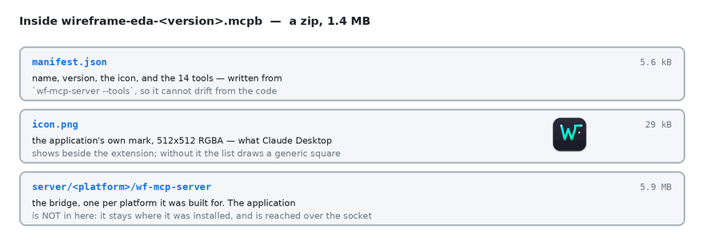

# Connect Claude, Codex, Cursor or another agent

Your agent reaches WireFrame through a small program that comes with it, `wf-mcp-server`. The agent starts it, and it passes every request to the WireFrame you have open. There is no key to paste and no server to run: the bridge uses the account WireFrame is signed in to.

Before you start:

1. **WireFrame 2.0.1 or later.** Earlier releases have no MCP server.
2. **Signed in, on Pro or Max.** MCP is not in Free.
3. **WireFrame open, with the project open.** For the board tools, the board's tab should be the one in front.

## Claude Desktop in five steps

Follow them in this order:

1. **Install the extension.** Get the `.mcpb` file from the [download page](https://wireframe.com.vn/download), then double-click it or drag it onto the Claude Desktop window.
2. **Open WireFrame**, and sign in.
3. **Turn the extension on in Claude.** In **Settings → Extensions → WireFrame EDA**, switch on **Enabled**.
4. **Create your project**, or open an existing one. Claude works on the project that is open, and cannot open one for you.
5. **Press Allow** on the card in WireFrame's AI panel. Nothing runs until you do, and each new connection asks again.

WireFrame has to be open before step 3: the extension looks for it once, when it starts. If you turned the extension on first, open WireFrame, then quit Claude Desktop completely and open it again.

Using another agent, or the config file instead of the extension? The sections below have the exact setup for each.

## Find the bridge

It is installed beside WireFrame itself:

| System | Where it is |
|---|---|
| Windows | `wf-mcp-server.exe`, in the WireFrame installation folder, next to `WireFrame.exe`. Right-click WireFrame in the Start menu → **Open file location** to find the folder. |
| macOS | `/Applications/WireFrameEDA.app/Contents/MacOS/wf-mcp-server` |
| Linux | `/usr/bin/wf-mcp-server` — on your `PATH`, so `wf-mcp-server` alone works |

Every example below uses the Linux path. Put yours in its place.

## Claude Desktop

Open **Settings → Developer → Edit Config**, or open the file directly:

| System | Claude Desktop's config file |
|---|---|
| macOS | `~/Library/Application Support/Claude/claude_desktop_config.json` |
| Windows | `%APPDATA%\Claude\claude_desktop_config.json` |

Add WireFrame under `mcpServers` — keep any servers already there:

```json
{
  "mcpServers": {
    "wireframe": {
      "command": "/Applications/WireFrameEDA.app/Contents/MacOS/wf-mcp-server"
    }
  }
}
```

On Windows, write the path with doubled backslashes: `"C:\\…\\WireFrame\\wf-mcp-server.exe"`. Quit Claude Desktop completely and open it again; WireFrame appears among its connectors with fourteen tools. Open WireFrame **first**: started without it, the bridge connects, offers no tools, and says why — and it does not look again until Claude Desktop restarts it.

### Or install it as an extension

WireFrame also comes as a Claude Desktop extension — one `.mcpb` file holding the bridge, WireFrame's icon and the list of tools. Get it from the [download page](https://wireframe.com.vn/download), below the three installers. Then double-click it, drag it onto the Claude Desktop window, or use **Settings → Extensions → Advanced settings → Install Extension…**. Nothing to edit, and WireFrame shows with its own icon.



The extension carries the bridge only. WireFrame itself must still be installed and open; the extension finds it the same way the config file does.

## Claude Code

One command, for every project on this machine:

```bash
claude mcp add --scope user wireframe -- /usr/bin/wf-mcp-server
```

Use `--scope project` instead to write it into the repository's `.mcp.json`, so everyone who opens the project gets it. Inside Claude Code, `/mcp` shows whether WireFrame is connected and lists its tools.

## Codex

```bash
codex mcp add wireframe -- /usr/bin/wf-mcp-server
```

Or add it to `~/.codex/config.toml` yourself — the Codex CLI and the Codex IDE extension both read it:

```toml
[mcp_servers.wireframe]
command = "/usr/bin/wf-mcp-server"
```

`codex mcp --help` lists the commands that show and remove it.

## Cursor

In `~/.cursor/mcp.json` for every project, or `.cursor/mcp.json` in one project:

```json
{
  "mcpServers": {
    "wireframe": {
      "type": "stdio",
      "command": "/usr/bin/wf-mcp-server"
    }
  }
}
```

## VS Code

In `.vscode/mcp.json` in the workspace. VS Code calls the list `servers`, not `mcpServers` — with the wrong key the entry is ignored without a word:

```json
{
  "servers": {
    "wireframe": {
      "type": "stdio",
      "command": "/usr/bin/wf-mcp-server"
    }
  }
}
```

## Any other MCP client

WireFrame's bridge is an ordinary **stdio** MCP server. Give your client:

- **command:** the path to `wf-mcp-server`
- **arguments:** none
- **environment:** none — no API key, no token

It speaks MCP protocol versions `2025-06-18`, `2025-03-26` and `2024-11-05`, answering in the one your client asks for.

## Allow it in WireFrame

The first time your agent calls a tool, WireFrame's **AI panel** shows a card: *"claude-ai wants to work on this design over MCP"*, with **Allow** and **Decline**. Nothing runs until you press **Allow** — your agent is told it is waiting, and those calls are not counted. The permission lasts until the agent disconnects; the next connection asks again. Once allowed, one line in the panel says who is connected, with **Revoke** to take it back.

## Check that it works

Press **Allow** in WireFrame, then ask your agent: *"Is WireFrame busy?"* It calls `is_busy` and answers that the agent is idle — WireFrame is connected. Then ask what it can do on the open board: it reads the tool list from `wireframe://tools`, which costs no calls.

## When it does not connect

The agent reports WireFrame's own words. Here is what each one means:

| The agent says | Why | What to do |
|---|---|---|
| "WireFrame is not running, or has no project open…" | The bridge started, but no WireFrame was listening. | Start WireFrame, open the project, then reconnect — in Claude Desktop, restart it; in Claude Code, `/mcp`. |
| "WireFrame is waiting for the person to allow this client…" | Nobody has pressed **Allow** yet. | Open WireFrame's AI panel and press **Allow** on the card. |
| "The person declined this client in WireFrame…" | **Decline** or **Revoke** was pressed. | Press **Allow** on the line in the AI panel, or reconnect. |
| "another MCP client is already connected to this WireFrame" | One client at a time. | Close the other agent, or disconnect WireFrame there. |
| "No PCB is open." | The project has no board yet, or it could not be opened. | Run `update_pcb` first, or open the board in WireFrame. |
| "The agent is still working on the last request…" | A turn is running; a second one, or a change, would land in the middle of it. Not counted. | Poll `is_busy`, then `read_transcript`; or call `stop`. |
| "… is not one of the design tools this project offers" | `call_tool` reaches only the tools listed in `wireframe://tools` for the open project. | Read the list and pick a tool from it. |
| "MCP is not included in this plan. Pro and Max include it." | The account is on Free. | See the [plans](https://wireframe.com.vn/pricing#mcp). |
| "This account's MCP allowance is spent…" | Pro's 500 calls this month are used. | Wait for the monthly reset, or add an MCP pack. |
| "This build of WireFrame is older than the release MCP ships in…" | WireFrame is older than 2.0.1. | Update WireFrame. |
| "Nobody is signed in to WireFrame…" | Calls cannot be counted without an account. | Sign in from WireFrame's account menu. |
| "The account server could not be reached…" | WireFrame is offline. | Check the connection; the call was not counted. |
| "Too many MCP calls just now…" | A burst over the fair-use rate. | Wait a minute. |

Every refusal in this table costs nothing, with one exception: "No PCB is open." is a tool's own answer — the tool ran and looked — so it counts as a call. What counts and what does not is on [the MCP page](mcp.md#how-calls-are-counted).

## Next

- [What every tool does](mcp.md)
- [MCP tool reference](mcp-tools.md) — the fourteen tools and their parameters
- [Copilot commands](commands.md) — what `run_command` can run
