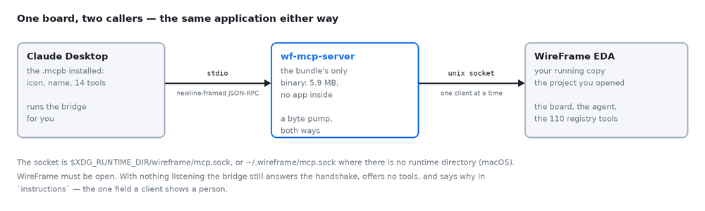

# Use WireFrame from your own agent

WireFrame speaks the [Model Context Protocol](https://modelcontextprotocol.io), so the agent you already work in — Claude, Codex, Cursor, or any other MCP client — can work on the board open in front of you. It gets fourteen tools of its own, and through one of them the design tools WireFrame's own Copilot works with: the placer and the layout optimiser, the router's stages, copper pours, the power and signal-integrity solvers, the board check. With a board open that is **95 tools**.

It is not a second WireFrame. Every answer comes from the application you have open, on the project you have open, by the same code that answers the Copilot panel — an agent asking `score_board` over MCP gets the number the panel would show.

> **Needs WireFrame 2.0.1 and a plan that includes MCP** — Pro, with 500 tool calls a month, or Max, with no monthly ceiling. It is not in Free. When both are in place, [connect your agent](mcp-connect.md).

## What you can ask

Ask in plain words; the agent picks the tool. A few things that work on a real board:

| Ask your agent | What answers |
|---|---|
| "Find where the 3V3 rail loses its voltage" | `power_setup_rail` → `power_run_ir_drop` → `power_suggest_fixes` |
| "Try four placements and keep the one that routes best" | `evaluate_layouts` → `apply_layout` |
| "Pour a ground plane on the bottom layer" | `edit_zones` |
| "How much current can a 0.5 mm trace carry on 1 oz copper?" | `ipc_calc` |
| "Is the USB pair at 90 Ω on this stack-up?" | `calculate_impedance`, `check_interfaces` |
| "Read the regulator's datasheet and tell me where the inductor goes" | `research_layout`, `read_datasheet` |
| "Would this board be better as two boards on standoffs?" | `evaluate_topologies` |
| "Check the board before it goes to the fab" | `check_board` |

## Two ways to work

**Your agent drives, WireFrame's tools answer.** The agent calls the design tools itself, through `call_tool`. The reasoning is your agent's — Claude's, Codex's — and WireFrame supplies the measurements. Each call is one MCP call and spends no AI credits.

**Hand the request to WireFrame's own agent.** `chat` sends a message to the Copilot and `run_command` a slash command, such as `/layout place,route`. WireFrame's agent does the work with its own sequencing — it knows which stage has to run before which — and its turn spends your plan's AI credits exactly as it would if you had typed it in the panel.

Most work mixes the two: let WireFrame's agent lay the board out, then have yours read the result and check it.

## Nothing changes until it is applied

A design tool opens what it reads: if no sheet or no board of the project is open, `call_tool` opens them before it runs. While the agent is working on a turn, a new `chat`, a slash command or any tool that changes the design is refused — not counted — until the turn ends; tools that only read still answer. A long turn sends progress to clients that ask for it.

Nothing at all happens until you **allow** the agent: the first time it calls a tool, WireFrame's AI panel asks, and every call waits for your **Allow** — see [Allow it in WireFrame](mcp-connect.md#allow-it-in-wireframe).

Every tool that would move a part, lay copper or rewrite a rule works on a **copy** first and reports what it would do: `propose_layout`, `evaluate_layouts`, `preview_patch`, `power_preview_fix`. The change reaches the board only through a step that applies it — `apply_layout`, `apply_placement` — and each of those is one undoable step in the app's history, recorded against the client that made it.

Some changes wait for **you**. A high-speed patch or a power fix is proposed by the agent and applied only once you approve it in WireFrame's own window: `apply_approved_patch` and `power_apply_approved_fix` apply what a person approved, and nothing else. The same goes for the number of copper layers and for splitting a product into several boards — the agent records your answer; it does not choose for you.

Some things it cannot do at all: it cannot reach a project other than the one open, it cannot export Gerbers (do that from the app), and only **one client** may be connected to a WireFrame at a time. A second one is told so and refused.

## The fourteen tools

What your agent sees when it connects — each one with its parameters is on the [MCP tool reference](mcp-tools.md):

| Tool | What it does |
|---|---|
| `chat` | Say something to WireFrame's design agent and get its answer |
| `run_command` | Run one of WireFrame's slash commands, such as `/layout` or `/bom` |
| `list_commands` | Every slash command offered right now, with what it does |
| `read_transcript` | The conversation so far, newest last |
| `is_busy` | Whether WireFrame's agent is still working |
| `stop` | Cancel what the agent is doing |
| `confirm_all` | Accept every change the agent is offering on a card |
| `attach` | Put a datasheet PDF, a pinout image or a reference file in front of the agent — files one by one, not folders, and nothing hidden (no file under a folder whose name starts with a dot) |
| `new_session` | Start a fresh conversation, keeping the planned BOM |
| `build_blocks` | Group the planned design into blocks and build the sheets from them |
| `update_schematic` | Draw the planned design onto the sheets, or update them after a revision |
| `place_schematic` | Place the parts on the sheets, marking anything unresolved on the canvas |
| `update_pcb` | Push the schematic's netlist onto the board and save it |
| `call_tool` | Call one of the design tools below by name, with JSON arguments |

`chat` and `run_command` wait for the turn to finish — up to half an hour — before they answer, so an agent does not have to guess how long a layout takes; `is_busy` and `read_transcript` are for the one that would rather poll.

## The design tools

About 110 are defined. Which ones are offered follows what is open — the board tools need a board, the simulation tools a simulation — and with a board open there are 95. Your agent can read the list as it stands, with every tool's parameters, from the resource `wireframe://tools`, without spending a call.

### Lay the board out

| Tool | What it does |
|---|---|
| `plan_layout` | Where any layout work starts: what the board needs, in the order the stages run |
| `propose_layout` | Place, plane, via, route and stitch on a copy, and report it — changes nothing |
| `evaluate_layouts` | Lay the board out several ways and compare them side by side — changes nothing |
| `optimize_layout` | Keep laying it out until every part is placed and every connection routed, or nothing gains |
| `apply_layout` | Commit what was proposed, one undoable step per stage |
| `read_layout` | Read the board, or an option just measured, the way a person looking at it would |
| `view_placement` | A top-down picture of the placement, each schematic block in its own colour |
| `verify_layout` | Measure the circuit rules — hot loops, switch nodes, crystals, pair skew — before applying |
| `propose_layout_intent` | State what this board needs of its layout that no datasheet can know |
| `propose_placement` | Search for a better arrangement of the parts and report it |
| `apply_placement` | Move the parts to that arrangement, as one undoable step |
| `align_parts` | Lay alike parts out alike — rows, columns, matching turns |
| `compare_spots` | Is a part easier to wire here or there? Route it both ways and compare |
| `propose_floorplans` | Where each schematic block goes before any part moves |
| `edit_floorplan` | Move or resize a block's region, each edit with its reason |
| `research_layout` | What a part's datasheet says about laying it out, read from the document |
| `get_board` | The board as it stands, and everything its shape forbids |
| `score_board` | The numbers it is judged by: unrouted length, crossings, overlaps, parts off the board |
| `update_plan` | Write the agent's reasoning onto the plan you are watching |
| `report_step` | Show you one step of the work as a card in the chat, with its evidence |

### Rules, layers and copper

| Tool | What it does |
|---|---|
| `get_layout_rules` | The fab limits, each net class, and what each copper layer is for |
| `set_layout_rules` | Change the layout rules for this session, all or nothing |
| `set_copper_layers` | Record how many copper layers you want — your answer, not the agent's |
| `get_stackup` | The stack-up layer by layer, with where each number came from |
| `edit_zones` | List, add, remove or refill copper pours, one undo step each |
| `ipc_calc` | Trace current, via current, clearance — computed to IPC, never quoted from memory |

### Check it

| Tool | What it does |
|---|---|
| `check_board` | Design-rule and manufacturing checks together with the layout checks |
| `check_power` | The power tree: every rail's voltage and where it is known from |
| `check_interfaces` | USB, PCIe, Ethernet, HDMI, MIPI, DDR and more against their layout profile |
| `run_hs_checks` | Run every accepted high-speed rule on the routed copper |
| `check_layout_edit` | Judge proposed copper against its impedance and length intents before it is laid |

### Power integrity (DC IR drop)

| Tool | What it does |
|---|---|
| `power_list_rails` | The rails set up on the board, and the ones its netlist suggests |
| `power_setup_rail` | Set up a rail for the analysis — the setup, not the copper |
| `power_run_ir_drop` | Every load's supply-pin voltage, its drop and its margin, on the board as it is |
| `power_get_results` | The last run, marked stale if the board changed since |
| `power_suggest_fixes` | WireFrame's fixes for the loads short of their minimum: widen, add vias, stitch |
| `power_propose_fix` | The agent's own fix, validated against the board |
| `power_preview_fix` | Solve the board with that fix on a copy: every drop before and after |
| `power_apply_approved_fix` | Apply a fix YOU approved in the Power Analyzer, as one undoable step |
| `power_report` | The IR-drop report: copper, loads, where each drop is lost, method, limits |
| `power_show` | Open the Power Analyzer for you at the page, side and layer that matter |
| `get_power_rails` | The supply rails with what you stated about ripple, load step and current |
| `calculate_pdn` | Power distribution impedance against its target, regulator to plane |

### Signal integrity and EMI

| Tool | What it does |
|---|---|
| `high_speed` | Which nets on this board need controlled impedance or length matching |
| `get_design_summary` | Layers, thickness, high-speed nets and pairs, the revision fingerprint |
| `get_net_topology` | One net's or pair's copper: length per layer, vias and their stubs, coupled run |
| `get_constraints` | Every high-speed rule the checks run, with its source and state |
| `get_layout_intents` | What the rules ask of the copper: impedance target and the width that meets it |
| `calculate_impedance` | Single-ended or differential impedance, with its model and uncertainty |
| `estimate_crosstalk` | Near- and far-end crosstalk between two lines |
| `estimate_delay_skew` | Propagation delay and skew |
| `estimate_emission` | A screening estimate of radiated emission against FCC Part 15 or CISPR 32 |
| `run_simulation` | Time-domain simulation of a point-to-point line |
| `propose_patch` | Propose a fix as a patch for you to review in the High-Speed Workbench |
| `preview_patch` | Apply it to a candidate copy and re-run the checks: what clears, what appears |
| `apply_approved_patch` | Apply a patch YOU approved, as one undoable step |
| `rollback_revision` | Undo an applied patch while it is still the last edit |
| `generate_report` | The evidence report: rules, results, method, who approved what |

### The board's shape, and products of several boards

| Tool | What it does |
|---|---|
| `edit_board_shape` | Read or change the outline, mounting holes, cutouts, keepouts and the case's heights |
| `set_board_sides` | Parts on one face of the board, or both |
| `read_mechanical` | The board stack, spacers, outlines and holes, in one call |
| `read_assembly` | What the product is made of: every sheet, every PCB and how they relate |
| `edit_board_stack` | Change a stack of boards — a flight controller on an ESC, a HAT on a Pi |
| `evaluate_topologies` | Measure two to four ways to build the product: one board, or a tower of them |
| `apply_topology` | Write the option YOU chose to the project's board stack |
| `plan_board_split` | Make the chosen tower into boards, a connector pin for every crossing net |
| `apply_board_split` | Write that split into the project — only once you agreed |

### Parts, datasheets and the library

| Tool | What it does |
|---|---|
| `research_part` | What can be established about one exact part number before it is drafted |
| `read_datasheet` | What a part's datasheet says on a topic, from the PDF WireFrame read |
| `draft_part` | Draft a part — symbol and land — from the pin table research found |
| `lookup_datasheet` | A part's datasheet URL and package from the library index |
| `lookup_part_catalog` | Ask DigiKey and Mouser about one part number, with your keys |
| `lookup_lcsc` | Ask JLCPCB / LCSC: stock, price breaks, whether it is still sold |
| `find_alternatives` | Other orderable parts that can do a planned row's job |
| `get_contract` | What a part requires electrically: pin roles and the parts around it |
| `search_library` | Search the component library |
| `inspect_library_symbol` | The real pin table of a symbol in your library, and its footprint |

### The schematic and the planned design

| Tool | What it does |
|---|---|
| `view_sheet` | A picture of the sheet as it is drawn, each block in colour |
| `arrange_block` | Lay a block out again the way you say, as one undoable edit |
| `get_block_layout` | Where every part in a block sits, and the convention the placer follows |
| `score_layout` | What is wrong with the sheet's arrangement, measured |
| `get_draft` | The BOM and netlist planned in the chat |
| `trace_draft` | What one part or net in the draft connects to |
| `check_draft` | What WireFrame's checkers found in the draft: missing pins, floating supplies |
| `check_pool` | Whether a planned part is bound to a real symbol and footprint |

### SPICE simulation

| Tool | What it does |
|---|---|
| `get_preflight` | What the pre-simulation check found for each component |
| `get_testbench` | What the circuit was driven by, loaded with and required to do, and whether it did |
| `list_signals` | Every probed net from the last run: level, ripple, frequency, settled or not |
| `measure_signal` | Min, max, RMS, frequency and rise time for one probed net |
| `get_sim_log` | The ngspice transcript: errors, warnings, usable waveforms or not |
| `get_netlist` | The SPICE deck the last run handed to ngspice |
| `inspect_spice_model` | Whether an exact .model or .subckt exists, and its pins |
| `validate_spice_model` | Check a proposed model's name, pins and syntax |
| `draft_spice_model` | Fetch a reviewed behavioural template |
| `install_spice_model` | Write a model into your library so the part stops blocking simulation |

## How calls are counted

One tool call is one call — not one conversation, and not one connection. It is the unit your agent's own log shows, so you can count it yourself.

| What happens | MCP calls |
|---|---|
| Any tool call, a read such as `is_busy` included | 1 |
| Your agent calling a design tool itself, through `call_tool` | 1 |
| `chat` or `run_command` — WireFrame's agent does the work | 1, plus the AI credits its turn spends |
| Connecting, listing the tools, reading `wireframe://tools` | 0 |
| A call refused: no plan with MCP, or the month's calls spent | 0 |
| One of the fourteen the app cannot offer right now, or a name that is not one of them | 0 |

A call that runs and answers with an error still counts: it did the work of finding out. That includes `call_tool` naming a design tool that does not exist — the call went to the application to find that out — so let your agent read `wireframe://tools` first, which is free.

Calls are counted on your machine and reported to your account in blocks of 50, so the figure on your account page catches up when a block runs out or the agent disconnects. Whatever a block did not use goes back to you then — not at the end of the month — and a block nobody returned, because the machine went to sleep, comes back by itself after six hours.

Pro's 500 calls are spent first, then an [MCP pack](https://wireframe.com.vn/pricing#mcp): 7,999 calls, valid twelve months, for a Pro account that runs out. Max has no monthly ceiling, under the fair-use limits in the [Terms](https://wireframe.com.vn/legal/terms#5-the-mcp-server).

## Your design stays on your machine

The bridge your agent starts talks to WireFrame over a local socket in your own user folder; there is no network port anywhere. A tool reads the project from your disk and answers your agent, and what your agent then does with the answer is between you and your agent's provider. For MCP itself, WireFrame sends your account two things, so the calls can be billed: how many were used, and the name of the agent that used them. Never what the calls were about.

## Next

- [Connect Claude, Codex, Cursor or another agent](mcp-connect.md)
- [MCP tool reference](mcp-tools.md) — the fourteen tools and their parameters
- [What waits for your approval](approvals.md)
- [Copilot commands](commands.md) — what `run_command` can run
- [AI credit & your data](models-and-credits.md) — what `chat` spends
