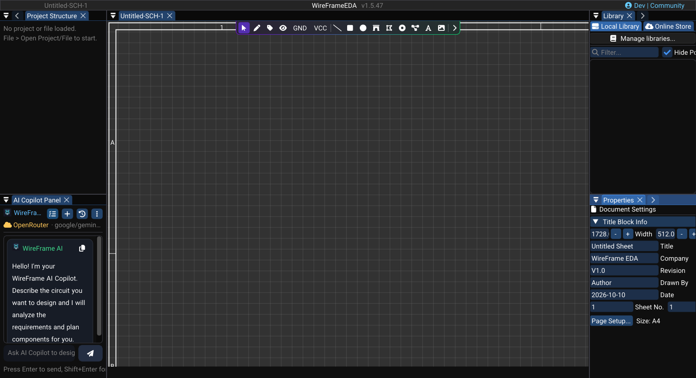
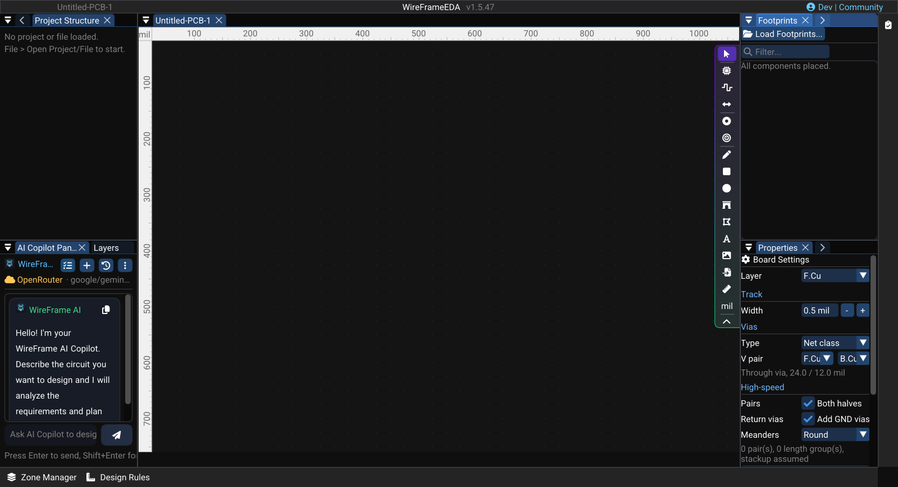

# Getting Started

This guide walks you through your first session with WireFrame EDA in about **10 minutes**: launching the application, the main window, and your first project.

!!! abstract "What you'll learn"
    - Launching WireFrame
    - Understanding the main window
    - Creating a project
    - Adding schematic and PCB files
    - Opening existing projects and files

---

## 1. Launching WireFrame

=== "Windows"

    Open the **Start** menu → type **WireFrame** → press ++enter++.

=== "macOS"

    Open **Applications** (or Launchpad) → **WireFrame**.

=== "Linux"

    Open **WireFrame EDA** from the application menu.

No sign-in is needed: WireFrame runs in community mode. On startup it restores the window size and position, and reopens the projects and documents that were open when you quit (**Preferences → Workspace → Restore on launch**).

---

## 2. The Main Window

### Image — Default layout with a project open

!!! note "Image capture brief"
    1. **Prepare:** Open the sample project after **Preferences → Workspace → Default layout** so every panel is where a fresh install has it.
    2. **Build the frame:** Capture the whole window with the menu bar (File, Edit, View, Tools, Simulation, Preferences, Help), Project Structure, the editor with a schematic tab, Library, Properties, and AI Copilot visible.
    3. **Clean the frame:** Close unrelated panels and tooltips, move the pointer away from key text, and hide credentials, usernames, customer data, and private paths.
    4. **Capture and finish:** Capture a native-resolution PNG, crop without cutting titles or primary actions, and add at most three subtle callouts without altering engineering content.
    5. **Approve:** Check the image at 100% zoom for current labels, readable evidence, correct release branding, and absence of sensitive information.

<!-- wf:shot id=default-layout-with-a-project-open
caption: The default layout with a project open
setup:
- open_project
- ensure_schematic
- wait: 1
- keys:
  - Home
- wait: 0.5
- click_at:
  - 700
  - 700
- wait: 0.5
- action:
    action: mouse_move_to
    x: 1000
    y: 12
brief_sha256: 7027d5fceb146593
-->
<!-- wf:out id=default-layout-with-a-project-open sha=b9d7589fb535 -->

<!-- /wf:out -->

| Area | Default position | Purpose |
|---|---|---|
| **Menu bar** | Top | **File**, **Edit**, **View**, **Tools**, **Simulation**, **Preferences**, **Help**, and the account menu on the right |
| **Project Structure** | Left, top | Project file tree |
| **AI Copilot** | Left, bottom | Chat with the design assistant |
| **Editor** | Centre | One tab per open schematic or PCB |
| **Library** / **Footprints** | Right, top | Symbols for a schematic, unplaced footprints for a PCB |
| **Properties** | Right, bottom | The selected object, or the document settings |
| **Layers** *(PCB)* | Beside the Properties panel | Visibility, lock, and colour of PCB layers |
| Notifications | Bottom of the editor | Short messages such as *Document saved successfully* |

!!! tip "Rearranging panels"
    **Drag any panel tab** to another edge or corner. The layout is saved when you quit. **Preferences → Reset to Default Layout** puts every panel back; **Preferences → Workspace → Layout presets** saves arrangements under a name.

---

## 3. Creating a New Project

!!! important "Why use a project?"
    A **project** (`.prjxml`) links your schematics, PCBs, and project library. **Update Schematic to PCB** and AI design work need a project.

**Steps:**

1. Go to **File → New → New Project (.prjxml)...**
2. Choose the folder for the project (**Select Folder for New Project**).
3. In **Create New Project**, type the project name and select **Create**.

WireFrame creates, in that folder:

- `<name>.prjxml` — the project file with its list of schematics and PCBs;
- `lib_<name>/` — the project library, where repaired and generated parts are saved.

The **Project Structure** panel shows the new project. Right-click it to **Add New Schematic** or **Add New PCB**.

---

## 4. Adding a Schematic File

1. Right-click the project in **Project Structure** → **Add New Schematic**.
    Or use **File → New → New Schematic (.schxml)** (++ctrl+n++) for a standalone sheet.
2. A new tab opens in the editor. The canvas shows a dot grid, the page outline, rulers, and the schematic toolbar centred at the top.
3. Press ++ctrl+s++ to save it as a `.schxml` file, for example `main.schxml`.

### Image — New schematic

!!! note "Image capture brief"
    1. **Prepare:** Press **Ctrl+N** in a clean workspace.
    2. **Build the frame:** Capture the new schematic tab with the page outline, the rulers, and the schematic toolbar centred at the top of the canvas.
    3. **Clean the frame:** Close unrelated panels and tooltips, move the pointer away from key text, and hide credentials, usernames, customer data, and private paths.
    4. **Capture and finish:** Capture a native-resolution PNG, crop without cutting titles or primary actions, and add at most three subtle callouts without altering engineering content.
    5. **Approve:** Check the image at 100% zoom for current labels, readable evidence, correct release branding, and absence of sensitive information.

<!-- wf:shot id=new-schematic
caption: 'A new schematic: page outline, rulers and the schematic toolbar'
project: none
setup:
- wait: 1
- keys:
  - Ctrl
  - N
- wait: 2
- action:
    action: mouse_move_to
    x: 1000
    y: 12
brief_sha256: ba0b9acca80cfbfc
-->
<!-- wf:out id=new-schematic sha=70fee785d1b7 -->

<!-- /wf:out -->

---

## 5. Adding a PCB File

1. Right-click the project → **Add New PCB**, or use **File → New → New PCB (.pcbxml)**.
2. A new tab opens with rulers, a grid, and the PCB toolbar on the right edge of the canvas.

### Image — New PCB

!!! note "Image capture brief"
    1. **Prepare:** Choose **File → New → New PCB (.pcbxml)** in a clean workspace.
    2. **Build the frame:** Capture the new PCB tab with the rulers, the vertical PCB toolbar on the right edge of the canvas, and the Footprints, Properties, and Layers panels.
    3. **Clean the frame:** Close unrelated panels and tooltips, move the pointer away from key text, and hide credentials, usernames, customer data, and private paths.
    4. **Capture and finish:** Capture a native-resolution PNG, crop without cutting titles or primary actions, and add at most three subtle callouts without altering engineering content.
    5. **Approve:** Check the image at 100% zoom for current labels, readable evidence, correct release branding, and absence of sensitive information.

<!-- wf:shot id=new-pcb
caption: 'A new PCB: rulers, the vertical PCB toolbar, Footprints, Properties and Layers'
project: none
setup:
- wait: 1
- menu:
  - File
  - New
  - New PCB (.pcbxml)
- wait: 2
- action:
    action: mouse_move_to
    x: 1000
    y: 12
brief_sha256: 299edd20c74f66bc
-->
<!-- wf:out id=new-pcb sha=f596695a4405 -->

<!-- /wf:out -->

!!! tip "Convert from schematic instead"
    Complete your schematic first and use **Tools → Update Schematic to PCB**. Footprints arrive on the board in a grid with their nets; review the target board, imported footprints, and ratsnest before routing.

---

## 6. Opening an Existing Project or File

### Opening a project (`.prjxml`)

1. **File → Open Project (.prjxml)...** (++ctrl+p++)
2. Select the `.prjxml` file
3. The **Project Structure** panel lists its schematics and PCBs
4. Click an entry to open it in the editor

### Opening a single file

1. **File → Open File...** (++ctrl+o++)
2. Select a `.schxml` (schematic), `.pcbxml` (PCB), or `.prjxml` (project) file
3. A schematic or PCB opens as a tab — no project required

---

## Next Steps

| Next page | Content |
|---|---|
| [UI Overview](ui-overview.md) | Every panel and menu |
| [Schematic Editor](schematic/index.md) | Place components, draw wires, manage nets |
| [PCB Editor](pcb/index.md) | Lay out footprints, route traces, export Gerbers |
| [Full Tutorial](tutorial/index.md) | End-to-end walkthrough: a complete LED circuit |
