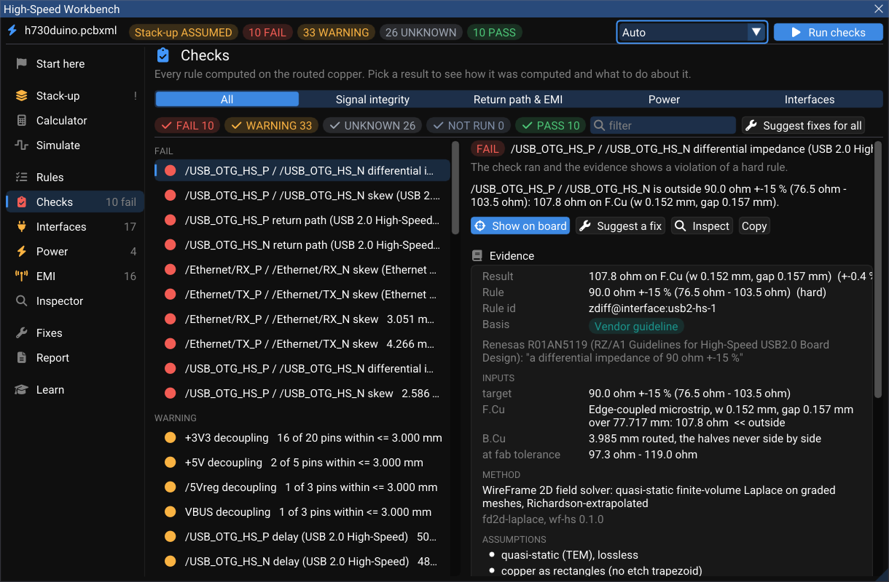
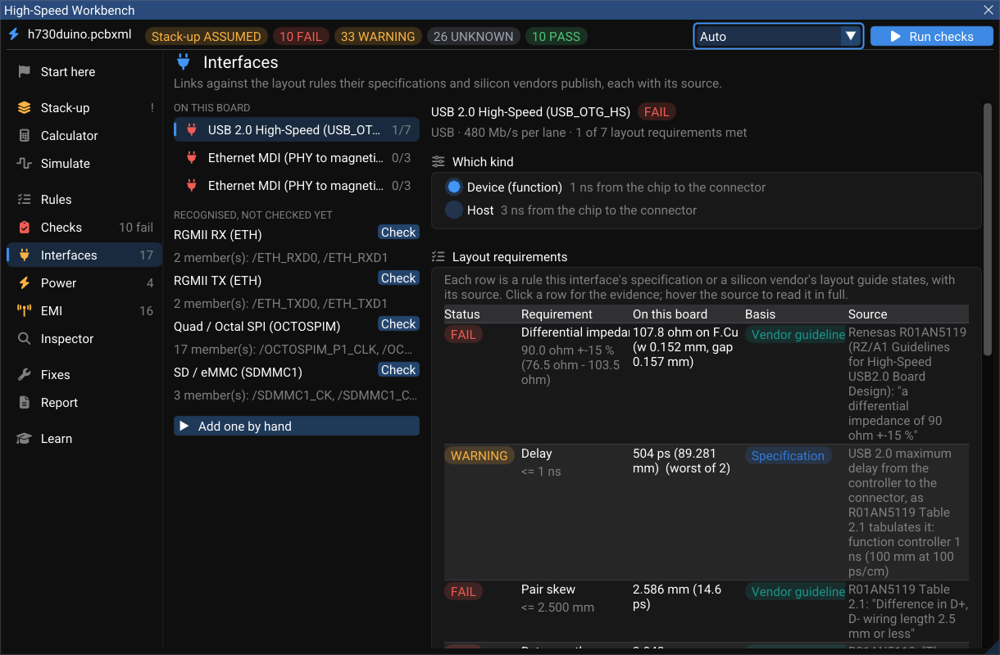
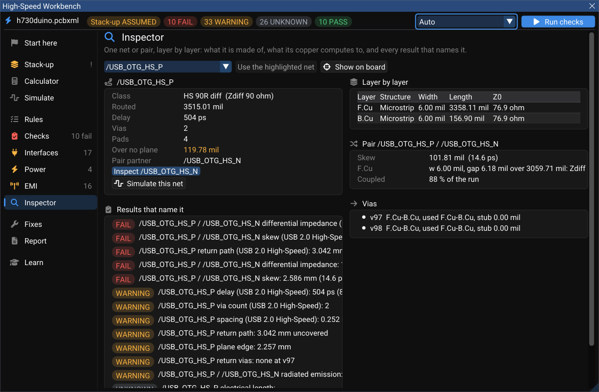

# Checks, Interfaces and the Inspector

**Checks** computes every high-speed rule on the copper you routed. **Interfaces** groups those results by link — a USB port, an Ethernet PHY, a DDR byte lane — and adds the layout rules each specification publishes. **Inspector** shows one net or pair layer by layer. All three read the same run.

## Running the checks

Press **Run checks** (top right of the Workbench, or the button on **Start here**). The run happens in the background; the board stays editable. When it finishes the status line counts the results, and the **Checks** page lists them.

| Control | What it does |
|---|---|
| **All · Signal integrity · Return path & EMI · Power · Interfaces** | Filters by category |
| Status chips (**FAIL**, **WARNING**, **UNKNOWN**, **NOT RUN**, **PASS**) | Show or hide each status |
| **filter** | Narrows by net, pair or rule name |
| **Suggest fixes for all** | Turns every failing result into a proposed fix on the [Fixes](fixes-and-report.md) page |
| **Auto** (top bar) | The impedance method: closed forms, with the field solver wherever a result is close to its limit |

### What a status means

| Status | Meaning |
|---|---|
| **PASS** | Computed, inside its limit, and nothing it depends on is assumed |
| **WARNING** | Inside a soft limit, close to a hard one — or computed on an assumed stack-up |
| **FAIL** | Outside a hard limit |
| **UNKNOWN** | Something the rule needs is missing (a rise time, a load step, an aggressor's edge) — it is never shown as PASS |
| **NOT RUN** | The rule has nothing to measure yet (the net is not routed) |
| **STALE** | The board changed after the run; press **Run checks** again |

### Reading one result

Pick a result to see how it was computed. The right-hand card shows:

- **Result** — the measured value, for example `107.8 Ω on F.Cu (w 0.152 mm, gap 0.157 mm)`.
- **Rule** and **Rule id** — the limit and where it lives (`zdiff@interface:usb2-hs-1`).
- **Basis** — *Specification*, *Vendor guideline*, *Physics* or *Rule of thumb*, with the source quoted: here Renesas R01AN5119, "a differential impedance of 90 ohm ±15 %".
- **Inputs** — the target, each layer the net runs on with its own value, and the value **at fab tolerance** (on h730duino the USB pair is 97.3–119.0 Ω across the board house's corners — outside the window even at its best corner).
- **Method** — for example *WireFrame 2D field solver: quasi-static finite-volume Laplace on graded meshes, Richardson-extrapolated*.
- **Assumptions** — quasi-static (TEM), lossless, copper as rectangles…

Buttons under the result: **Show on board** (selects and frames the copper on the canvas), **Suggest a fix**, **Inspect** (opens the net in the Inspector) and **Copy** (the result as text, for a review or an issue).

### What is checked

| Rule | Default limit | How it is measured |
|---|---|---|
| Impedance (single and differential) | The class's target and tolerance | Each layer's routed geometry, closed form or 2D field solver |
| Pair skew | The class's limit, in length or in time | Each leg's length per layer × that layer's delay |
| Length / time matching | The group's tolerance | Against the group's reference net |
| Via count, stub length | The class's limits | Vias on the net; the unused barrel below the last layer used |
| Return path | No length over a gap | The reference plane under each segment, from the poured copper |
| Plane edge | 6.3 × the height above the plane | Rays sideways from the track to the reference pour's edge (holes under 2 mm ignored) |
| Return via | 1.27 mm | A via that moves the net between reference planes needs a stitching via (same net) or a capacitor (different nets) beside it |
| Crosstalk | 5 % of the aggressor's swing (a class can ask less) | Every parallel run on the same layer within 10 × the height; near-end saturates, far-end grows with length; all aggressors at once. No aggressor edge rate → an upper bound marked UNKNOWN |
| Decoupling | 3 mm pin to capacitor | Every IC supply pin on the rail to the nearest rail-to-ground capacitor |
| PDN impedance | V × ripple / ΔI | See [Power](simulate-power-emi.md#power-the-ac-side) |
| Current capacity | The rail's DC current | IPC-2221 (10 °C rise) on the rail's narrowest track |
| Emission | 6 dB under the chosen limit | See [EMI](simulate-power-emi.md#emi) |
| Insertion loss | The interface's budget at Nyquist | Conductor loss (with roughness) + dielectric loss per layer |

## Interfaces

Each link is checked against the **layout** requirements its specification or its silicon vendors publish, one row per requirement, each with its source.

Profiles shipped: **USB 2.0 HS**, **USB 3.x**, **PCIe**, **Ethernet MDI**, **HDMI**, **MIPI D-PHY**, **LVDS**, **SATA**, **DDR3/DDR4 byte lane**, **RGMII**, **Quad/Octal SPI** and **SD/eMMC**. Examples of what they cite: USB 2.0 from Renesas R01AN5119 (90 Ω ±15 %, 2.5 mm skew, no vias, plane 1 mm wider, 3 × S guard); Ethernet MDI from TI SNLA387 (100 Ω ±10 %); DDR4 DQ to DQS ±3.5 ps *in time* (Intel Agilex 7 EMIF); RGMII TXD within 11 ps (TI DP83867). A number no document gave is marked *rule of thumb*.

On h730duino, USB 2.0 HS meets 1 of its 7 requirements and the two Ethernet MDI ports 0 of 3. Groups WireFrame recognised but nobody has declared yet — RGMII, OCTOSPI, SD/eMMC — are listed under them, each with **Check**.

!!! important "Layout compliance is necessary, not sufficient"
    Meeting every row here means the copper follows the published layout rules. Whether the link passes its own electrical compliance test is decided by that test, on hardware. The Workbench prints this wherever it says "compliance".

## Inspector

One net or one pair, layer by layer: what it is made of, what its copper computes to, and every result that names it.

On h730duino, `/USB_OTG_HS_P` is 3515 mil long, 504 ps of delay, through 2 vias, and runs 119.78 mil over no plane. Its two halves differ by 101.81 mil (14.6 ps) and run side by side for only 88 % of their length.

## While you route

For a net with high-speed rules, the routing readout beside the cursor gains the same measurements, for the track being drawn:

- the **return path** — which plane is under the new segment, and how much of it runs over none;
- the **plane edge**, measured sideways from the track;
- the whole net's **crosstalk** against the copper beside it;
- and the fix for the worst finding.

They are the checks' own measurements on the pours as filled, so the number while drawing and the number after the run are the same number. See [Length tuning and differential pairs](../pcb/length-tuning.md) for routing pairs and adding meanders.

## Pitfalls

- **Everything is WARNING.** The stack-up is still ASSUMED. Enter your board house's stack-up on **Stack-up** and tick *I confirmed this with my board house*.
- **A crosstalk or PDN result is UNKNOWN.** It needs an input nobody stated: the aggressor's rise time (on the net class or the interface), or the rail's load step. Stating it is a fix of its own (*set_rail*, *set_interface*), approved like any other.
- **A newly declared interface reads "not routed".** It is measured as soon as the declaration is previewed; run the checks again after applying it.
- **Return-path results changed after a pour.** They read the planes as filled — refill zones (Zone Manager) before trusting them.
