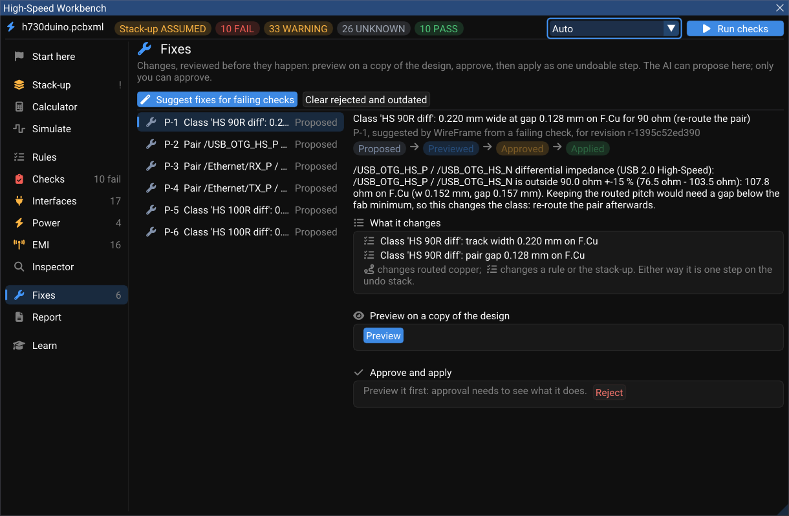
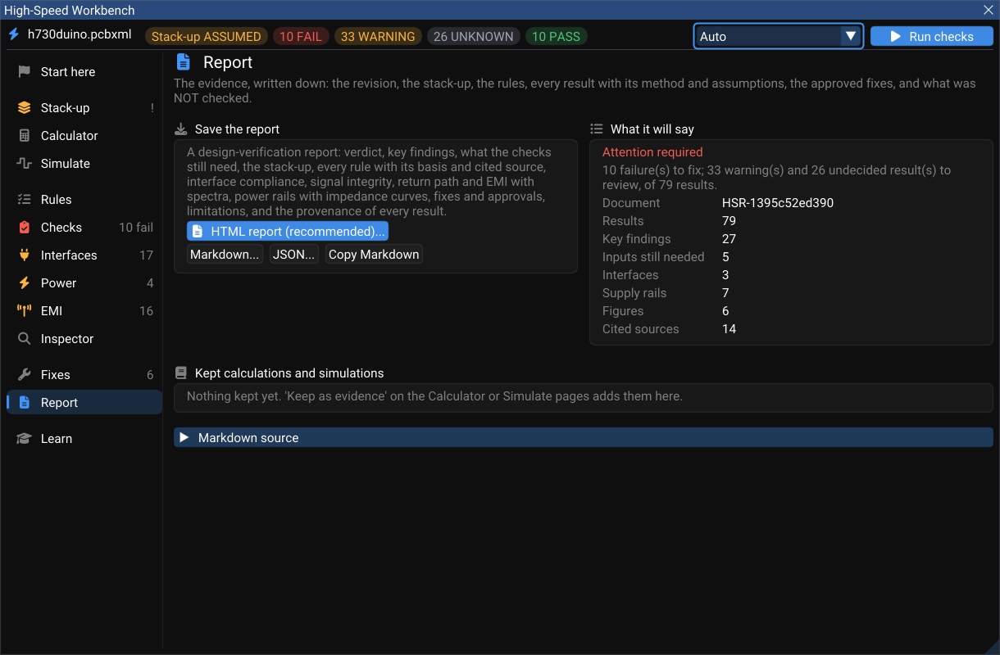

# Fixes, Reports and the AI

The [High-Speed Workbench](index.md) never changes your board on its own. A fix is a **proposal** you can look at before anything happens, and the evidence behind every result can be written down for a review, a customer or a certification file.

## Fixes

Press **Suggest a fix** on a result, or **Suggest fixes for all** on the Checks page. Each proposal lands on **Fixes** and moves through four states:

**Proposed → Previewed → Approved → Applied**



1. **Preview** applies the change to a copy of the design and runs the checks again on that copy. You see what it fixes and anything it breaks.
2. **Approve** — only a person can. The approval records who approved it and on which revision of the board.
3. **Apply to the board** writes it as **one** undoable step (rules and copper together). ++ctrl+z++ takes it back like any edit.
4. **Roll back** takes an applied fix back from this page.

On h730duino, fix P-1 changes the net class `HS 90R diff` to 0.220 mm wide with a 0.128 mm gap on F.Cu, which brings the USB pair to 90 Ω.

A fix can change a net class's rules (width, gap, targets — a time-matching failure is turned into the length to add on the layer the meanders go to), or **state something about the board**: declare an interface, set a rail's voltage, ripple, load step or DC current, choose the EMC limit, or set the fab tolerance. A statement is validated against the board's own nets and approved like any other change — and once applied, the nets it brings in are measured, not shown as "not routed".

## Report

**Report** writes the evidence down: the board's revision fingerprint, the stack-up, the rules, every result with its method and assumptions, the fixes and who approved them — and, explicitly, what was **not** checked.



| Format | For |
|---|---|
| **HTML report (recommended)** | Reading and printing: inline figures — the EMI spectrum, each rail's impedance curve — A4 print rules, and the list of sources cited |
| **Markdown** | GitHub, wikis, pull requests |
| **JSON** | Your own tools and CI (`wireframe.hs/1`, units in every key) |

The controlled-impedance table for the board house is exported separately from the [Stack-up](index.md#stack-up) page.

## What the AI Copilot can do here

The Copilot has the same tools the Workbench pages use — read the design summary, the stack-up, a net's topology and constraints; calculate impedance, delay and skew, crosstalk, PDN impedance and emission; run the checks and the simulations; check interfaces; propose and preview patches; generate the report.

Two tools write: **apply an approved patch** and **roll back a revision** — and the first refuses any patch that a **person** did not approve in the Workbench, on the same revision it was previewed on. The model can propose; it cannot approve, set a result's status, or produce evidence. Every number it quotes comes from an engine run.

Ask it in the Copilot panel with the board open, for example:

```text
Why does the USB pair fail, and what is the smallest change that fixes it?
Check the Ethernet ports against their interface rules.
Is +3V3 decoupled well enough for a 300 mA load step?
```

See [AI Copilot commands](../ai/commands.md) for the panel itself.
