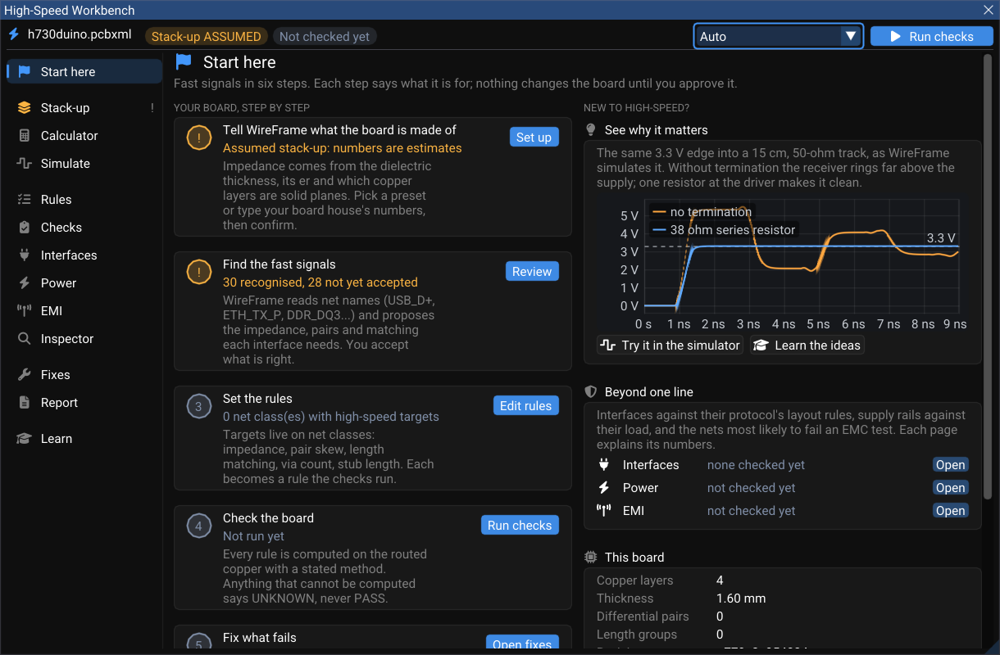
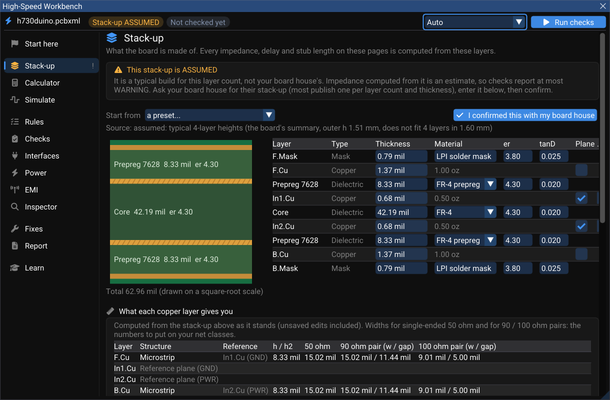

# High-Speed Workbench

A fast signal — USB, Ethernet, DDR, PCIe, MIPI, QSPI, SD — has to be more than connected. Its track must have the right impedance, the two halves of a pair must arrive together, its return current needs a solid plane underneath, and the supply that drives it must hold its voltage when the load steps. The **High-Speed Workbench** puts all of those questions in one window, in the order a board designer asks them, and answers each one from the copper you actually routed.

Open it with **View ▸ High-Speed Workbench** while a board is open, or from **Properties ▸ Board Settings ▸ High-speed ▸ High-Speed Workbench**, or from **Design Rules ▸ High-Speed**.

The pictures on these pages were drawn by WireFrame on **h730duino** — a 4-layer STM32H730 board with USB 2.0 High-Speed and two Ethernet ports, by Martin Ribelotta, MIT licence ([github.com/martinribelotta/h730duino](https://github.com/martinribelotta/h730duino)).

## Two rules behind every page

**No PASS that cannot be proven.** A result is PASS only when everything it depends on is known. A stack-up nobody confirmed caps every result at **WARNING**; a missing input — a rise time, a load step, a DC current — makes the result **UNKNOWN**, never PASS. Every result carries its method, the assumptions it made, and where its limit comes from (a specification, a silicon vendor's guideline, physics, or a rule of thumb — labelled as such).

**Nothing changes the board until you approve it.** Fixes are proposals. Each one is previewed on a copy of the design, approved by a person, and applied as one undoable step. The AI Copilot can propose fixes on these pages; it cannot approve them.

## The pages

| Page | What it answers |
|---|---|
| **Start here** | Six guided steps — stack-up, fast signals, rules, check, fix, report — each with the board's current state |
| **Stack-up** | What the board is made of: copper and dielectric layers, laminates, planes, fab tolerance |
| **Calculator** | Impedance, delay, reflection, bandwidth, loss, via stub and crosstalk for any geometry; PDN impedance, track current and radiated emission |
| **Simulate** | Reflections and termination on one line, a differential pair, several loads on one net, a measured channel (S-parameters) |
| **Rules** | What the high-speed nets must do: targets on net classes, pairs and length groups |
| **Checks** | Every rule computed on the routed copper, with the evidence |
| **Interfaces** | USB, PCIe, Ethernet, HDMI, MIPI, DDR, RGMII, QSPI, SD/eMMC… against the layout rules their specifications publish |
| **Power** | Each supply rail against the impedance its load allows (the AC side; the DC side is the [Power Analyzer](../power/power-analyzer.md)) |
| **EMI** | The nets most likely to radiate and the return-path problems behind them |
| **Inspector** | One net or pair, layer by layer |
| **Fixes** | Proposed changes: preview, approve, apply, roll back |
| **Report** | The evidence written down — HTML, Markdown or JSON |
| **Learn** | The ideas behind every number, in plain words, each with a button that shows it |

The status line at the top of the window counts the results — for example `Stack-up ASSUMED · 10 FAIL · 33 WARNING · 26 UNKNOWN · 10 PASS` — and **Run checks** recomputes them. Results become **STALE** the moment the board changes; the Workbench notices within half a second.

## Start here

The first page walks through the six steps and says, for each one, where the board stands:

1. **Tell WireFrame what the board is made of** — *Assumed stack-up: numbers are estimates* until you confirm one.
2. **Find the fast signals** — WireFrame reads net names (`USB_D+`, `ETH_TX_P`, `DDR_DQ3`…) and proposes impedance targets, pairs, length groups and interfaces. On h730duino it recognises 30 fast signals: USB_OTG_HS, Ethernet, RGMII, OCTOSPI and SDMMC. Press **Review** and accept what is right.
3. **Set the rules** — targets live on net classes: impedance, pair skew, length matching, via count, stub length.
4. **Check the board** — every rule computed on the routed copper.
5. **Fix what fails** — proposals you preview and approve.
6. **Keep the evidence** — a report of the revision, the rules, every result and every approved fix.

The **See why it matters** card simulates the same 3.3 V edge into a 15 cm, 50 Ω track with and without termination, so the reason for all of this is on screen before any rule is.

## Stack-up

Every impedance, delay and stub length in the Workbench is computed from the stack-up. A board imported from KiCad brings its `(setup (stackup …))`, with the inner planes inferred from the pours (the plane's net is the one with the largest pour on that layer). A board with no stated stack-up gets a typical one for its layer count, marked **ASSUMED**.

| You can set | Notes |
|---|---|
| Each layer's thickness, copper weight and roughness | Roughness (Rq) feeds the conductor-loss model |
| Each dielectric's material | From the laminate library: generic FR-4, Isola 370HR and FR408HR, Panasonic Megtron 6, Rogers RO4350B and RO4003C. Dk and Df come from datasheet points, interpolated on log f, and kept causal outside them (Djordjevic–Sarkar). For Rogers, the "design Dk" is the one impedance uses |
| Which copper layers are planes, and of which net | The return-path, plane-edge and PDN checks read the planes as poured copper |
| **Fab tolerance** | Width, dielectric height, εr and copper, typically 10 / 10 / 5 / 10 %. Results then show the impedance at the board house's corners |
| **I confirmed this with my board house** | Until this is ticked, nothing on the board can be PASS |

The table at the bottom says what each copper layer can do: which plane it references and the width (and, for a pair, the gap) that meets 50 Ω and 90/100 Ω on it. On h730duino, F.Cu is a microstrip over In1.Cu (GND), and a 90 Ω pair needs 15.02 mil wide, 11.44 mil apart.

**Export the controlled-impedance table** from this page (CSV or printable HTML): class, layer, structure, reference planes, width and gap, target and WireFrame's computed value — the table a board house asks for when you order controlled impedance.

## Calculator

Seven signal-integrity tabs — **Impedance**, **Delay & length**, **Reflection**, **Bandwidth**, **Loss**, **Via stub**, **Crosstalk** — and three for power and EMI — **PDN impedance**, **Track current**, **Radiated emission**. Pick a structure (Microstrip, Embedded, Stripline, Pair outer, Pair inner, Coplanar RF), type the geometry, and read the answer with the model it came from and the range that model is good for.

- **Solve width / gap** turns a target impedance into geometry.
- **Field solver** runs WireFrame's 2D quasi-static finite-volume solver on the cross-section and draws the potential. Near a limit, the checks use it automatically instead of a closed-form formula.
- The same engine sits behind the routing readout, DRC, Design Rules and the Workbench: one geometry has one impedance everywhere in the app.

## Rules

Targets live on **net classes**; **pairs** and **length groups** say which nets go together. A class can state its impedance (single-ended and differential), tolerance, rise time, maximum vias, maximum stub, minimum coupling, pair skew (in length or **in time**), crosstalk limit, and whether each rule is hard or soft. A length group's tolerance can be stated in picoseconds too.

**Matching in time** matters when nets change layer: each net's delay is its length on each layer times that layer's propagation delay. On a six-layer test board a DQ line routed on a stripline at the same length as its DQS on the microstrip arrives 26 ps late — a DDR4 byte lane (±3.5 ps) fails where a plain length check passes. When a time rule fails, the suggested fix turns the missing delay into length on the layer the meanders go to.

Accepting a recognised interface on **Start here**, **Rules** or **Interfaces** declares it on the board: its pairs, its lanes grouped (a DDR byte lane, an RGMII direction, a QSPI or SD bus word) and its profile's rules.

## Where to go next

- [Checks, interfaces and the inspector](checks-and-interfaces.md) — reading results and their evidence.
- [Simulation, power and EMI](simulate-power-emi.md) — the time domain, rails and emissions.
- [Fixes, reports and the AI](fixes-and-report.md) — changing the board safely and keeping the evidence.
- [Length tuning and differential pairs](../pcb/length-tuning.md) — routing the nets these rules describe.
- [Power Analyzer (DC IR drop)](../power/power-analyzer.md) — the voltage each chip really sees.
