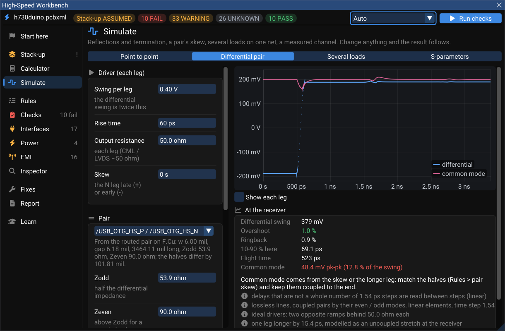
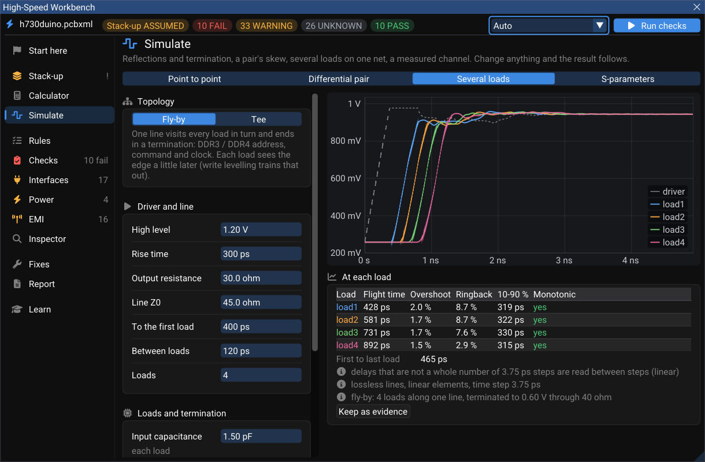
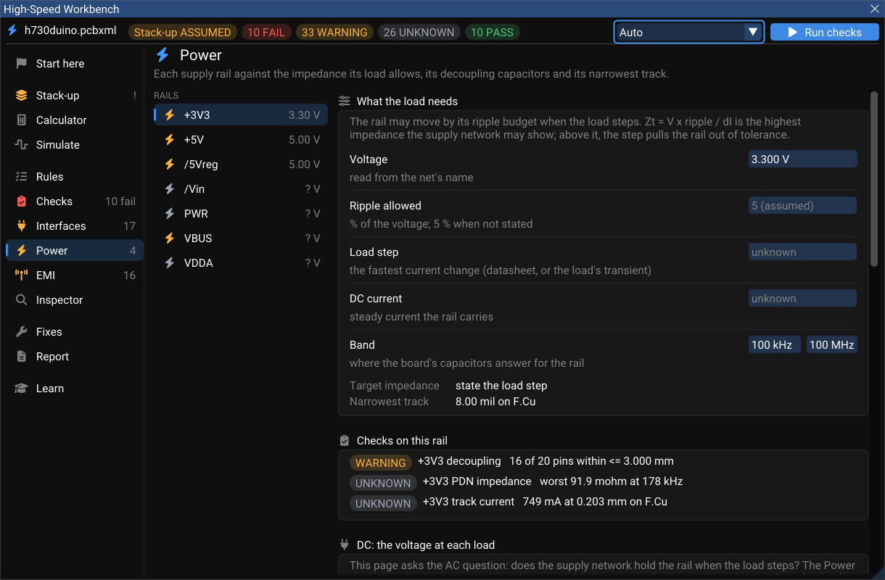
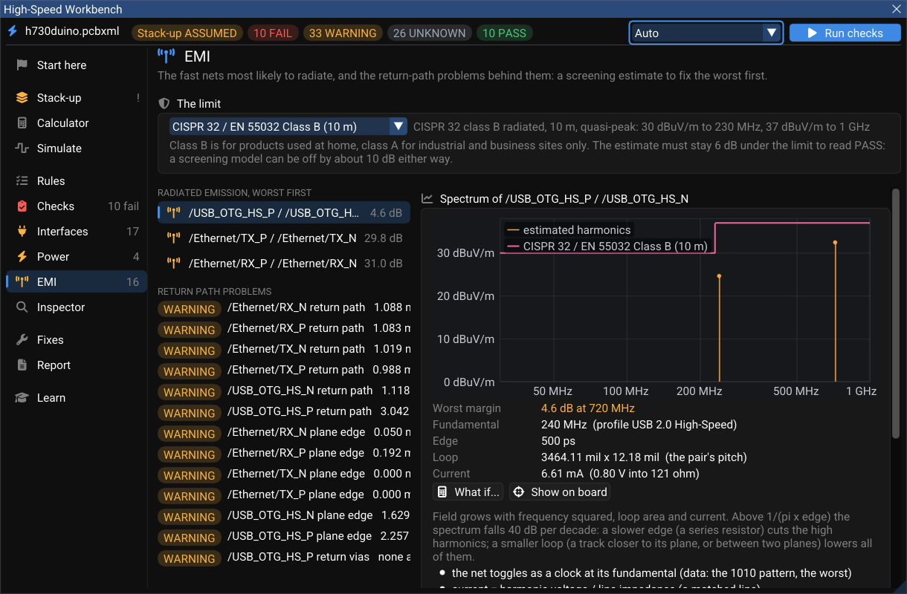

# Simulation, Power and EMI

Three pages of the [High-Speed Workbench](index.md) look past the copper's geometry: **Simulate** puts a signal through it in time, **Power** asks whether each supply rail can hold its voltage as the load changes, and **EMI** estimates which nets will radiate.

## Simulate

Four tabs, each reading the board's own routed nets or values you type. Change anything and the result follows.

| Tab | What it simulates |
|---|---|
| **Point to point** | A driver, a lossless line and a receiver: reflections, overshoot and ringing, with five termination schemes compared side by side and a verdict in words (**Suggest termination**). **Cross-check with ngspice** runs the same circuit through ngspice |
| **Differential pair** | A coupled pair by its even and odd modes; one leg longer than the other is modelled as an uncoupled stretch at the receiver. Reports the differential edge, its swing and the **common mode** the skew creates |
| **Several loads** | One net with several receivers — a **fly-by** (lead, between-segments, N loads, a resistor to VTT; DDR3/DDR4 address, command and clock) or a **tee**. Flight time, overshoot and ringback at each load |
| **S-parameters** | **Open a Touchstone file...** (`.s1p` … `.sNp`, version 1 or 2.0, dB / MA / RI, S / Y / Z) from a VNA, a connector vendor or a field solver. For a 4-port it plots SDD21, SDD11 and SCD21 for the port pairing you choose against a cited loss budget, and says so when the file is not reciprocal or not passive (a channel that cannot exist) |

The differential-pair tab reads the routed pair straight from the board: its odd- and even-mode impedance, its delay, and how much longer one half is than the other.

On h730duino, 15.4 ps of extra length on one half of the USB pair turns into 48.4 mV of common mode at the receiver — 12.8 % of the swing — while the differential signal itself stays clean (1 % overshoot). Common mode is exactly what radiates, which is why skew is a rule even when the eye looks fine.

!!! note "What these simulations are, and are not"
    The driver is ideal (a Thévenin source with a stated edge), not an IBIS model, and lines are lossless in the time domain (loss is computed separately, per layer). The window lists these and its other assumptions under every result. **Keep as evidence** adds a result to the [report](fixes-and-report.md#report).

## Power (the AC side)

Each supply rail against the impedance its load allows, its decoupling capacitors and its narrowest track.

The **target impedance** is `Zt = V × ripple / ΔI`: the rail's voltage, the ripple it may show, and the load step it must survive. WireFrame models the regulator, every capacitor on the rail (with typical ESL and ESR for its package) and the plane capacitance between the rail's pour and ground, and draws |Z(f)| from 100 kHz to 100 MHz with its peaks.

On h730duino, +3V3 takes 3.30 V from the net's name, assumes 5 % ripple, and has no stated load step — so there is no target yet, and the PDN result is **UNKNOWN** rather than an unfounded PASS. State the load step (the chip's datasheet gives the current change between modes) and run again.

The same page checks **decoupling** (every IC supply pin within 3 mm of a rail-to-ground capacitor) and **current capacity** (the rail's narrowest track against its DC current, IPC-2221).

!!! tip "AC here, DC in the Power Analyzer"
    This page answers the AC question: does the rail hold its voltage across frequency? The DC question — how many volts each chip actually gets after the copper has taken its share — is the [Power Analyzer](../power/power-analyzer.md). The card *DC: the voltage at each load* at the bottom of this page opens the same rail there, and the analyzer's *AC impedance & decoupling* button comes back. A DC current stated in one is offered to the other as the same number.

## EMI

The fast nets most likely to radiate, their estimated spectrum against a limit, and the return-path problems behind them.

- **Limits:** CISPR 32 / EN 55032 class A or B (default B) and FCC Part 15.109 class A or B, with a margin (default 6 dB). Set them on this page; the choice is saved with the board.
- **Model:** each net's trapezoid spectrum (its rate from the net class or the interface profile) through Ott's differential- and common-mode radiation formulas, the loop being the track's length × its height (for a pair, × its pitch), up to 1 GHz.
- On h730duino the USB pair sits only 4.6 dB under the limit at 720 MHz — the third harmonic of 240 MHz.

!!! warning "A screening estimate"
    Closed-form emission models can be off by about 10 dB either way. Use this page to find and fix the worst offenders first — gaps under fast nets, layer changes without a return via, long unshielded runs — not as a substitute for a test lab.
