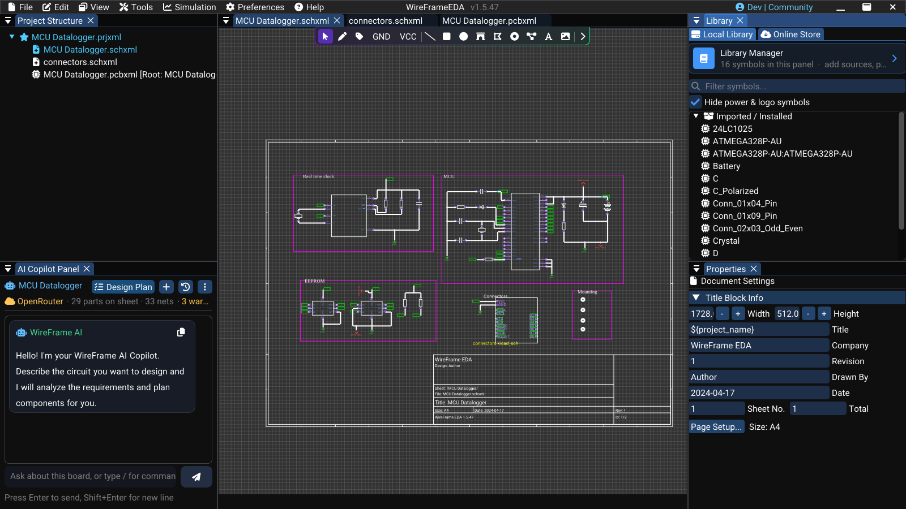
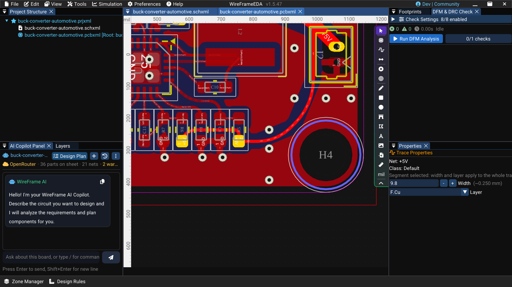
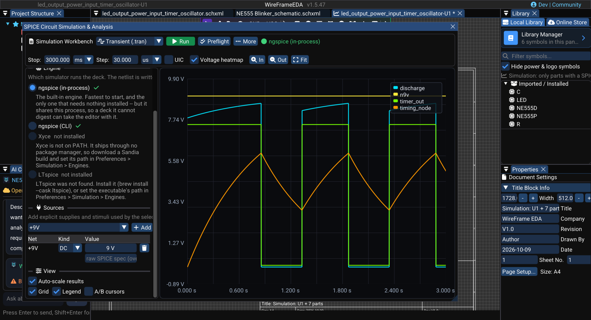
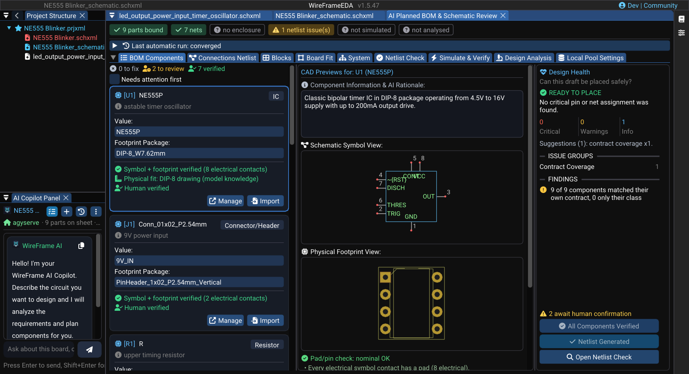
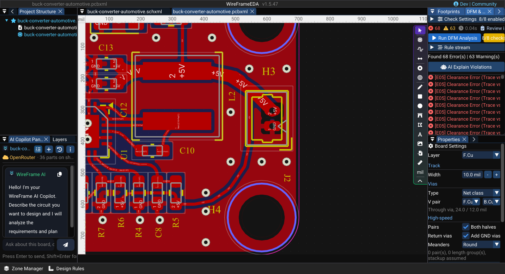

---
hide:
  - navigation
  - toc
---

WireFrame EDA · v1.5.47 guide

# From idea to a board you can order.

Draw the schematic, check it, simulate it, lay out the PCB and export fabrication files — with an AI Copilot that proposes and never applies on its own.

[:material-rocket-launch: Start learning](learn/index.md){ .md-button .md-button--primary }
[:material-download: Download WireFrame](https://wireframe.com.vn/download){ .md-button }

## Where do you want to start? { .wf-section-title }

Pick the line that sounds most like you. Each one opens a short path with the pages in order and how long they take.

-   :material-sprout:{ .lg .middle } **I'm new to PCB design**

    ---

    Learn the screen, then build a small LED board from schematic to Gerber files.

    [:octicons-arrow-right-24: The beginner path](learn/index.md#new-to-pcb-design) · about 1 hour

-   :material-swap-horizontal:{ .lg .middle } **I already use KiCad or Altium**

    ---

    Bring your projects and libraries across and learn what is different here.

    [:octicons-arrow-right-24: The switcher path](learn/index.md#coming-from-kicad-or-altium) · about 30 min

-   :material-robot-outline:{ .lg .middle } **I want AI to help me design**

    ---

    Describe a circuit, review the BOM and connections the Copilot proposes, fix missing parts.

    [:octicons-arrow-right-24: The AI path](learn/index.md#design-with-ai) · about 45 min

-   :material-factory:{ .lg .middle } **I need to send a board to the fab**

    ---

    Design rules, DFM and DRC checks, and a fabrication package that matches one revision.

    [:octicons-arrow-right-24: The release path](learn/index.md#ready-for-manufacturing) · about 30 min

## Your first hour, step by step { .wf-section-title }

1

### Install and open WireFrame <small>10 min</small>

Download the build for your system and check that it starts — no account is needed. → [Installation](installation.md)

2

### Find your way around <small>10 min</small>

Project tree on the left, editor in the middle, Library and Properties on the right, AI Copilot below. → [User Interface](ui-overview.md)

3

### Build your first board <small>30 min</small>

Connector, resistor and LED: schematic, ERC, PCB, routing, DFM. → [Tutorial: A Simple LED Board](tutorial/index.md)

4

### Let the Copilot help <small>10 min</small>

Ask for a circuit, then review what it proposes before anything is applied. → [Tutorial: AI-Assisted Design](tutorial/ai-design.md)

## What you can do in WireFrame { .wf-section-title }

-   

    **Schematic editor** — multi-sheet designs, wires and nets, title blocks, and an
    electrical rules check that points at the pin. [Open the guide :octicons-arrow-right-24:](schematic/index.md)

-   

    **PCB layout** — footprints, tracks and vias, copper zones, layer control and
    design rules. [Open the guide :octicons-arrow-right-24:](pcb/index.md)

-   

    **Simulation** — choose an engine, pick the blocks to run, add loads and
    assertions, measure waveforms. [Open the guide :octicons-arrow-right-24:](simulation/index.md)

-   

    **AI Copilot** — a planned BOM and netlist you review card by card; every part is
    checked against its symbol and land pattern. [Open the guide :octicons-arrow-right-24:](ai/index.md)

-   

    **Libraries** — KiCad folders and files, Altium libraries converted in place,
    symbol and footprint editors. [Open the guide :octicons-arrow-right-24:](libraries/library-converter.md)

-   

    **Checks and fabrication** — DFM and DRC with the location of every violation,
    then Gerber, drill and BOM. [Open the guide :octicons-arrow-right-24:](pcb/fabrication-and-export.md)

!!! warning "One rule for everything automatic"
    AI proposals, imported libraries, automatic placement and routing, and simulation results are all **proposals**. Check part numbers, pin mapping, package geometry, model assumptions and design rules before you release a board.

**Stuck?** Search this guide with ++slash++ or ++s++, read the [FAQ & Troubleshooting](faq.md), or see the [keyboard shortcuts](advanced/shortcuts.md).

