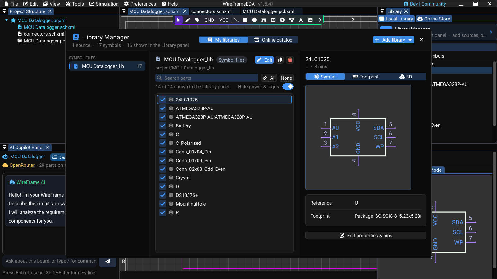
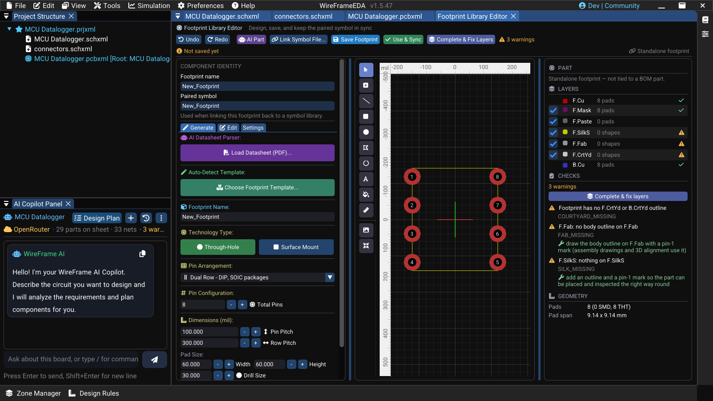

# Footprint Libraries

Footprints define the physical pads, drills, component outline, and optional 3D model used on the PCB. Select the exact manufacturer package and recommended land pattern, not only a similarly named footprint.

## Add a footprint source

1. Open **View → Local Library Manager**.
2. Select **Add library ▾ → Folder of KiCad libraries...** and choose the folder with `.kicad_mod` files or `.pretty` folders.
3. Select the source and confirm its footprints are listed.
4. Assign footprints to symbols (see [Symbol Libraries](symbols-library.md#assign-a-footprint)); the PCB receives them through **Update Schematic to PCB**.

Keep custom footprints and their 3D models in a controlled project or team location so another machine can resolve them.

### Image — Footprint source and active inventory

!!! note "Image capture brief"
    1. **Prepare:** Open a clean release-build workspace with fictional or public sample data and prepare the requested state.
    2. **Build the frame:** Capture Local Library Manager in v1.5.47 with a KiCad footprint source and several active inventory items visible. Hide private paths.
    3. **Clean the frame:** Close unrelated panels and tooltips, move the pointer away from key text, and hide credentials, usernames, customer data, and private paths.
    4. **Capture and finish:** Capture a native-resolution PNG, crop without cutting titles or primary actions, and add at most three subtle callouts without altering engineering content.
    5. **Approve:** Check the image at 100% zoom for current labels, readable evidence, correct release branding, and absence of sensitive information.

<!-- wf:shot id=footprint-source-and-active-inventory
caption: Local Library Manager with the project's KiCad library folders loaded
setup:
- open_project
- ensure_schematic
- wait: 1
- menu:
  - View
  - Local Library Manager
- wait: 2
- action:
    action: mouse_move_to
    x: 1000
    y: 12
brief_sha256: 18e2a7efa4ab9d2e
-->
<!-- wf:out id=footprint-source-and-active-inventory sha=5a290a10d330 -->

<!-- /wf:out -->

## Review a footprint

Compare the footprint with the exact datasheet land pattern:

- package name and body dimensions;
- pad count, numbering, shape, size, and pitch;
- plated or non-plated drill geometry;
- pin-1 or polarity marker;
- solder-mask and paste behavior;
- courtyard, silkscreen, and fabrication outlines;
- component origin and board-side orientation;
- symbol-pin to footprint-pad mapping.

Print or measure at 1:1 scale when dimensions are safety-critical. A 3D model is useful for review but does not prove that the pads are correct.

## The Footprint Library Editor

Open **Tools → PCB Footprint Editor** (or **Edit in the Footprint Editor** from the Library Manager). The **Footprint Library Editor** opens as a tab — *Design, save, and keep the paired symbol in sync*.

### Image — PCB Footprint Editor

!!! note "Image capture brief"
    1. **Prepare:** Compare the existing asset with the current release UI and list every changed label or control before recapturing.
    2. **Build the frame:** Capture the current editor with package controls, pad numbering, dimensions, and preview visible. Replace older “Footprint Wizard” media if its window title or controls differ from v1.5.47.
    3. **Clean the frame:** Close unrelated panels and tooltips, move the pointer away from key text, and hide credentials, usernames, customer data, and private paths.
    4. **Capture and finish:** Capture a native-resolution PNG, crop without cutting titles or primary actions, and add at most three subtle callouts without altering engineering content.
    5. **Approve:** Check the image at 100% zoom for current labels, readable evidence, correct release branding, and absence of sensitive information.

<!-- wf:shot id=pcb-footprint-editor
caption: Footprint Library Editor with an 8-pin dual-row package
setup:
- open_project
- wait: 1
- menu:
  - Tools
  - PCB Footprint Editor
- wait: 2
- action:
    action: mouse_move_to
    x: 1000
    y: 12
brief_sha256: a8d5ea63c48a9392
-->
<!-- wf:out id=pcb-footprint-editor sha=d804142997b5 -->

<!-- /wf:out -->

Before release, place the footprint on a test board and inspect pad geometry, courtyard, silkscreen, origin, and orientation.

### Layout of the editor

| Area | Contents |
|---|---|
| Top bar | **Undo**, **Redo**, **AI Part**, **Link Symbol File...**, **Save Footprint**, **Use & Sync**, and — when layers are missing — **Complete & Fix Layers**, with a status such as *Not saved yet* or *Geometry valid* |
| **Component identity** | **Footprint name** (required, e.g. `SOIC-8`) and **Paired symbol** (optional — used when linking back to a symbol library) |
| Left tabs | **Generate**, **Edit**, **Checks**, **Settings** |
| Canvas | Tool strip, pads and graphics, rulers, the unit button (mil / mm) |
| Right panel | **Part**, **Layers** (pads or shapes per layer, with a warning when a layer is empty), **Checks**, **Geometry** (pad count, pad span) |

### Generate a footprint from parameters

On the **Generate** tab:

1. Under **Auto-Detect Template**, choose **Choose Footprint Template...** for a standard package. Templates are grouped — through-hole packages and sockets, SOIC/SOP, QFP/QFN/BGA, transistors and diodes, passives, crystals, connectors, switches and relays, LEDs, battery and high-current, RF modules and debug, mechanical utilities, standard pin headers.
2. Or set the parameters yourself:
    - **Technology Type** — **Through-Hole** (DIP, SIP, headers) or **Surface Mount** (SOIC, QFP, 0805…);
    - **Pin Arrangement** — **Single Row**, **Dual Row**, **Grid / Matrix** (BGA, PGA), or **Quad (QFP)**;
    - **Pin Configuration** — **Total Pins**, or **Rows** and **Columns** for a grid;
    - **Dimensions** — pin pitch (100 mil = 2.54 mm is the standard header pitch), row pitch, **Pad Size**, drill diameter (typically 0.8–1.0 mm), silkscreen margin, and body corner radius.
3. The preview updates as you type. **Override with Parametric Generator** replaces a template with the parametric result.

### Generate a footprint from a datasheet

1. On the **Generate** tab, under **AI Datasheet Parser**, select **Load Datasheet (PDF)...**, then **Analyze For Footprint Pages**.
2. Optionally type **Target Part Number / Package** and select **AI: Auto-Generate Parameters**.
3. Read the **AI PACKAGE DECISION** — its assumptions and checks — or select **Open Manual Editor** to draw the pads yourself.
4. Select **Review AI result**. **AI Footprint Evidence Review** overlays the generated copper on the datasheet land pattern (**Opacity**, **Scale**, **Rotate**, **Reset alignment**; drag to align, wheel to scale) and lists where each value came from.
5. Tick the **REQUIRED HUMAN CHECKS** — **Pin 1 and orientation match**, **Shell tabs, holes and omitted balls match**, **Critical pitch and pad sizes match dimensions** — then **Approve & Apply** (or **Apply for manual editing**).

Until the AI result is approved, the top bar reads *Confirm AI review to Save/Sync*.

**AI Part** on the top bar builds the whole part — footprint with every layer completed — from the datasheet's mechanical drawing.

### Edit pads and graphics

On the **Edit** tab (**Manual Pad Editor**):

- **Add Pad** (at the origin), **Duplicate**, **Clear All**; the **Pad List** shows every pad;
- select a pad to edit its **Number**, size, position, **Rotation**, **Round/Oval Shape**, and drill; **Delete Selected Pad(s)**;
- graphics have a **Layer**, **Fill Style**, **Content** and **Angle** for text, and **Convert to Rectangle** for four-point polygons; **Delete Selected Graphic**;
- **Display Unit: mil / mm** switches the unit.

The canvas tool strip has **Select & Move**, **Place Pad**, **Draw Line**, **Draw Rectangle**, **Draw Circle**, **Draw Polygon**, **Draw Arc**, **Draw Text**, **Flood Fill (Boundary Fill)**, **Measure Distance**, **Import Image (Vectorize)**, and **Fit footprint to canvas**. Footprint geometry is stored in millimetres.

### Checks and completing layers

The **Checks** tab and the right panel list problems such as a missing courtyard (`COURTYARD_MISSING`), no fabrication body outline (`FAB_MISSING`), nothing on silkscreen (`SILK_MISSING`), SMD pads without mask or paste openings, paste on through-hole pads, or silkscreen too close to a pad. Most come with a hint.

**Complete & Fix Layers** adds what the fab needs besides copper — mask and paste openings, silkscreen, fabrication outline, courtyard — following IPC-7351B / IPC-7525, as one undo step.

### Save and link

| Button | What it does |
|---|---|
| **Save Footprint** | Saves or updates the `.kicad_mod` file and reloads it into the library; the editor stays open |
| **Link Symbol File...** | Writes this footprint name into an existing `.kicad_sym` file (save the footprint first) |
| **Use & Sync** | Saves, updates the paired symbol, and closes the editor |

The **Settings** tab shows where the footprint is saved; without a project library folder you are asked where to save.

Before release, place the footprint on a test board and inspect pad geometry, courtyard, silkscreen, origin, and orientation.

## Align a 3D model

1. In the Library Manager, select the part, open the **3D** tab, and choose **Edit 3D model & alignment**.
2. In **Model Alignment**, under **MODELS**, use **Import 3D File...** (or **Add**) to attach the STEP model; **Remove** detaches one.
3. Use **VIEW CONTROLS** — **Opacity**, **Top View (2D)**, **Iso View** — to compare the model with the pads, and **Auto Center Model** to centre it.
4. Adjust **TRANSFORM**: **Translation (mils)**, **Rotation (deg)** (with ±90° buttons per axis), and **Scale (1.0 = native size)**. **Reset All** starts again.
5. Select **Save to .kicad_mod** to store the alignment in the footprint.

Check that pin 1, the body position, and the board side match the 2D footprint.

### Short video — Align a footprint model

!!! note "Video production brief"
    1. **Prepare:** Load a public footprint and matching 3D model with a small intentional alignment offset.
    2. **Opening shot (2 s):** Show the offset model over the 2D pads in the alignment editor.
    3. **Action shot (7–10 s):** Correct the offset and rotation, then switch between top and underside views.
    4. **Result shot (3–4 s):** Hold on the aligned model with pin 1 and pad centers visibly consistent.
    5. **Deliver:** Export a **15–20 second** 1080p MP4 and hide every private model path.

## Import an Altium footprint library

In the Library Manager, select **Add library ▾ → Altium library (SchLib, PcbLib, IntLib)...** and choose a `.PcbLib`, `.IntLib`, or `.LibPkg` file. Review all converted pads and dimensions; update external 3D model paths when needed.

Eagle footprint import is not available.

## Related guidelines

- [Symbol Libraries](symbols-library.md)
- [Library Import and Management](library-converter.md)
- [Fix or Create a Component](../ai/component-generator.md)
- [Footprints and Placement](../pcb/footprints-and-placement.md)
- [3D Viewer](../advanced/3d-viewer.md)
