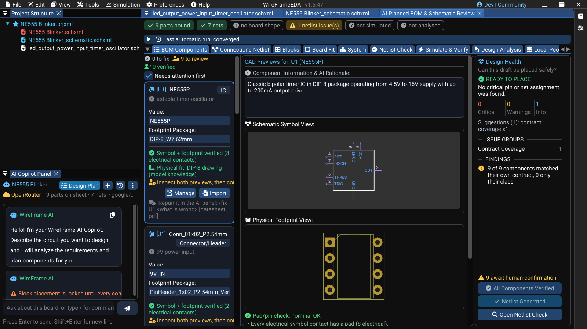

# How a Part Is Found

Every BOM row — one you add, or one the AI Copilot plans — has to land on **a symbol and a land pattern that are really that part**. This page explains where WireFrame looks, in what order, what each candidate must pass, and why the answer is fast and repeatable for you and for the Copilot alike.

The short version: **matching is code, not a model**. The Copilot may *propose* a part; whether it binds is decided by deterministic checks that give the same answer every time and name the rule when they say no.

## Where WireFrame looks

| | Source | What it is |
|---|---|---|
| **Pool** | **The project's own library** | `lib_<project>` beside the project file — the parts this board already uses |
| | **Parts a person confirmed** | Parts someone checked and confirmed on an earlier project, kept for the next one |
| | **Loaded libraries and library clones** | The libraries in the [Library Manager](library-converter.md), plus a targeted scan of the library clones on disk (KiCad's official libraries and others) |
| **Then** | **WireFrame's published library** | 63,000+ parts, each with a symbol, a footprint and usually a 3D model, checked before publishing |
| | **LCSC / EasyEDA** | By the row's exact part number only, with the land pattern the manufacturer specifies |
| | **A generated draft** | From the datasheet, a template or a description — a draft until you confirm it |

Everything in the **pool** is scored together against the row and must pass the same checks. The published library, LCSC and a generated draft are asked only when nothing in the pool passes — in that order: a real part beats a fabricated one, but a wrong real part is the worst outcome of all, because it looks right. That is why every candidate, wherever it comes from, passes the same checks.

### Your project's library stays yours

A project's own library is **data of that project**. It is loaded when the project opens, it is not added to the global library list, and the matcher refuses its files for another project. A part reaches another project only one way: after a person **confirms** it, a copy goes to the confirmed-parts store (source 2), which every project can use.

### Confirmed parts are reused — but judged again

A confirmed part is the most expensive thing the BOM flow produces: a search, a binding, sometimes a repair, and a person who looked at both previews and pressed **Confirm**. Keeping it means the next board that uses the same regulator does not pay for it again.

It is not a shortcut past the checks. A hit only puts the files in the pool; the new row still has to pass every check, because "this was right for a board last month" is evidence, not a verdict — the new row may ask for another package. Only what a **person** confirmed is kept: an automatic acceptance is the machine agreeing with itself, and is never carried forward.

### The pool is scanned, not loaded wholesale

KiCad's official symbol library alone has over 200 libraries. Loading all of them for every row would be slow, so WireFrame scans the clones on disk for the files whose names fit the row — its part number, its family, its package — and loads only those. A row that asks for a USB-C receptacle loads the connector files, not the whole collection.

### Family names are understood

KiCad names a symbol after a family — `SHT4x`, `LM78xx`, `STM32F103C8Tx` — while a BOM names one orderable part: `SHT40-AD1B-R2`, `LM7805CT`, `STM32F103C8T6`. The trailing `x` stands for the characters of the order code, so the family symbol is found for the part. An `x` elsewhere in a name is a letter (`MAX232`).

### LCSC: only the exact part

LCSC is asked for the row's part number, and **only an exact match is taken** (case and punctuation aside). `AMS1117-3.3S` is a different part from `AMS1117-3.3`, and is listed for you, not taken. Among exact matches the row's package decides; the rest are ranked JLC basic, then preferred, then in stock, and the card says which was taken and what else matched. The downloaded part is checked again — its own part number must be the one chosen and its contact count must be what the row expects — and the symbol and footprint are written together or not at all.

## What every candidate must pass

A candidate symbol is not accepted because its name looks right. It passes, in order:

| Check | What it asks |
|---|---|
| **Class** | Is it the same kind of part? A resistor row does not take a connector; a 7-segment display does not take an OLED symbol |
| **Contacts** | Does it have as many electrical pins as the row declares — and where did that number come from (the BOM, or the part's family)? |
| **Pins against pads** | Does every symbol pin have a pad with the same number on the land pattern, and no pad left over? |
| **Physical fit** | Do the pads fit the package the part really has, measured against its drawing? |
| **Copper** | Do pads of different signals short, or sit closer than 0.1 mm? |

When a check says no, the BOM card says **which rule decided and why** — the class it read the row as, the pin count and where that number came from — so you know whether to repair the part, the library or the BOM row.

### Shorts that matter

Two overlapping pads are an error only when the **symbol says they are different signals**. Manufacturers deliberately join ground to an exposed pad — KiCad ships 19 such footprints — while the same overlap between VIN and VOUT is a dead board. Without a symbol, an overlap is shown for you to look at, never reported as an error. This audit was calibrated on all 15,447 footprints of KiCad's library: apart from footprints with no pads at all (logos, heatsinks), none is flagged as an error.

<!-- wf:shot id=bom-card-verdicts
caption: A BOM card in the review — symbol and footprint verified with their contact count, the physical
  fit against the package drawing, and whether a person has confirmed it yet
project: samples/ne555-blinker/NE555 Blinker.prjxml
setup:
- open_project
- panel: ai
- wait: 1
- click: //AI Copilot Panel/{fa:tasks} Design Plan
- wait: 6
- action:
    action: mouse_move_to
    x: 1000
    y: 12
-->
<!-- wf:out id=bom-card-verdicts sha=b08cad2689c0 -->

<!-- /wf:out -->

## Datasheets: downloaded, never quoted from memory

Pin functions and electrical limits come from a datasheet WireFrame has **actually downloaded**:

1. A datasheet **you attach** is used first.
2. Then the datasheet link in the library index.
3. Then the web: the model may name a URL, but **WireFrame downloads it itself**, keeps a hash of the file and extracts its text.

A link that does not download produces **no claim at all** — an invented URL fails safely instead of becoming a confident wrong pinout.

What a part needs electrically — supply range, decoupling, pull-ups, strapping — is recorded once as the part's **contract** (`/contract U1`) and shared by every board that uses the part, so a later check holds each new design to it.

## How the Copilot uses the library

The Copilot does not answer from memory about parts. It is given tools that read this machine's library, and is told to use them:

| Tool | What it returns |
|---|---|
| `search_library` | What can be **placed** today — a stock list, searched by function ("buck converter") or by class ("ic.power") |
| `check_pool` | Whether a part is in the pool this project can bind from |
| `inspect_library_symbol` | A library symbol's pins and properties, before it is proposed |
| `lookup_datasheet` | A part's datasheet URL and package facts, to cite — not text to repeat |
| `get_contract` | What a part requires electrically; when no contract covers it, the requirement is stated as **unknown** |
| `get_draft` | The design the user is looking at, rather than the model's memory of the conversation |

Before it names a part in a BOM, the Copilot confirms the part exists here; a part the library does not have cannot be placed, however good the choice. An empty search limits what it may **place**, never what it may **recommend**: it says what is missing and offers you the options.

## Why it is fast

- **No model in the matching.** Binding, the checks and the reasons are code: milliseconds per row, and the same answer on every run.
- **Only candidate files are loaded** from the library clones, not every library.
- **Confirmed parts and contracts are reused** across projects, so a part you checked once is not searched, bound and judged from scratch again.
- **Downloads are cached on disk** — LCSC searches and datasheets — so a second run does not wait on the network.
- **Commands that need no model** (`/findings`, `/bom`, `/missing`, `/review` in the Library Workspace) read this same data and answer instantly.

## See also

- [Library Import and Management](library-converter.md)
- [Library Workspace](library-workspace.md)
- [Fix or Create a Component](../ai/component-generator.md)
- [Datasheets, Repairs and Project Memory](../ai/datasheets-and-memory.md)
- [Copilot Commands](../ai/commands.md)
