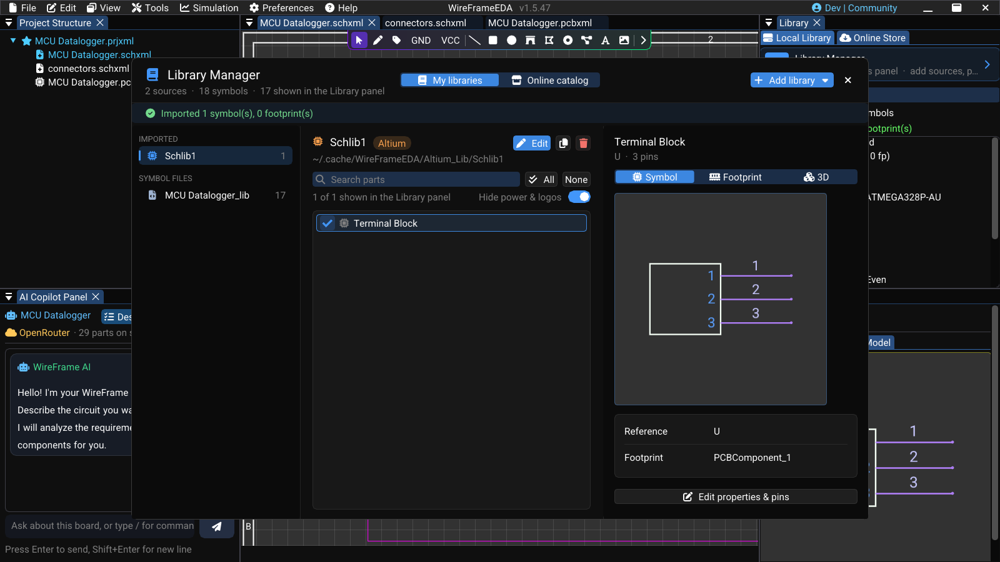

# Library Import and Management

Use the **Library Manager** to add KiCad libraries, import Altium libraries, choose which parts the Library panel shows, inspect and correct parts, and install parts from WireFrame's online catalog.

## Open the Library Manager

Select **View → Local Library Manager**, or **Manage libraries...** at the top of the Library panel. The header shows how many sources and symbols are loaded and how many are shown in the Library panel.

The window has two modes:

- **My libraries** — the sources you added, their parts, and a preview;
- **Online catalog** — WireFrame's component store, browsed by category.

**Close (Esc)** closes the window. Library sources can also be managed from **Preferences → Libraries**.

### Image — Local Library Manager overview

!!! note "Image capture brief"
    1. **Prepare:** Open a clean release-build workspace with fictional or public sample data and prepare the requested state.
    2. **Build the frame:** Capture the complete **Local Library Manager** window. Include both column headers, the three source cards, and part of the active inventory. Use a clean project and hide personal filesystem paths. Suggested size: **1400 × 900 px**.
    3. **Clean the frame:** Close unrelated panels and tooltips, move the pointer away from key text, and hide credentials, usernames, customer data, and private paths.
    4. **Capture and finish:** Capture a native-resolution PNG, crop without cutting titles or primary actions, and add at most three subtle callouts without altering engineering content.
    5. **Approve:** Check the image at 100% zoom for current labels, readable evidence, correct release branding, and absence of sensitive information.

<!-- wf:shot id=local-library-manager-overview
caption: Local Library Manager — import options and the loaded inventory
setup:
- open_project
- ensure_schematic
- wait: 1
- menu:
  - View
  - Local Library Manager
- wait: 2
- action:
    action: mouse_move_to
    x: 1000
    y: 12
brief_sha256: 5922ed51f81e3066
-->
<!-- wf:out id=local-library-manager-overview sha=5a290a10d330 -->

<!-- /wf:out -->

## Add a library

Select **Add library ▾** (in **My libraries**) and choose:

| Menu item | Adds |
|---|---|
| **Folder of KiCad libraries...** | A directory with `.kicad_sym`, `.kicad_mod`, or `.pretty` content. It appears under **Folders** |
| **KiCad symbol file (.kicad_sym)...** | One or more symbol files. They appear under **Symbol files** |
| **Altium library (SchLib, PcbLib, IntLib)...** | An Altium `.SchLib`, `.PcbLib`, `.IntLib`, or `.LibPkg`, converted in place. It appears under **Imported** |

Keep a folder at the same path after adding it. For a single footprint file, use **Load Footprints...** in the PCB Footprints panel, or add its folder.

## Import an Altium library

1. Select **Add library ▾ → Altium library (SchLib, PcbLib, IntLib)...** and choose the file (`.SchLib`, `.PcbLib`, `.IntLib`, or `.LibPkg`).
2. Wait while the window shows *Converting the Altium library...*.
3. Find the result under **Imported** in the source list.
4. Inspect representative symbols, footprints, pad numbering, and 3D model references.

### Short video — Import an Altium library

!!! note "Video production brief"
    1. **Prepare:** Place a public `.IntLib` or supported paired library in a neutral demo folder.
    2. **Opening shot (1–2 s):** Start on **View → Local Library Manager** with **Altium Library Importer** visible.
    3. **Action shot (6–9 s):** Select **Select Altium File**, choose the source, show the genuine **Converting Altium** state, and cut only the inactive wait.
    4. **Result shot (3–4 s):** Expand the new entry under **Imported / Converted Libraries** and hold on its symbol/footprint counts.
    5. **Deliver:** Export a **12–18 second** 1080p MP4 with all private paths hidden.

<!-- wf:video id=import-an-altium-library
caption: Library Manager → Add library → Altium library; it lands under Imported
setup:
- open_project
- ensure_schematic
- wait: 1
- menu:
  - View
  - Local Library Manager
- wait: 2
- action:
    action: mouse_move_to
    x: 1000
    y: 12
steps:
- wait: 1
- click: //Library Manager/{fa:plus}  Add library  {fa:caret-down}
- wait: 1.2
- open_file: wireframe:tests/data/altium_libraries/Schlib1.SchLib
- click_at:
  - 1412
  - 194
- wait: 3
- click_at:
  - 288
  - 249
- action:
    action: mouse_move_to
    x: 1000
    y: 12
- wait: 2.5
brief_sha256: 28d9019b49f0e3cb
-->
<!-- wf:out id=import-an-altium-library sha=63bd71b59854 -->
<video controls muted playsinline preload="metadata" src="../../assets/wf/docs/libraries/library-converter/import-an-altium-library.mp4" title="Library Manager → Add library → Altium library; it lands under Imported"></video>
<!-- /wf:out -->

!!! warning "Review converted content"
    Library conversion is not manufacturing approval. Check the exact part variant, pin mapping, pad dimensions, footprint orientation, and model paths before using an imported component.

!!! warning "Review converted content"
    Library conversion is not manufacturing approval. Check the exact part variant, pin mapping, pad dimensions, footprint orientation, and model paths before using an imported component.

## Choose what the Library panel shows

Select a source on the left to list its parts.

- **Search parts** filters the list; ++arrow-up++ / ++arrow-down++ move through it while you type.
- The tick beside a part shows or hides it in the Library panel. **All** and **None** show or hide every listed part; **Hide power & logos** hides power symbols and logos. Select several parts (++shift++ / ++ctrl++ click) and press ++space++ to show or hide them together.
- The line under the search reads *n of m shown in the Library panel*.

Hiding a part does not delete it — it only keeps the Library panel short.

## Inspect or remove a source

Hover a source for its full path. The buttons beside the source name **Copy path** and **Remove from library**; the same actions are in its right-click menu. Removing asks for confirmation — *Remove "…" from the library? Its files stay on disk.*

Removing a source does not repair placed components whose definitions can no longer be resolved. Archive required project libraries with the project before moving it to another machine.

## Review and edit a part

Select a part to preview it on the right, with **Symbol**, **Footprint**, and **3D** tabs and its **Reference** and **Footprint** below.

| Tab | Review | Actions |
|---|---|---|
| **Symbol** | Shape, pin numbers and names, reference prefix, default footprint | **Edit properties & pins** opens **Edit symbol**: **Name**, **Reference prefix**, **Default footprint**, and the **Pins** table (**Name**, **Type**) with **Add pin**; **Edit geometry in the Symbol Editor**; **Save**, **Save as...**, or **Cancel** |
| **Footprint** | Pad numbers, pad geometry, body outline | **Edit in the Footprint Editor**; **Link a footprint file...** links another footprint — saved into the symbol file and applied to this part on the open schematic |
| **3D** | Package model, orientation, offset, scale | **Edit 3D model & alignment** |

**Cancel** discards pending edits. Saving a renamed symbol or linking a footprint changes how the part is resolved later, so confirm the symbol-to-footprint mapping before closing the manager.

### Image — Inventory selection and CAD preview tabs

!!! note "Image capture brief"
    1. **Prepare:** Open a clean release-build workspace with fictional or public sample data and prepare the requested state.
    2. **Build the frame:** Capture one imported library selected under **Imported / Converted Libraries**, several components in the selection list, and the **Symbol**, **Footprint**, and **3D Model** tabs in the preview area. Show **Select All**, **Deselect All**, and one edit action without exposing a personal path. Suggested size: **1500 × 950 px**.
    3. **Clean the frame:** Close unrelated panels and tooltips, move the pointer away from key text, and hide credentials, usernames, customer data, and private paths.
    4. **Capture and finish:** Capture a native-resolution PNG, crop without cutting titles or primary actions, and add at most three subtle callouts without altering engineering content.
    5. **Approve:** Check the image at 100% zoom for current labels, readable evidence, correct release branding, and absence of sensitive information.

<!-- wf:shot id=inventory-selection-and-cad-preview-tabs
caption: An imported Altium library selected, with its parts and the Symbol / Footprint / 3D preview
setup:
- open_project
- ensure_schematic
- wait: 1
- menu:
  - View
  - Local Library Manager
- wait: 2
- click: //Library Manager/{fa:plus}  Add library  {fa:caret-down}
- wait: 1
- open_file: wireframe:tests/data/altium_libraries/Schlib1.SchLib
- click_at:
  - 1412
  - 194
- wait: 3
- click_at:
  - 288
  - 249
- wait: 2
- action:
    action: mouse_move_to
    x: 1000
    y: 12
brief_sha256: 2609136198f1a6e8
-->
<!-- wf:out id=inventory-selection-and-cad-preview-tabs sha=296f5b17cc34 -->

<!-- /wf:out -->

### Short video — Inspect and correct an imported component

!!! note "Video production brief"
    1. **Prepare:** Import a public sample containing a symbol, linked footprint, and 3D model.
    2. **Opening shot (2 s):** Show the collapsed converted-library entry and empty or previous preview.
    3. **Action shot (8–11 s):** Expand the entry, select a component, pause on **Symbol**, **Footprint**, and **3D Model** in order, then open **Edit Symbol Properties & Pins**.
    4. **Result shot (3–4 s):** Select **Cancel** and hold on the unchanged preview to demonstrate that no edit was saved.
    5. **Deliver:** Export a **15–20 second** 1080p MP4 using a visible pointer and no private path.

<!-- wf:video id=inspect-and-correct-an-imported-component
caption: Select the imported part, step through Symbol, Footprint and 3D, open Edit properties & pins
setup:
- open_project
- ensure_schematic
- wait: 1
- menu:
  - View
  - Local Library Manager
- wait: 2
- click: //Library Manager/{fa:plus}  Add library  {fa:caret-down}
- wait: 1.2
- open_file: wireframe:tests/data/altium_libraries/Schlib1.SchLib
- click_at:
  - 1412
  - 194
- wait: 3
- action:
    action: mouse_move_to
    x: 1000
    y: 12
steps:
- wait: 1
- click_at:
  - 288
  - 249
- wait: 1.5
- click_at:
  - 1176
  - 283
- wait: 1.5
- click_at:
  - 1305
  - 283
- wait: 1.5
- click_at:
  - 1045
  - 283
- wait: 1.5
- click: //Library Manager/{fa:edit}  Edit properties & pins
- wait: 2.5
brief_sha256: 89b281d9b40e8642
-->
<!-- wf:out id=inspect-and-correct-an-imported-component sha=882cf6edf606 -->
<video controls muted playsinline preload="metadata" src="../../assets/wf/docs/libraries/library-converter/inspect-and-correct-an-imported-component.mp4" title="Select the imported part, step through Symbol, Footprint and 3D, open Edit properties &amp; pins"></video>
<!-- /wf:out -->

## Install parts from the online catalog

Switch to **Online catalog**:

1. Pick **All parts** or a category on the left.
2. Search with **Search name, value, description**; **Installed** and **3D** narrow the list to installed parts or parts that ship a 3D model.
3. Select parts (++shift++ / ++ctrl++ click) and choose **Install selected (n)**, or **Install all (n)** for every part listed that is not installed yet (after a confirmation).

Each installed part is downloaded with its symbol, footprint, and 3D model and added to **My libraries → Imported**. The **Online Store** tab of the Library panel offers the same catalog next to the schematic, with **Install** and **Drag to schematic** on each part.

## Component Library panel

The docked **Library** panel is separate from the Library Manager. In its **Local Library** tab:

- **Filter...** searches the shown parts; **Hide Power/Logo** hides power symbols and logos;
- drag a symbol onto the schematic canvas to place it;
- right-click a converted library for **Remove Library**, a folder for **Remove Folder**, or a symbol for **Remove Symbol**;
- select several symbols with ++ctrl++ or ++shift++, then use **Remove Selected** (or **Clear** to drop the selection).

## What is not supported

WireFrame does not import an entire Altium project or Eagle `.lbr`, `.sch`, or `.brd` files. KiCad *projects* are imported with **File → Import → KiCad Project** — see [Projects and Files](../projects.md).

## After any import

- confirm symbols appear in a schematic;
- confirm footprints appear in a PCB;
- link the intended footprint to each symbol;
- check pin and pad counts;
- inspect 3D model paths;
- run ERC, DRC, and DFM on a test project before production use.

## See also

- [Symbol Libraries](symbols-library.md)
- [Footprint Libraries](footprints-library.md)
- [Fix or Create a Component](../ai/component-generator.md)
- [Projects and Files](../projects.md)
