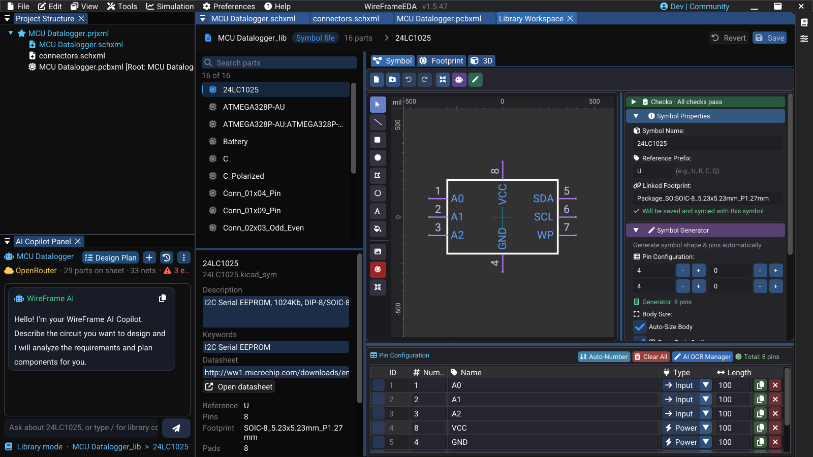

# Library Workspace

The **Library Workspace** is where a library is edited. The [Library Manager](library-converter.md) only previews; editing one library — its parts, their symbols, land patterns and 3D models — happens in this centre tab, with the Project and AI Copilot panels beside it.

## Open it

1. Open **View → Local Library Manager**.
2. Select a library in the source list.
3. Select **✎ Edit**, or double-click a part to open the workspace focused on it.

The Library Manager closes and the workspace opens as a tab next to your sheets and boards.

<!-- wf:shot id=library-workspace-overview
caption: The Library Workspace — the library's parts, the open part's details, and its symbol in the embedded
  editor
project: board:klp4e-datalogger
setup:
- open_project
- ensure_schematic
- wait: 1
- menu:
  - View
  - Local Library Manager
- wait: 2
- click: //Library Manager/{fa:pen}  Edit
- wait: 3
- action:
    action: mouse_move_to
    x: 1000
    y: 12
-->
<!-- wf:out id=library-workspace-overview sha=f920f52d0439 -->

<!-- /wf:out -->

## What is on screen

| Area | What it holds |
|---|---|
| **Parts** | Every part of the library, with search and multi-select. A selection is what the Copilot's `selected` means |
| **The part** | Name, reference prefix, description, datasheet, footprint, 3D model, and the result of the part's checks |
| **Symbol / Footprint / 3D** | The symbol and footprint editors, embedded, and the 3D model on the land pattern |

## Saving

- A **KiCad folder or `.kicad_sym` file** is written in place, in KiCad's format, so KiCad can still open it.
- An **imported library** (Altium, the online catalog) is a converted copy that cannot be written back to its original format. **Save** asks where the part goes — by default a KiCad library of yours — and the imported copy stays untouched.
- What is written keeps everything the editors do not show: hidden pins, units and every property of the part are merged back, not dropped.

## Working with the Copilot

While the workspace is in front, the AI Copilot works on **library parts** and `/` offers the library commands. Each runs on the open part, on the parts selected in the list (`selected`), or on the whole library (`all`), and writes into the embedded editors while it works — a **LIVE** band says what it is doing ("Placing pin 7 of 16…").

| Command | Use it to |
|---|---|
| `/review` | Audit everything that needs no model: pins on pads, shorts, layers, 3D model, description, datasheet |
| `/check-physics` | Check the land pattern as copper: pin to pad by number, pads that short, measured pad geometry |
| `/check-template` | Compare the land pattern with the standard drawing of the package it names |
| `/describe` | Write descriptions and search keywords (a batch only fills empty ones) |
| `/deepsearch` | Find datasheets — WireFrame downloads each link and writes only those that downloaded |
| `/deepthink` | Read a datasheet pin by pin, citing a page for each, and compare it with the symbol |
| `/contract` | Record what the part needs electrically, for every board that uses it |
| `/edit`, `/symbol`, `/footprint` | Change the open part from a sentence, live in the editors |
| `/stop` | Stop a running batch; what is done stays done |

A batch over `all` is the quickest way to bring an inherited library up to standard: `/review all` first (free), then `/describe all` and `/deepsearch all` for the parts that need them.

<!-- wf:video id=library-review-of-one-part
caption: /review on one part of the KLP4e library — the checks that need no model
project: board:klp4e-datalogger
setup:
- open_project
- ensure_schematic
- wait: 1
- menu:
  - View
  - Local Library Manager
- wait: 2
- click: //Library Manager/{fa:pen}  Edit
- wait: 3
- panel: ai
- wait: 1
steps:
- wait: 1
- type:
    ref: //AI Copilot Panel/##ChatInput
    text: /review
- keys:
  - Enter
- wait: 10
- action:
    action: mouse_move_to
    x: 190
    y: 700
- scroll: -20
- wait: 3
-->
<!-- wf:out id=library-review-of-one-part sha=7284533213a5 -->
<video controls muted playsinline preload="metadata" src="../../assets/wf/docs/libraries/library-workspace/library-review-of-one-part.mp4" title="/review on one part of the KLP4e library — the checks that need no model"></video>
<!-- /wf:out -->

## See also

- [Library Import and Management](library-converter.md)
- [How a part is found](how-parts-are-found.md)
- [Copilot Commands](../ai/commands.md)
- [Symbol Library Editor](symbol-creator.md)
- [Footprint Libraries](footprints-library.md)
