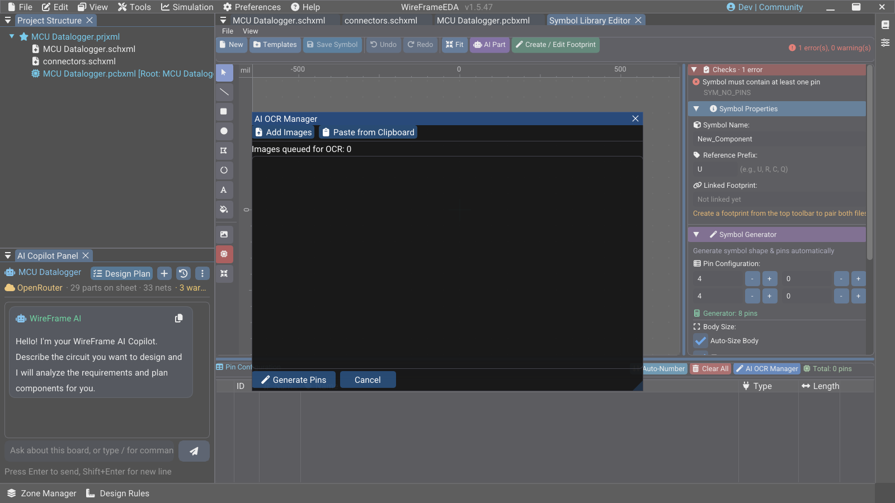
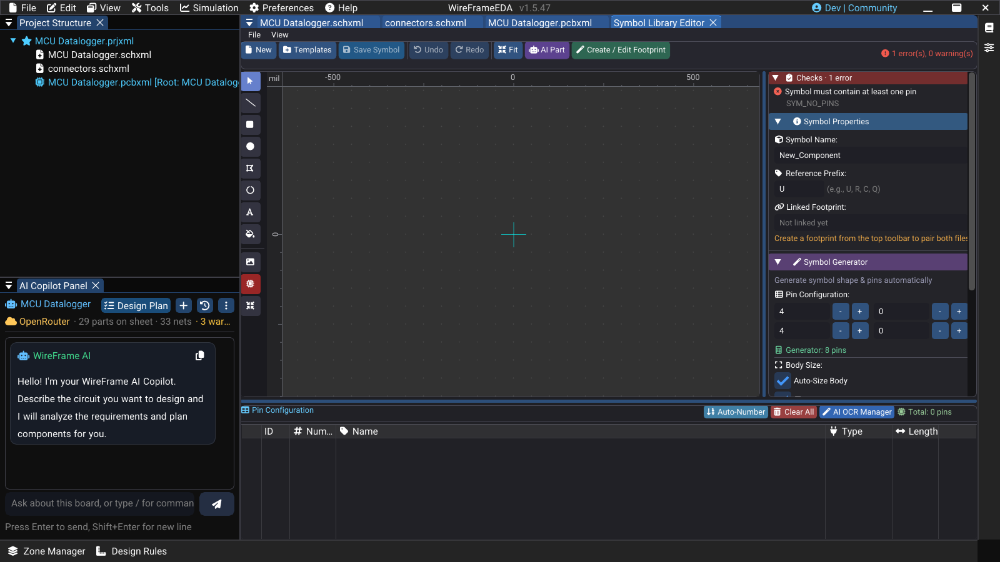

# Symbol Library Editor

Use the Symbol Library Editor to create or correct schematic symbols that are not available from an approved library or an AI repair (`/fix`). A symbol is acceptable only when its logical pins match the physical component and its footprint mapping.

## Open the editor

Choose **Tools → Symbol Library Editor** (or **Edit geometry in the Symbol Editor** from the Library Manager). When editing an existing library item, start from the selected symbol and save to the intended local library rather than overwriting an unrelated source.

The editor has a top bar — **New** (++ctrl+n++ inside the editor), **Templates** (1-click load of a component template), **Save Symbol**, **Undo**, **Redo**, **AI Part** — two tabs on the left, and the canvas on the right:

| Tab | Contents |
|---|---|
| **Properties & Generate** | **Symbol Properties** — **Symbol Name**, **Reference Prefix**, **Linked Footprint**. **Symbol Generator** — pins per side (**Left**, **Right**, **Top**, **Bottom**), **Auto-Size Body** or **Width / Height (mil)**, **Draw Body Outline**, pin **Spacing** and **Length (mil)**, then **Generate Symbol**. Below them, the properties of the selected pin or graphic |
| **Pins** | The pin table — **Number**, **Name**, **Type**, **Length** — with **Auto-Number**, **Clear All**, **AI OCR Manager**, and per-row duplicate and delete |

Pin types are **Input**, **Output**, **Bidirectional**, **Power In**, **Power Out**, **Passive**, **Tri-State**, and **Unspecified**; ERC uses them.

The canvas tool strip has **Select Tool**, **Draw Line**, **Draw Rectangle**, **Draw Circle**, **Draw Polygon**, **Draw Arc**, **Draw Text**, **Flood Fill (Boundary Fill)**, **Import Image (Vectorize)**, **Place Pin**, **Fit symbol to canvas**, and the mm / mil unit button. Right-click the canvas for **Delete Selected** (++delete++) and **Clear Selection** (++esc++).

## Information to prepare

Before drawing, obtain the manufacturer datasheet and record:

- Exact part number and package variant.
- Pin numbers, names, and electrical roles.
- Hidden, power, no-connect, and duplicated unit pins.
- Default reference prefix and displayed value.
- Intended footprint and its pad numbering.

## Create the symbol

1. Set a unique **Symbol Name** and **Reference Prefix** (`U`, `R`, `J`…).
2. Use **Symbol Generator** for a rectangular body with pins on its sides, or draw a simple body that remains readable at normal schematic zoom.
3. On **Pins**, give every physical pin its datasheet number and signal name (**Auto-Number** fills 1, 2, 3…).
4. Assign the correct **Type** to support meaningful ERC results.
5. Arrange inputs, outputs, power, and control pins consistently.
6. Link the footprint under **Linked Footprint**, then **Save Symbol** into the intended local library.

Do not encode package geometry into the schematic symbol. Physical dimensions, pad shape, and courtyard belong to the footprint.

## Generate pins from images with AI OCR

Use **AI OCR Manager** when the datasheet exposes a clear pin table as an image and manual entry would be error-prone.

1. On the **Pins** tab, select **AI OCR Manager**.
2. Select **Add Images** to choose one or more PNG or JPEG pin-table captures, or **Paste from Clipboard** when the image is already copied.
3. Inspect every thumbnail and use **Remove** on package drawings, timing charts, or unrelated tables.
4. Select **Generate Pins**.
5. Compare the generated number, name, and electrical type for every pin with the exact datasheet before saving.

**Generate Pins** requires at least one image. **Cancel** closes the modal without running generation. OCR can confuse characters such as `0`/`O`, `1`/`I`, overbars, slashes, and active-low markers, so it must never be treated as an approved pin table by itself.

### Image — AI OCR Manager with a clean pin table

!!! note "Image capture brief"
    1. **Prepare:** Open a clean release-build workspace with fictional or public sample data and prepare the requested state.
    2. **Build the frame:** Capture **AI OCR Manager** with two public datasheet pin-table images loaded. Show **Add Images**, **Paste from Clipboard**, one **Remove** action, **Generate Pins**, and **Cancel**. Crop or blur local paths while keeping the thumbnails readable. Suggested size: **1200 × 780 px**.
    3. **Clean the frame:** Close unrelated panels and tooltips, move the pointer away from key text, and hide credentials, usernames, customer data, and private paths.
    4. **Capture and finish:** Capture a native-resolution PNG, crop without cutting titles or primary actions, and add at most three subtle callouts without altering engineering content.
    5. **Approve:** Check the image at 100% zoom for current labels, readable evidence, correct release branding, and absence of sensitive information.

<!-- wf:shot id=ai-ocr-manager-with-a-clean-pin-table
caption: AI OCR Manager, opened from the Symbol Library Editor, before any image is added
setup:
- open_project
- wait: 1
- menu:
  - Tools
  - Symbol Library Editor
- wait: 2
- click: '**/{fa:magic} AI OCR Manager'
- wait: 1
- action:
    action: mouse_move_to
    x: 1000
    y: 12
brief_sha256: 780063412c1039f2
-->
<!-- wf:out id=ai-ocr-manager-with-a-clean-pin-table sha=7530eaf34d72 -->

<!-- /wf:out -->

### Short video — OCR pins and verify one correction

!!! note "Video production brief"
    1. **Prepare:** Have one clear public pin-table image and one irrelevant public datasheet image ready in a neutral folder.
    2. **Opening shot (1–2 s):** Hold on the empty **AI OCR Manager**.
    3. **Action shot (6–9 s):** Add both images, remove the irrelevant one, select **Generate Pins**, and cut across processing after showing one real status.
    4. **Result shot (3–5 s):** In Symbol Library Editor, highlight and correct one OCR mismatch against the visible public reference.
    5. **Deliver:** Export a **12–18 second** 1080p MP4; do not imply that unreviewed OCR output is approved.

### Image — Symbol Library Editor

!!! note "Image capture brief"
    1. **Prepare:** Open a clean release-build workspace with fictional or public sample data and prepare the requested state.
    2. **Build the frame:** Capture the v1.5.47 Symbol Library Editor with an eight-pin example selected. Show the body, pin numbers/names, and the properties used for one pin.
    3. **Clean the frame:** Close unrelated panels and tooltips, move the pointer away from key text, and hide credentials, usernames, customer data, and private paths.
    4. **Capture and finish:** Capture a native-resolution PNG, crop without cutting titles or primary actions, and add at most three subtle callouts without altering engineering content.
    5. **Approve:** Check the image at 100% zoom for current labels, readable evidence, correct release branding, and absence of sensitive information.

<!-- wf:shot id=symbol-library-editor
caption: Symbol Library Editor
setup:
- open_project
- wait: 1
- menu:
  - Tools
  - Symbol Library Editor
- wait: 2
- action:
    action: mouse_move_to
    x: 1000
    y: 12
brief_sha256: 6b9b2ec42fafd6b5
-->
<!-- wf:out id=symbol-library-editor sha=dbddcd7fe441 -->

<!-- /wf:out -->

## Validate before use

Compare the saved symbol with the datasheet line by line:

- Every physical pin is represented exactly once unless the device specification requires otherwise.
- Pin numbers and names match the selected package variant.
- Power and ground pins are not hidden accidentally.
- Input/output/passive types support correct ERC behavior.
- Symbol pins map one-to-one to footprint pads.
- The symbol remains readable when placed and wired on a normal sheet.

Place the symbol in a temporary schematic, connect representative nets, and run ERC. Correct the library source rather than patching each placed instance.

### Short video — Create and validate a symbol

!!! note "Video production brief"
    1. **Prepare:** Open a public demo symbol with one known pin issue and a writable test library.
    2. **Opening shot (2–3 s):** Show the incorrect pin and the corresponding public datasheet row.
    3. **Action shot (12–17 s):** Add or correct the pin, save to the local library, then place the updated symbol in a test schematic.
    4. **Verification shot (7–10 s):** Connect the representative nets, run ERC, and hold on the resulting clean or expected summary.
    5. **Deliver:** Export a **25–35 second** 1080p MP4 with the corrected number and name readable.

## When to use AI generation

With the exact datasheet attached, `/fix <refdes> …` in the AI Copilot panel can prepare both symbol and footprint. It does not remove the same pin, pad, dimension, and mapping review. See [Fix or Create a Component](../ai/component-generator.md).

## Related guidelines

- [Symbol Libraries](symbols-library.md)
- [Footprint Libraries](footprints-library.md)
- [Library Import and Management](library-converter.md)
- [ERC](../schematic/erc.md)
