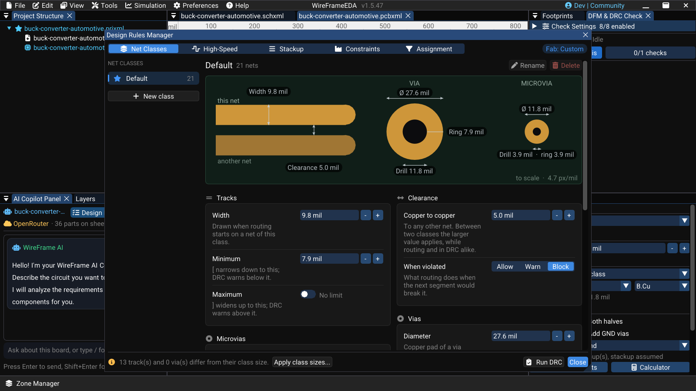

# Design Rules and Net Classes

Design rules express the manufacturing limits and the routing constraints of the active board. Set them before routing; routing, DFM/DRC, and the AI layout all read the same rules.

## Open the Design Rules Manager

With a PCB active, select **View → Design Rules**. The **Design Rules Manager** window has five pages — **Net Classes**, **High-Speed**, **Stackup**, **Constraints**, and **Assignment** — and a **Fab: …** chip that shows which manufacturing preset is in use (hover it for the numbers).

### Image — Design Rules Manager

!!! note "Image capture brief"
    1. **Prepare:** Open a clean release-build workspace with fictional or public sample data and prepare the requested state.
    2. **Build the frame:** Capture the v1.5.47 manager with global limits and at least two net classes visible. Use clearly fictional example values and show the active unit.
    3. **Clean the frame:** Close unrelated panels and tooltips, move the pointer away from key text, and hide credentials, usernames, customer data, and private paths.
    4. **Capture and finish:** Capture a native-resolution PNG, crop without cutting titles or primary actions, and add at most three subtle callouts without altering engineering content.
    5. **Approve:** Check the image at 100% zoom for current labels, readable evidence, correct release branding, and absence of sensitive information.

<!-- wf:shot id=design-rules-manager
caption: 'The Design Rules Manager on the imported buck converter: its one class, Default, drawn to scale
  — 9.8 mil track, 5 mil clearance, 27.6 mil via'
setup:
- open_project
- ensure_pcb
- wait: 1
- menu:
  - View
  - Design Rules
- wait: 1
- action:
    action: mouse_move_to
    x: 1000
    y: 12
brief_sha256: f62c8f826a83ff3a
-->
<!-- wf:out id=design-rules-manager sha=38c567bd8798 -->

<!-- /wf:out -->

At the bottom of the window:

- *Routed copper matches its net classes.* — or *n track(s) and n via(s) differ from their class size.* with **Apply class sizes...**, which resizes routed tracks and vias to their class values after a confirmation (one undo step puts everything back). Widths chosen on purpose — a track necked down to a fine-pitch pin, a wider power run — change too, so review the list first.
- **Run DRC** opens the DFM & DRC check; **Close** closes the window.

## Constraints — what the board house can make

Every net class must sit on or above these limits, and DRC reports anything below them as an error.

1. Under **Start from**, pick a preset or **Custom**:

    | Preset | For | Track / clearance | Via diameter / drill |
    |---|---|---|---|
    | **Relaxed** | Home etching, CNC milling, or the safest order | 10 / 10 mil | 47 / 23.6 mil |
    | **Standard** | Typical pooled 2–6 layer prototype service | 5 / 5 mil | 18 / 10 mil |
    | **Fine pitch** | 0.4 mm BGA / QFN fan-out | 3.5 / 3.5 mil | 15.7 / 7.9 mil |
    | **HDI** | Laser microvias, stacked or staggered | 3 / 3 mil | 15.7 / 7.9 mil |

2. Adjust the cards to your manufacturer's published capability:
    - **Copper** — **Minimum track**, **Minimum clearance** (also the floor routing and DRC use between any two nets), **Copper to board edge**;
    - **Drilling** — **Via diameter / drill**, **Microvia diameter / drill**, **Annular ring** (vias and through-hole pads), **Hole to hole**, **Mounting hole** (the diameter **Place Mounting Hole** uses).
3. If a card **Net classes below these limits** appears, fix the classes or select **Raise them to the minimum**.

Do not copy "typical" internet values into a production board. Use the current fabricator's capability and keep a margin.

## Net Classes

The left column lists the classes; **Default** (star) is what every net falls back to and cannot be renamed or deleted. A new board has **Default** and **Power**; a board imported from KiCad has the classes its project defined — the buck converter in the pictures has only **Default**. Hover a class to see how many nets use it.

- **New class** creates a copy of the selected class; **Rename** and **Delete** act on the selected one. Nets, rules, and tracks follow a new name.
- Each class has these cards:

| Card | Fields |
|---|---|
| **Tracks** | **Width** (drawn when routing starts on a net of the class), **Minimum** (++bracket-left++ narrows to it), **Maximum** (++bracket-right++ widens to it) |
| **Clearance** | **Copper to copper** (between two classes the larger value applies), **When violated** — **Allow**, **Warn**, or **Block** (default); see [Routing](routing.md#clearance-while-routing) |
| **Vias** | **Diameter**, **Drill**, **Annular ring** (worked out for you), **Type** used when the routing via mode is *Net class* |
| **Microvias** | **Diameter** and **Drill** of laser-drilled microvias |
| **Impedance** | **Single-ended Z0** and **Differential Zdiff** targets, **Pair gap**; **Use that width** / **Use that gap** fill in the values that hit the target on the current stackup. DRC rule W13 compares the routed width |
| **Routing & length** | **Preferred layer** (routing from a through-hole pad starts on it), **Target length** and **Tolerance** (DRC warns outside them), **Max skew** within a differential pair |

A value below the board's constraint is flagged under the field.

## Assignment — which net gets which class

**Rules by net name** are checked top to bottom and the first match wins. Each rule is a pattern (**starts with**, **contains**, or **is exactly**) and a class; use the arrow to check a rule earlier, and **Add** to create one (e.g. `GND`, `USB_`, `+`). A new board starts with *contains GND → Power*, *contains VCC → Power*, and *starts with + → Power*; an imported board starts with no rules. Type a name under **Try a net name** to see which class it would get.

**Every net** lists each net with its **Class** and **Because** (the rule that matched). Choosing a class here is a manual assignment, marked **Manual**, and overrides every rule; **Reset** returns the net to the rules. Use **Filter nets** to find one.

## High-Speed and Stackup

- **High-Speed** — **Detected from net names** suggests differential pairs and groups from names such as `USB_D+/D-`, `ETH_TX_P/N`, `DDR_DQ0`, `QSPI_IO0`, `*_CLK`, `RF_ANT`, with a target and confidence; accept the ones you want. **Differential pairs** (**Add pair**) and **Length-matched groups** (**Add group**) can also be declared by hand. Routing and length tuning use them — see [Routing](routing.md#length-tuning-and-differential-pairs).
- **Stackup** — **Board build**: **Confirmed** (until you confirm your board house's stackup, every impedance number is marked *assumed*), **Copper layers**, **εr (dielectric)**, **Outer layer to plane**, **Plane to plane**, **Copper outer / inner**, **Board thickness**. **Your net classes on this stackup** shows the impedance each class gets, and the **Impedance calculator** (**Single-ended**, **Differential**, **Coplanar**) solves width or gap for a target and can **Apply** the result to a class.

## Verify the effect

While routing, the readout near the cursor shows the class, width, clearance, and violation handling of the net. Selecting a track shows its net and class in **Trace Properties**.

What changes existing copper, and what does not:

- **Changing a class's values** (width, via size) leaves the tracks already drawn alone. The footer counts how many tracks and vias differ from their class size; **Apply class sizes...** resizes them all, in one undo step, after asking.
- **Moving a net to another class** (a manual choice under **Every net**, or **Reset**) resizes *that net's* tracks and vias to the new class at once, in one undo step. Pick the width before you reassign: on the buck converter, putting `+5V` into a 20 mil class narrows its 1 mm input track and widens its 0.25 mm feeds, and DRC then reports six clearance errors around the inductor. ++ctrl+z++ undoes it.

After either change, rerun DFM/DRC.

### Short video — Assign and verify a net class

!!! note "Video production brief"
    1. **Prepare:** Create a fictional supply net and a clearly wider demo power net class with valid rule values.
    2. **Opening shot (2–3 s):** Show the supply net in **Assignment → Every net** resolving to `Default`, and both net classes on **Net Classes**.
    3. **Action shot (10–15 s):** Pick the wide class for the supply net in **Every net**, route a short connection, and show the route adopting the class width in the routing readout.
    4. **Verification shot (5–7 s):** Run DFM/DRC and hold on the result plus the selected wide route.
    5. **Deliver:** Export a **20–30 second** 1080p MP4 with the active unit and width readable.

<!-- wf:video id=assign-and-verify-a-net-class
caption: 'A Power class at the 1 mm (39.37 mil) the author used for the 12 V input; /12V_fused assigned
  to it under Every net (13 → 10 tracks off their class size), its track shows Class: Power, and DFM stays
  clean'
project: board:buck-converter
setup:
- open_project
- ensure_pcb
- wait: 2
- canvas_fit:
    box:
    - -900
    - -350
    - 0
    - 50
- wait: 1
- action:
    action: mouse_move_to
    x: 1000
    y: 12
steps:
- wait: 1
- menu:
  - View
  - Design Rules
- wait: 2
- click: //Design Rules Manager/{fa:plus}  New class
- wait: 1
- type:
    ref: '**/##name'
    text: Power
    enter: true
- wait: 1.5
- type:
    ref: '**/##w'
    text: '39.37'
    enter: true
- wait: 2
- click: //Design Rules Manager/##seg@5
- wait: 2
- click_at:
  - 1078
  - 470
- wait: 1
- click_at:
  - 1078
  - 508
- wait: 2.5
- click: //Design Rules Manager/Close
- wait: 1
- canvas_click:
  - -660
  - -265.2
- wait: 2.5
- menu:
  - Tools
  - DFM & DRC Check Panel...
- wait: 1
- click: '**/{fa:play} Run DFM Analysis'
- wait: 1
- action:
    action: mouse_move_to
    x: 1000
    y: 12
- wait: 3
brief_sha256: c8d421ddcf7bfd61
-->
<!-- wf:out id=assign-and-verify-a-net-class sha=b4a74dcebd9b -->
<video controls muted playsinline preload="metadata" src="../../assets/wf/docs/pcb/design-rules/assign-and-verify-a-net-class.mp4" title="A Power class at the 1 mm (39.37 mil) the author used for the 12 V input; /12V_fused assigned to it under Every net (13 → 10 tracks off their class size), its track shows Class: Power, and DFM stays clean"></video>
<!-- /wf:out -->

## Release checklist

- Constraints match the selected manufacturer's current capabilities.
- Critical nets resolve to the intended class (**Assignment → Every net**).
- Manual assignments are intentional.
- Existing tracks and vias comply after every rule change.
- DFM/DRC has been rerun on the saved release revision.

## Related guidelines

- [Routing](routing.md)
- [Zones and Planes](zones-and-planes.md)
- [DFM and DRC](dfm-and-drc.md)
- [Fabrication and Export](fabrication-and-export.md)
