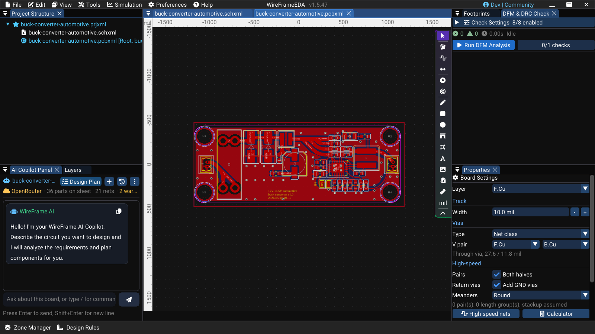

# PCB Editor — Overview

The PCB Editor handles board layout — from component placement to trace routing, copper zones, design rule checks, and manufacturing file export.

---

## What You Can Do Here

| Task | Tool |
|---|---|
| Bring footprints in from the schematic | **Tools → Update Schematic to PCB** |
| Place a footprint again after removing it | Drag it from the **Footprints** panel |
| Route copper traces between pads | **Route Trace** (++x++) |
| Place vias to switch routing layers | **Place Via** (++v++), or ++v++ while routing |
| Add mechanical holes (screws, standoffs) | **Place Mounting Hole** (++h++) |
| Define the board outline | Edge.Cuts layer + drawing tools, or **File → Import → CAD Outline** |
| Fill copper zones (ground planes) | **View → Zone Manager** |
| Set clearances, widths, and net classes | **View → Design Rules** |
| Run DFM / DRC checks | **Tools → DFM & DRC Check Panel...** |
| Export Gerber, drill, BOM, PDF | **File → Export → Fabrication Outputs (Gerber/Drill/BOM)...** or **Tools → Fabrication Output...** |
| Preview the board in 3D | **View → 3D Viewer** (++3++) |

---

## Workspace

### Image — PCB workspace

!!! note "Image capture brief"
    1. **Prepare:** Open the sample project's PCB with footprints placed and a few traces routed.
    2. **Build the frame:** Capture the PCB editor with the canvas, the vertical toolbar on the right edge, the Layers panel, the Footprints panel, and Properties showing **Board Settings**.
    3. **Clean the frame:** Close unrelated panels and tooltips, move the pointer away from key text, and hide credentials, usernames, customer data, and private paths.
    4. **Capture and finish:** Capture a native-resolution PNG, crop without cutting titles or primary actions, and add at most three subtle callouts without altering engineering content.
    5. **Approve:** Check the image at 100% zoom for current labels, readable evidence, correct release branding, and absence of sensitive information.

<!-- wf:shot id=pcb-workspace
caption: 'The PCB editor: canvas, vertical toolbar, Layers, Footprints and Board Settings'
project: wireframe:tests/data/buck_converter_automotive/wireframe/buck-converter-automotive.prjxml
setup:
- open_project
- ensure_pcb
- wait: 1
- action:
    action: mouse_move_to
    x: 1000
    y: 12
brief_sha256: a5f102850adc67cb
-->
<!-- wf:out id=pcb-workspace sha=315db8e28df4 -->

<!-- /wf:out -->

- **Canvas** — the board area with rulers, grid, footprints, traces, zones, and **ratsnest** lines (unrouted connections)
- **Toolbar** — a vertical strip of tool buttons on the right edge of the canvas; ++tab++ hides or shows it
- **Layers panel** — toggle visibility and select the active layer (**View → PCB Layers**)
- **Footprints panel** — footprints of the design that are not on the board yet
- **Properties panel** — the selected object, or **Board Settings** when nothing is selected

---

## PCB Toolbar Tools

From top to bottom:

| Tool | Shortcut | Function |
|---|---|---|
| **Select** | ++esc++ | Select and move objects |
| **Place Footprint** | ++o++ | Footprints are placed by dragging them from the **Footprints** panel |
| **Route Trace** | ++x++ | Route copper traces between pads — see [Routing](routing.md) |
| **Tune Length** | — | Add meanders to a net that is shorter than its target — see [Routing](routing.md#length-tuning-and-differential-pairs) |
| **Place Via** | ++v++ | Place a via by itself |
| **Place Mounting Hole** | ++h++ | Place a mechanical hole |
| **Draw Line / Rectangle / Circle / Arc / Polygon** | ++shift+l++ / ++r++ / ++e++ / ++a++ / — | Draw shapes on the active layer |
| **Place Text** | ++t++ | Place text on the active layer |
| **Vectorize Image** | — | Turn a PNG/JPG logo into board artwork — see [below](#logos-and-images) |
| **Import CAD (SVG)** | — | Import an SVG drawing — see [Board Shape and Outline](board-outline.md) |
| **Measure** | ++m++ | Place a dimension: click the start, click the end, move to set the offset, click to place |
| **mil / mm** | ++shift+u++ | Switch the display unit |

---

## Board Outline (Edge.Cuts)

Every PCB needs a board outline that defines its **physical shape**:

1. In the **Layers** panel, click **Edge.Cuts** to make it the active layer
2. Use the **Draw Rectangle** (or Polygon) tool to draw the board shape
3. The outline appears in magenta

You can also import a mechanical drawing — see [Board Shape and Outline](board-outline.md).

!!! tip "Why Edge.Cuts matters"
    The board outline is used for:
    - Telling the manufacturer where to cut the board
    - Defining the valid placement area for footprints (DFM checks this)
    - Clipping copper zone fills at the board edge

---

## Ratsnest Lines

Ratsnest lines are **thin dashed lines** showing connections that have not yet been routed:

### Short video — Ratsnest cleared by routing

!!! note "Video production brief"
    1. **Prepare:** Use two nearby pads on the same net with exactly one visible ratsnest connection.
    2. **Opening shot (1–2 s):** Hold on both pads and the unrouted ratsnest line.
    3. **Action shot (5–8 s):** Start the route on the first pad, place any required corner, and finish on the destination pad.
    4. **Result shot (2–3 s):** Hold on the completed selected track and the cleared ratsnest connection.
    5. **Deliver:** Export a **10–15 second** 1080p MP4 and replace the existing empty file.

<!-- wf:video id=ratsnest-cleared-by-routing
caption: Route Trace from C7 to the regulator tab; the +3V3 ratsnest line clears
project: wireframe:tests/data/7805_voltage_regulator/wireframe/7805_regulator.prjxml
setup:
- open_project
- ensure_pcb
- wait: 2
- canvas_fit:
    refs:
    - C7
    - U2
    margin: 0.2
- wait: 1
- action:
    action: mouse_move_to
    x: 1000
    y: 12
steps:
- wait: 1.5
- canvas_hover: pad:C7.1
- wait: 1
- keys:
  - X
- wait: 0.5
- canvas_click: pad:C7.1
- wait: 1
- canvas_hover:
  - 470
  - -100
- wait: 1
- canvas_hover: pad:U2.2@1
- wait: 1
- canvas_click: pad:U2.2@1
- wait: 1
- keys:
  - Escape
- wait: 1
- action:
    action: mouse_move_to
    x: 1000
    y: 12
- wait: 2
brief_sha256: 101f88647dbaff97
-->
<!-- wf:out id=ratsnest-cleared-by-routing sha=a5e1057b4be1 -->
<video controls muted playsinline preload="metadata" src="../assets/wf/docs/pcb/index/ratsnest-cleared-by-routing.mp4" title="Route Trace from C7 to the regulator tab; the +3V3 ratsnest line clears"></video>
<!-- /wf:out -->

- Ratsnest lines **automatically update** after every edit
- When you **route a trace**, the corresponding ratsnest line **disappears**
- The goal is to **route until all ratsnest lines are gone**

---

## Logos and Images

**Vectorize Image** on the toolbar turns a PNG, JPG, or BMP into board artwork:

1. Choose the image. **Image Vectorizer Settings** opens with a **Live Preview**.
2. Adjust **Invert Colors** (for light art on a dark background), **Fill Style** (**None (Outline)**, **Solid Fill**, **Hatch (Grid)**), **Threshold (Black/White)** — or **Auto** to pick it — **Smoothing**, **Edge Blur**, and **Simplification (Epsilon)**.
3. Set the size with **Scale (mils per pixel)** or **Target Width (mm)**; **Size Info** shows the result in mm and mil.
4. Select **Import**. The artwork is added on **F.SilkS** as a footprint named `LOGO…` and follows the cursor — click to drop it. Move or rotate it like any other footprint.

Measure the result and check the line width against your manufacturer's minimum silkscreen or copper width before release.

---

## Section Pages

| Page | What you'll learn |
|---|---|
| [Footprints & Placement](footprints-and-placement.md) | Load libraries, place and arrange footprints |
| [Routing](routing.md) | Route traces, vias, mechanical holes |
| [Layers & Views](layers-and-views.md) | Layer management, visibility, navigation |
| [Zones & Planes](zones-and-planes.md) | Copper fills, ground planes, zone priority |
| [Design Rules & Net Classes](design-rules.md) | Clearance, trace width, via size, net class configuration |
| [DFM & DRC](dfm-and-drc.md) | Design rule and manufacturability checks |
| [Fabrication & Export](fabrication-and-export.md) | Gerber, drill, BOM, PDF export |

---

## Related Sections

| Section | What you'll learn |
|---|---|
| [3D Viewer](../advanced/3d-viewer.md) | Preview the PCB with 3D component models |
| [Placement and Routing Assistant](../ai/auto-placer-router.md) | Review AI-assisted placement and routing proposals |
