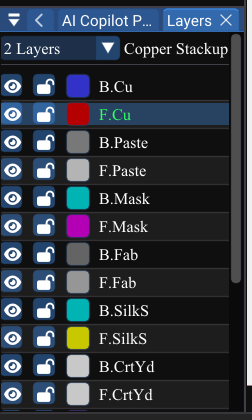

# Layers and Views

PCB layers control which drawing plane is active — copper, silkscreen, solder mask, or board outline. This page covers the layer stack, the Layer panel, rendering behavior, and canvas navigation.

---

## Default Layer Stack

| Layer | Color | Contains |
|---|---|---|
| **F.Cu** | Red | Front copper — traces and pads |
| **B.Cu** | Blue | Back copper |
| **F.SilkS** | Yellow | Front silkscreen — labels, outlines, logos |
| **B.SilkS** | Cyan | Back silkscreen |
| **F.Mask** | Translucent purple | Front solder mask openings (around pads) |
| **B.Mask** | Translucent cyan | Back solder mask openings |
| **F.Paste** | Translucent light grey | Front solder paste |
| **B.Paste** | Translucent grey | Back solder paste |
| **F.Fab** | Grey | Front fabrication layer |
| **B.Fab** | Dark grey | Back fabrication layer |
| **F.CrtYd** | Light grey | Front courtyard (keep-out area per component) |
| **B.CrtYd** | Light grey | Back courtyard |
| **Edge.Cuts** | Magenta | Board outline — physical board shape |
| **Dwgs.User** | White | User drawings and notes |
| **Eco1.User**, **Eco2.User**, **Cmts.User** | Green, olive, blue | Extra user layers |

Boards with more than two copper layers add inner layers (**In1.Cu**, **In2.Cu**, …) between F.Cu and B.Cu.

---

## The Layer Panel

Open **View → PCB Layers**. The **Layers** panel follows the active PCB:

### Image — PCB Layers panel

!!! note "Image capture brief"
    1. **Prepare:** Open a clean release-build workspace with fictional or public sample data and prepare the requested state.
    2. **Build the frame:** Capture the Layers panel with F.Cu active, one hidden layer, and several visible copper and technical layers. Keep the eye icons, color swatches, and active highlight readable.
    3. **Clean the frame:** Close unrelated panels and tooltips, move the pointer away from key text, and hide credentials, usernames, customer data, and private paths.
    4. **Capture and finish:** Capture a native-resolution PNG, crop without cutting titles or primary actions, and add at most three subtle callouts without altering engineering content.
    5. **Approve:** Check the image at 100% zoom for current labels, readable evidence, correct release branding, and absence of sensitive information.

<!-- wf:shot id=pcb-layers-panel
caption: PCB Layers panel with F.Cu active
setup:
- open_project
- ensure_pcb
- wait: 1
- focus: //Layers
- wait: 1
- action:
    action: mouse_move_to
    x: 1000
    y: 12
capture:
  window: Layers
  padding: 8
brief_sha256: aac3d86c82026b85
-->
<!-- wf:out id=pcb-layers-panel sha=d1b3e695f598 -->

<!-- /wf:out -->

| Control | Interaction |
|---|---|
| **Copper Stackup** | Number of copper layers: **2**, **4**, **6**, **8**, **16**, or **32 Layers** |
| **Hide All References** | Hides every footprint designator on the canvas |
| **Vis** (eye) | Click to **show / hide** the layer |
| **Lock** | Click to **lock** the layer; hover shows **Layer Locked** or **Click to lock layer** |
| **Color** | Click the swatch to **change the layer color** |
| **Name** | Click to make it the **active layer** |

The active layer has a **highlighted background**.

### Locked layers

Footprints, traces, and designators on a locked layer ignore clicks, so they cannot be selected or moved by accident, and changing layer onto it while routing is refused with *"… is locked"*. Lock finished layers — the board outline, for instance — to protect them while you work on the rest.

---

## The Active Layer

The active layer determines where traces and graphics are placed:

- Routing a trace → places it on the **active copper layer**
- Drawing text → places it on the **active layer** (set to F.SilkS for silkscreen labels)
- Change the active layer by **clicking its name** in the Layers panel, or from the keyboard: ++tab++ (to its via pair, F.Cu ↔ B.Cu by default), ++equal++ / ++minus++ (next / previous copper layer), ++page-up++ / ++page-down++ (F.Cu / B.Cu). A short note on the canvas confirms *Active layer: …*

!!! tip "Always check your active layer before routing"
    F.Cu (red) and B.Cu (blue) are physically different sides of the board. Routing on the wrong layer will not connect the intended pads.

---

## Hiding and Showing Layers

Click the **eye icon** next to a layer name to toggle its visibility:

- Hidden layers — traces, pads, and graphics are **not drawn on the canvas**
- The data still exists on the board and in the saved file — hiding a layer does not remove anything

**Practical examples:**

- Hide **B.Cu** while working on the front side to reduce visual clutter
- Hide **F.SilkS** to inspect trace routing without text overlay
- Re-enable all layers to review the full board

---

## Changing Layer Colors

Click the **color swatch** next to any layer name to open a color picker.

Default colors are chosen for easy visual distinction (red/blue for copper). You can adjust them to your preference.

---

## How Colors Render on the Canvas

| Element | Color source |
|---|---|
| Trace | The layer the trace is on |
| Pad | Copper layer color |
| Footprint graphics | Layer of each individual graphic (SilkS, Fab, etc.) |
| Silkscreen | F.SilkS or B.SilkS layer color |
| Board outline | Edge.Cuts layer color |
| Copper zone | Layer color rendered semi-transparently |

---

## Canvas Navigation

| Action | Input |
|---|---|
| **Pan** | Middle-drag or right-drag; two-finger scroll on a macOS trackpad |
| **Zoom in / out** | Scroll wheel, centred on the cursor (++ctrl++ / ++cmd++ + scroll on macOS) |
| **100% zoom** | ++ctrl+0++ |
| **Toggle grid / crosshair** | ++shift+g++ / ++shift+c++ |
| **Switch unit mm / mil** | ++shift+u++, or the **mil / mm** button on the toolbar |

**Fit to Screen** (++home++) and **Zoom to Selection** (++ctrl+shift+f++) work in the schematic editor only.

---

## See Also

- [PCB Editor Overview](index.md) — general PCB workspace
- [Routing](routing.md) — the active layer determines which copper layer is routed
- [Fabrication & Export](fabrication-and-export.md) — layer selection for Gerber export
