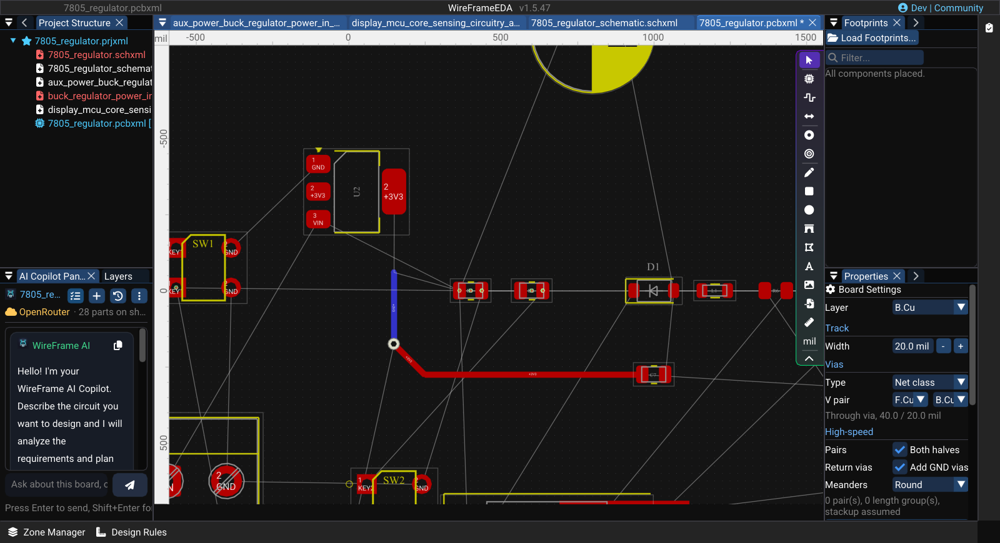
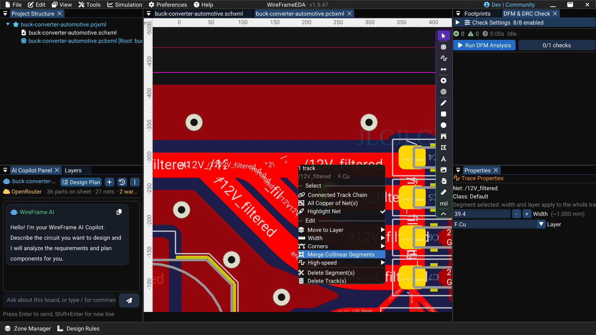

# Routing Traces

Trace routing connects pads on the PCB with copper paths under the board's design rules. This page covers drawing traces, changing layer through vias, mounting holes, and editing finished routes.

---

## Starting a Route

Press ++x++ or click **Route Trace** on the PCB toolbar (the vertical toolbar on the right edge of the canvas).

### Drawing a trace

1. **Click a pad** (or an existing trace or via) to start. The trace takes the net of what you clicked and the width of that net's class.
2. Move the cursor. WireFrame proposes a path with 45° or 90° steps and rounds or mitres the corners in the style set under **Properties → Board Settings → Corners**. If the straight path would break a rule, it tries a path that walks around the obstacle.
3. **Click** to commit each waypoint. ++backspace++ takes back the last waypoint.
4. **Click the destination pad** to finish — or a trace of the same net, which joins the new trace to it. When the pad is on the other copper layer, a via is inserted automatically. The ratsnest line disappears once the connection is complete.
5. To stop elsewhere, **double-click**, or press ++esc++: the committed part of the trace is kept. ++esc++ before the first waypoint removes the trace.

### Image — Completed pad-to-pad route

!!! note "Image capture brief"
    1. **Prepare:** Open a clean release-build workspace with fictional or public sample data and prepare the requested state.
    2. **Build the frame:** Capture one short F.Cu route between two pads, with the completed track selected and the corresponding ratsnest connection cleared.
    3. **Clean the frame:** Close unrelated panels and tooltips, move the pointer away from key text, and hide credentials, usernames, customer data, and private paths.
    4. **Capture and finish:** Capture a native-resolution PNG, crop without cutting titles or primary actions, and add at most three subtle callouts without altering engineering content.
    5. **Approve:** Check the image at 100% zoom for current labels, readable evidence, correct release branding, and absence of sensitive information.

<!-- wf:shot id=completed-pad-to-pad-route
caption: A completed +5V route on F.Cu, selected
setup:
- open_project
- ensure_pcb
- wait: 1
- canvas_click: trace:44
- wait: 0.5
- action:
    action: mouse_move_to
    x: 1000
    y: 12
brief_sha256: 28fa26183f831998
-->
<!-- wf:out id=completed-pad-to-pad-route sha=fc19e66b10ed -->

<!-- /wf:out -->

| Action | Input |
|---|---|
| Start on a pad, trace, or via | Click |
| Commit a waypoint | Click |
| Take back the last waypoint | ++backspace++ |
| Finish on the destination pad | Click the pad |
| Finish here | Double-click, or ++esc++ |
| Thinner / wider trace | ++bracket-left++ / ++bracket-right++ (1 mil per press, within the net class limits) |
| Change layer (drops a via) | ++v++, ++tab++, or ++space++ — see below |

While you route, a small readout near the cursor shows the net, its class, the layer, the width, the clearance, how violations are handled, and the routed length so far.

---

## Clearance While Routing

When every candidate path would break the clearance of the net class, the net class setting **Design Rules → Clearance → When violated** decides what happens:

| Setting | Preview colour | Result |
|---|---|---|
| **Block** (default) | Red | The segment cannot be committed — move the cursor to a clear path |
| **Warn** | Amber | The segment is committed; DRC will report it |
| **Allow** | Layer colour | The segment is committed without a warning |

Ending a route on a pad of a **different net** is allowed; DFM/DRC reports the short. Always run [DFM & DRC](dfm-and-drc.md) after routing.

---

## Vias — Switching Layers

A via is a plated hole that connects copper layers so a trace can change layer.

### Changing layer while routing

| Key | Via goes to |
|---|---|
| ++v++, ++tab++, or ++space++ | The other layer of the via pair (F.Cu ↔ B.Cu by default) |
| ++equal++ / ++minus++ (or keypad ++num-plus++ / ++num-minus++) | The next / previous copper layer of the stackup |
| ++page-up++ / ++page-down++ | F.Cu / B.Cu |
| ++shift+v++ | A layer you pick from a list |

The via is dropped at the last waypoint and routing continues on the new layer. Move away from the start point first — a via cannot be dropped on it. The via type (through, blind/buried, or micro) follows **Properties → Board Settings → Vias → Type**, which defaults to the net class.

### Image — Route changing layer through a via

!!! note "Image capture brief"
    1. **Prepare:** Open a clean release-build workspace with fictional or public sample data and prepare the requested state.
    2. **Build the frame:** Capture a selected route that begins on F.Cu, changes layer through a via, and continues on B.Cu. Keep both layer colors visible.
    3. **Clean the frame:** Close unrelated panels and tooltips, move the pointer away from key text, and hide credentials, usernames, customer data, and private paths.
    4. **Capture and finish:** Capture a native-resolution PNG, crop without cutting titles or primary actions, and add at most three subtle callouts without altering engineering content.
    5. **Approve:** Check the image at 100% zoom for current labels, readable evidence, correct release branding, and absence of sensitive information.

<!-- wf:shot id=route-changing-layer-through-a-via
caption: 'The LED feed rerouted through the back: it leaves D3 on F.Cu, V drops a via, it crosses on B.Cu,
  a second V brings it back up to R8 — and DFM stays clean'
project: board:buck-converter
setup:
- open_project
- ensure_pcb
- wait: 2
- canvas_fit:
    box:
    - 540
    - -420
    - 800
    - -270
- wait: 1
- canvas_click:
  - 666
  - -315
- keys:
  - Delete
- wait: 1
- canvas_hover: pad:D3.2
- keys:
  - X
- wait: 0.5
- canvas_click: pad:D3.2
- wait: 0.5
- canvas_click:
  - 629
  - -372
- wait: 0.5
- keys:
  - V
- wait: 0.5
- canvas_hover:
  - 703.3
  - -372
- canvas_click:
  - 703.3
  - -372
- wait: 0.5
- keys:
  - V
- wait: 0.5
- canvas_hover: pad:R8.2
- canvas_click: pad:R8.2
- wait: 1
- keys:
  - Escape
- keys:
  - Escape
- menu:
  - Tools
  - DFM & DRC Check Panel...
- wait: 1
- click: '**/{fa:play} Run DFM Analysis'
- wait: 2
- action:
    action: mouse_move_to
    x: 1000
    y: 12
- wait: 1
brief_sha256: 79c5704094dcad31
-->
<!-- wf:out id=route-changing-layer-through-a-via sha=21f4e54a3b11 -->

<!-- /wf:out -->

### Placing a via by itself

1. Select **Place Via** on the toolbar (++v++ when not routing).
2. Click on the board. The via takes the net of the trace or pad under the cursor.

### Via properties

Select one or more vias to edit them in **Properties**. Edits apply to every selected via.

| Field | Description |
|---|---|
| Lock | Locked vias cannot be moved or deleted |
| Type | **Through**, **Blind/Buried**, or **Micro**, with the layers it spans |
| **Diameter** / **Drill** | Copper pad and hole size; **Ring** shows the annular ring left around the hole |
| **Reset to net class** | Takes diameter and drill from the net class in Design Rules |

---

## Mounting Holes

Use **Place Mounting Hole** (++h++) for holes such as screws and standoffs:

1. Select the tool and click on the board.
2. Select the hole and set it in **Properties → Hole Properties**:

| Field | Description | Example |
|---|---|---|
| **Diameter** | Hole diameter, in mil with the mm value beside it | 3.2 mm for M3 screws |
| **X** / **Y** | Position | |
| **Plated (PTH)** | Copper-plated hole | Usually off |
| **Net** | Net of a plated hole (shown when **Plated** is on) | `GND` |

---

## Editing Existing Traces

| Operation | How |
|---|---|
| Select a segment | Click it |
| Select a whole net | Double-click a trace — every trace and via of that net is selected and highlighted |
| Move | Drag the selection, or nudge it with the arrow keys (5 mil per press) |
| Delete | ++delete++, or right-click → **Delete Segment(s)** / **Delete Track(s)**. The ratsnest reappears |
| Change layer, width, or corners | Right-click → **Edit** (below), or **Properties → Trace Properties → Layer** |

Moving a via or a footprint keeps the attached trace endpoints connected.

### The trace context menu

Right-click a selected trace:

| Group | Item | What it does |
|---|---|---|
| **Select** | **Connected Track Chain** | Every track joined end-to-end to the selection, through vias, up to the pads |
| | **All Copper of Net(s)** | Every track and via of the selected nets |
| | **Highlight Net** | Highlights the net on the canvas |
| **Edit** | **Move to Layer ▸** | Moves the selected tracks to another copper layer |
| | **Width ▸** | Type a width and **Apply**, or use **Net class width** or **Match widest** |
| | **Corners ▸** | Set a radius, then **Miter 45°** or **Arc** |
| | **Merge Collinear Segments** | Joins pieces that continue along the same line |
| **Bus** (several parallel tracks) | **Distribute Evenly** | Keeps the two outer tracks and spaces the ones between evenly |
| | **Pack to Top / Left**, **Pack to Bottom / Right** | Closes the gaps to width + clearance toward one side; ends on pads stay put |
| | **Set Pitch ▸** | Centre-to-centre spacing from the top or left track |
| **High-speed ▸** | Tune length, pairs, and groups | See [Length tuning and pairs](#length-tuning-and-differential-pairs) |
| | **Delete Segment(s)** / **Delete Track(s)** | Removes the selected segments, or whole tracks |

Review clearance after every group operation and re-run DFM.

---

## Consolidate Collinear Trace Segments

After routing, select the segments, right-click, and choose **Edit → Merge Collinear Segments** to remove boundaries between pieces that continue along the same line. It does not simplify zig-zags or redesign the route; use **Corners ▸** to round or mitre corners instead. Inspect the result and re-run DFM/DRC.

### Image — Route before and after trace consolidation

!!! note "Image capture brief"
    1. **Prepare:** Open a clean release-build workspace with fictional or public sample data and prepare the requested state.
    2. **Build the frame:** Use a two-panel image of the same selected route before and after **Merge Collinear Segments**. Keep the geometry identical except for the removed collinear boundaries, and include a small inset of the right-click menu with **Merge Collinear Segments**. Do not label the action **Gloss**. Suggested size: **1400 × 760 px**.
    3. **Clean the frame:** Close unrelated panels and tooltips, move the pointer away from key text, and hide credentials, usernames, customer data, and private paths.
    4. **Capture and finish:** Capture a native-resolution PNG, crop without cutting titles or primary actions, and add at most three subtle callouts without altering engineering content.
    5. **Approve:** Check the image at 100% zoom for current labels, readable evidence, correct release branding, and absence of sensitive information.

<!-- wf:shot id=route-before-and-after-trace-consolidation
caption: 'Right-click a selected /12V_filtered track: Merge Collinear Segments joins the pieces that run
  along one straight line'
setup:
- open_project
- ensure_pcb
- wait: 2
- canvas_fit:
    box:
    - -440
    - -20
    - -60
    - 240
- wait: 1
- canvas_click: trace:25
- wait: 1
- canvas_click:
    target: trace:25
    button: right
- wait: 1
- hover: '**/{fa:compress-arrows-alt}  Merge Collinear Segments'
- wait: 1
brief_sha256: ed87886135515216
-->
<!-- wf:out id=route-before-and-after-trace-consolidation sha=3538ea333591 -->

<!-- /wf:out -->

---

## Routing Several Traces Together

Select two or more existing traces, choose **Route Trace**, and click one of the selected traces to continue them all at once. The other traces follow in parallel at their current spacing.

---

## Length Tuning and Differential Pairs

- **Tune Length** (toolbar, under Route Trace): hover a straight segment of a net that is shorter than its pair, its length group, or its class target. The distance from the segment sets the bump height and the side of the cursor sets the side; click to add a meander. ++esc++ leaves the tool.
- Right-click → **High-speed ▸** adds a meander with set **Add**, **Height**, **Pitch**, side, and corner style, declares two nets as a differential pair (**Declare as differential pair**), or adds nets to a length group.
- **Properties → Board Settings → High-speed**: with **Pairs → Both halves** on, starting a route on a pad of a declared pair routes both halves together; **Return vias → Add GND vias** drops a GND via beside a pair's vias when it changes layer; **Meanders** sets the corner style of tuning bumps.

Pairs, length groups, and targets are defined in [Design Rules](design-rules.md).

---

## AI-Assisted Routing

The AI Copilot can propose placement and routing for the whole board with `/layout`. Proposals run on a copy and change nothing until you apply them. See [Placement and Routing Assistant](../ai/auto-placer-router.md).

---

## See Also

- [Footprints & Placement](footprints-and-placement.md) — place footprints before routing
- [Layers & Views](layers-and-views.md) — manage layers during routing
- [Zones & Planes](zones-and-planes.md) — copper fills interact with trace clearances
- [Design Rules & Net Classes](design-rules.md) — configure clearance and trace width rules
- [DFM & DRC](dfm-and-drc.md) — check clearances and widths after routing
- [Placement and Routing Assistant](../ai/auto-placer-router.md) — AI-assisted placement and routing review
