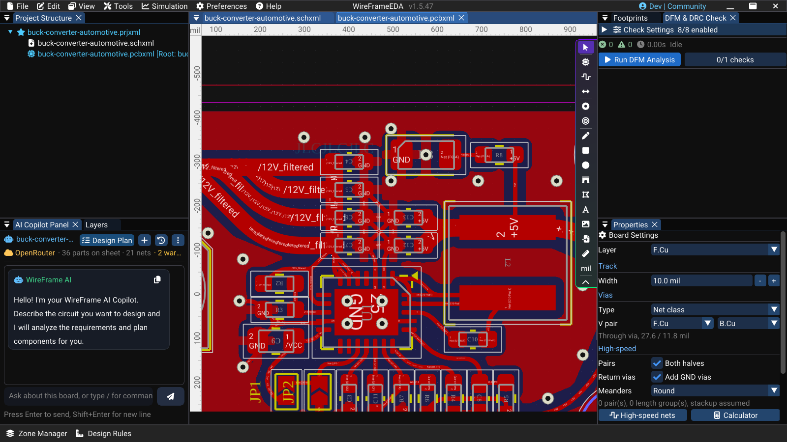
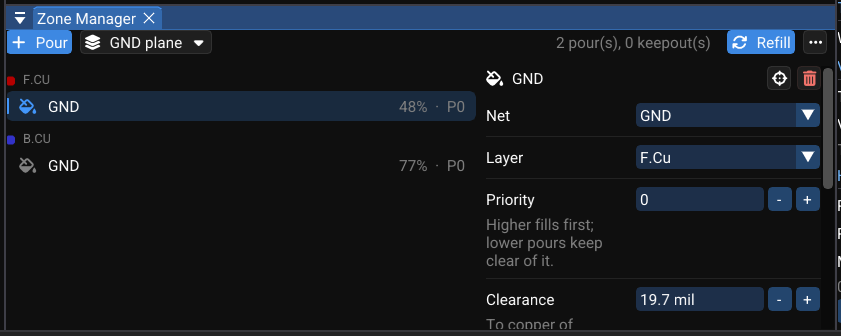
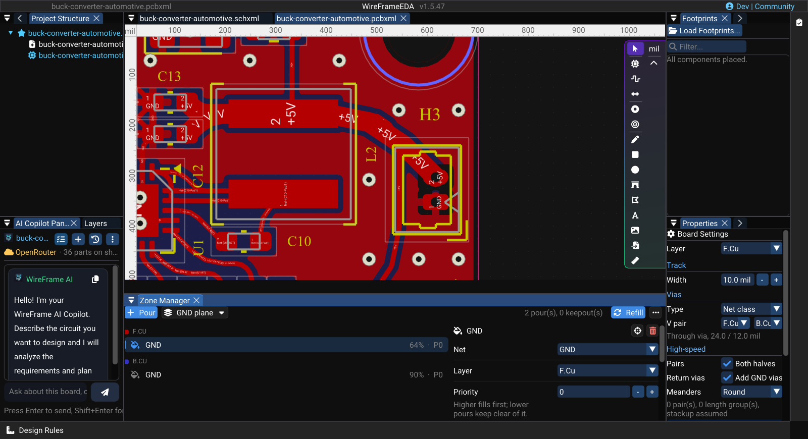

# Zones and Copper Planes

Copper zones (fills / pours) cover a board area with copper — typically used for **ground planes** or **power planes**. This is a standard practice in professional PCB design.

---

## Why Use Zones?

- **Ground plane** — reduces EMI noise and improves RF signal integrity
- **Power plane** — reduces voltage drop on power rails
- **Larger copper area** → lower impedance → better heat dissipation

---

## What Is a Zone?

### Image — A filled copper zone

!!! note "Image capture brief"
    1. **Prepare:** Open the sample PCB and add a GND pour with **Zone Manager → GND plane → F.Cu**, then **Refill**.
    2. **Build the frame:** Capture the board area where the GND fill keeps clearance around a pad of another net and connects to a GND pad with thermal spokes.
    3. **Clean the frame:** Close unrelated panels and tooltips, move the pointer away from key text, and hide credentials, usernames, customer data, and private paths.
    4. **Capture and finish:** Capture a native-resolution PNG, crop without cutting titles or primary actions, and add at most three subtle callouts without altering engineering content.
    5. **Approve:** Check the image at 100% zoom for current labels, readable evidence, correct release branding, and absence of sensitive information.

<!-- wf:shot id=a-filled-copper-zone
caption: 'A filled GND zone: clearance around other nets, thermal spokes to GND pads'
project: wireframe:tests/data/buck_converter_automotive/wireframe/buck-converter-automotive.prjxml
setup:
- open_project
- ensure_pcb
- wait: 1
- canvas_hover: C13
- scroll: -4
- wait: 1
- action:
    action: mouse_move_to
    x: 1000
    y: 12
brief_sha256: 544f6c3c7ff7fdf1
-->
<!-- wf:out id=a-filled-copper-zone sha=9ec208eb8174 -->

<!-- /wf:out -->

A filled zone follows its outline while maintaining clearance around objects on other nets. Pads on the zone net connect according to the configured zone connection style.

Each zone has:

| Property | Description |
|---|---|
| **Net** | The net name (e.g. `GND`, `VCC`) |
| **Layer** | Copper layer (e.g. F.Cu, B.Cu) |
| **Priority** | Higher-priority zones override lower ones where they overlap |
| **Clearance** | Minimum gap from pads and traces on other nets |
| **Outline** | The polygon you draw to define the zone boundary |

---

## Quick Ground Plane

The fastest way is the **Zone Manager** (**View → Zone Manager**):

1. Select **GND plane ▾** and choose **Top and bottom**, **F.Cu**, or **B.Cu**. WireFrame adds a `GND` zone on that layer (see [where the outline comes from](#where-a-new-pour-gets-its-outline)).
2. Select **Refill** to compute the copper. A new pour holds no copper until it is filled, so you can set priorities first.

The fill keeps clearance around pads and traces on other nets and connects `GND` pads into the copper. Adding the plane is one undo step.

!!! note "Ground plane on an inner layer"
    The **GND plane** menu lists every copper layer of the stackup, but it only creates zones on **F.Cu** and **B.Cu**. For an inner layer such as **In2.Cu**, use **+ Pour**, pick that layer, and choose the net `GND`.

### Short video — Fill a ground plane from the Zone Manager

!!! note "Video production brief"
    1. **Prepare:** Open the sample PCB with a board outline and no copper zones.
    2. **Opening shot (1–2 s):** Show the board with the **Zone Manager** open and reading **No zones on this board**.
    3. **Action shot (5–8 s):** Select **GND plane ▾ → Top and bottom**, then **Refill** and wait for the fill.
    4. **Result shot (2–3 s):** Hold on the filled board with the two `GND` rows (F.Cu and B.Cu) readable in the zone list.
    5. **Deliver:** Export a **10–15 second** 1080p MP4.

<!-- wf:video id=fill-a-ground-plane-from-the-zone-manager
caption: Zone Manager → GND plane → Top and bottom, then Refill
project: wireframe:tests/data/7805_voltage_regulator/wireframe/7805_regulator.prjxml
setup:
- open_project
- ensure_pcb
- wait: 2
- menu:
  - View
  - Zone Manager
- wait: 2
- canvas_fit: {}
- wait: 1
- action:
    action: mouse_move_to
    x: 1000
    y: 12
steps:
- wait: 2
- click_at:
  - 385
  - 619
- wait: 1.5
- click_at:
  - 470
  - 650
- wait: 1.5
- click: //Zone Manager/{fa:sync}  Refill
- wait: 2
- action:
    action: mouse_move_to
    x: 1000
    y: 12
- wait: 3
brief_sha256: 669b938da1a35385
-->
<!-- wf:out id=fill-a-ground-plane-from-the-zone-manager sha=3a87ca484f47 -->
<video controls muted playsinline preload="metadata" src="../../assets/wf/docs/pcb/zones-and-planes/fill-a-ground-plane-from-the-zone-manager.mp4" title="Zone Manager → GND plane → Top and bottom, then Refill"></video>
<!-- /wf:out -->

---

## Zone Manager

**View → Zone Manager** opens a panel, docked below the canvas by default, that lists every copper zone and keepout of the active board.

### Top bar

| Control | What it does |
|---|---|
| **+ Pour** | Opens **Whole-board pour**: pick a **Layer** (any copper layer, inner layers included) and a **Net** (the list has a search box), then **Add pour** |
| **GND plane ▾** | Adds a `GND` pour on **Top and bottom**, **F.Cu**, or **B.Cu** |
| *n* pour(s), *n* keepout(s) | How many zones the board has. On a narrow panel this count moves into the **Refill** tooltip |
| **Refill** | Recomputes every fill from the copper around it, in the background. The button reads **Filling...** until it finishes |
| **⋯ → Unfill all** | Clears the computed copper but keeps every zone and its settings. **Refill** fills them again |
| **⋯ → Remove all zones...** | Deletes every zone and keepout after a confirmation. One undo step brings them back |

New pours never replace existing ones. Pressing **GND plane** twice creates two overlapping `GND` zones — delete the extra one.

#### Where a new pour gets its outline

**+ Pour** and **GND plane** take the zone outline from the first of these that exists:

1. Polygons or rectangles you have drawn **on that copper layer** — each one becomes a zone. Draw the area first when a plane should cover only part of the board.
2. The board outline on **Edge.Cuts**.
3. Without an outline: a rectangle around the placed footprints, with a 200 mil margin.

### Zone list and details

The left side lists the zones grouped by copper layer, in stackup order and highest priority first. Each row shows the net (or **Keepout**), how much of the outline is filled, and the priority (`P0`, `P1`, …). Zones with the same layer, net, priority, and name are one row, marked `×n`. A row at **0%** has not been filled yet — select **Refill** — or has no copper of its net to join. Double-click a row to zoom to it.

Select a row to edit it on the right:

| Field | Meaning |
|---|---|
| **Net** | The zone's net; `<No net>` for an unconnected copper area |
| **Layer** | Copper layer |
| **Priority** | Higher fills first; lower pours keep clear of it — see [Zone Priority](#zone-priority) |
| **Clearance** | Gap to copper of other nets, shown in mil or mm |
| **Min width** | Slivers of copper narrower than this are removed |
| **Thermal relief** | Spokes to pads of its net so they can be soldered; **Spoke width** sets their width |
| Keepout rules | For a keepout: **No tracks**, **No vias**, **No pads**, **No copper pour**, **No footprints** |

The buttons beside the title centre the view on the zone or delete it (one undo step brings it back). The line at the bottom shows the outline area, the filled percentage, and the number of copper islands.

Every change is one undo step (**Ctrl+Z**), and the board refills automatically after an edit in this panel.

### Image — Zone Manager with two planes

!!! note "Image capture brief"
    1. **Prepare:** Open the sample PCB, create `GND` zones on both outer layers with **GND plane → Top and bottom**, then **Refill**.
    2. **Build the frame:** Capture the **Zone Manager** panel with the top bar (**+ Pour**, **GND plane**, **Refill**), the zone list, and the details of the selected row (Net, Layer, Priority, Clearance, Thermal relief) readable. Suggested size: **900 × 360 px**.
    3. **Clean the frame:** Close unrelated panels and tooltips, move the pointer away from key text, and hide credentials, usernames, customer data, and private paths.
    4. **Capture and finish:** Capture a native-resolution PNG, crop without cutting titles or primary actions, and add at most three subtle callouts without altering engineering content.
    5. **Approve:** Check the image at 100% zoom for current labels, readable evidence, correct release branding, and absence of sensitive information.

<!-- wf:shot id=zone-manager-with-two-planes
caption: Zone Manager with GND planes on F.Cu and B.Cu
project: wireframe:tests/data/buck_converter_automotive/wireframe/buck-converter-automotive.prjxml
setup:
- open_project
- ensure_pcb
- wait: 1
- menu:
  - View
  - Zone Manager
- wait: 1
- action:
    action: mouse_move_to
    x: 1000
    y: 12
capture:
  window: Zone Manager
  padding: 6
brief_sha256: 98ac765cfd91c6dc
-->
<!-- wf:out id=zone-manager-with-two-planes sha=8733e54168de -->

<!-- /wf:out -->

---

## Creating a Zone of Your Own Shape

1. Select a copper layer (e.g. **F.Cu**) in the Layer panel.
2. Draw a closed shape on it with the **Draw Polygon** or **Draw Rectangle** (++r++) tool.
3. In the Zone Manager, select **+ Pour**, choose the same layer and the net (e.g. `GND`), then **Add pour**. Every polygon or rectangle on that layer becomes a zone of that net.
4. Set **Priority**, **Clearance**, and **Thermal relief** for the new row, then **Refill** if it is still at 0%.

Keepout areas are not drawn by hand: they come with an imported KiCad board or from a `/layout` proposal, and appear in the Zone Manager as **Keepout** rows.

## Zone Priority

When two zones overlap, the zone with the **higher priority** wins:

The higher-priority zone owns the overlapping copper area; the lower-priority zone remains in the rest of its valid outline.

### Image — Overlapping zones with different priorities

!!! note "Image capture brief"
    1. **Prepare:** Open a clean release-build workspace with fictional or public sample data and prepare the requested state.
    2. **Build the frame:** Capture a GND zone at priority 0 and a smaller VCC island at priority 1. Show the zone outlines, net labels, and resulting filled overlap.
    3. **Clean the frame:** Close unrelated panels and tooltips, move the pointer away from key text, and hide credentials, usernames, customer data, and private paths.
    4. **Capture and finish:** Capture a native-resolution PNG, crop without cutting titles or primary actions, and add at most three subtle callouts without altering engineering content.
    5. **Approve:** Check the image at 100% zoom for current labels, readable evidence, correct release branding, and absence of sensitive information.

<!-- wf:shot id=overlapping-zones-with-different-priorities
caption: Zone Manager — the board's GND pours with their layer, priority and clearance
setup:
- open_project
- ensure_pcb
- wait: 1
- menu:
  - View
  - Zone Manager
- wait: 1
- action:
    action: mouse_move_to
    x: 1000
    y: 12
brief_sha256: 2cc4a83854365dd4
-->
<!-- wf:out id=overlapping-zones-with-different-priorities sha=cd6fd7b81f01 -->

<!-- /wf:out -->

!!! tip "Priority guidelines"
    - Ground plane → priority **0** (lowest)
    - VCC island inside the GND plane → priority **1**
    - Zone nested inside VCC → priority **2**, and so on

---

## How Zones Interact with Nets

| Situation | Result |
|---|---|
| Pad on the **same net** as the zone | Pad connects directly to the fill (no ratsnest) |
| Trace on the **same net** passing through | Trace connects to the zone |
| Pad on a **different net** inside the zone | Clearance gap is maintained around the pad |
| Trace on a **different net** inside the zone | Clearance gap is maintained around the trace |

---

## Editing Zones

| Change | Where |
|---|---|
| Net, layer, priority, clearance, min width, thermal relief | Zone Manager, on the selected row |
| Position | Click the zone on the canvas, then drag it or nudge it with the arrow keys (5 mil per press) |
| Shape | Delete the zone, change the drawn polygon or rectangle on the copper layer, and pour again |
| Remove | **Delete** with the zone selected, or the delete button in the Zone Manager |

---

## See Also

- [Routing](routing.md) — traces interact with zone clearances
- [DFM & DRC](dfm-and-drc.md) — zone connectivity is validated during DRC
- [Layers & Views](layers-and-views.md) — zone visibility follows layer settings
