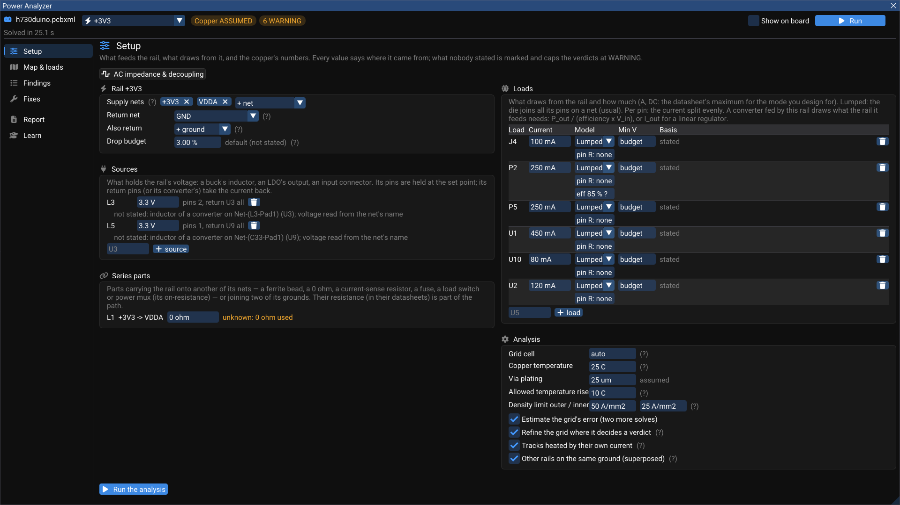
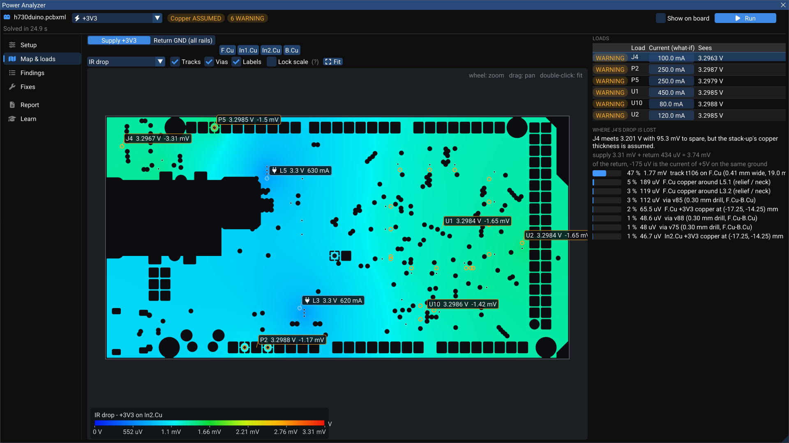
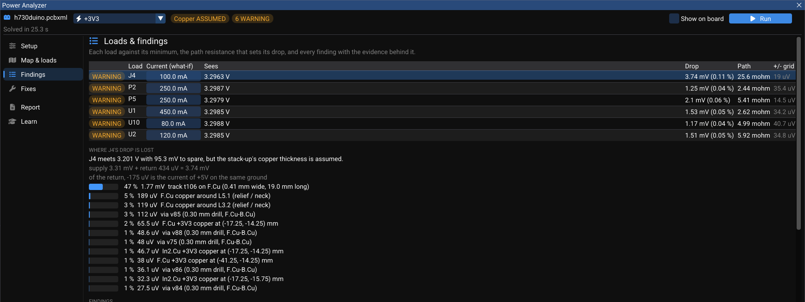

# Power Analyzer (DC IR drop)

What voltage does each chip really see? A 3.3 V regulator does not deliver 3.3 V to a processor 60 mm away: every track, neck, via and plane on the way takes a little, on the supply side and again on the ground side. The **Power Analyzer** solves the rail's real copper — pours as filled, tracks, vias and pads — for the loads you state, and answers:

- each load's **voltage** and **drop** (supply + return), and its path resistance;
- **where on the board** each load's drop is lost, split exactly between the pieces of copper that cause it;
- the **current density** in every neck, and the current in every **via** and **track** against IPC-2221;
- copper connected to nothing;
- and **what to change** — previewed by an actual solve, approved by a person, applied as one undo step.

Open it with **View ▸ Power Analyzer (DC IR drop)** while a board is open, or from **Properties ▸ Board Settings ▸ High-speed ▸ Power Analyzer (DC IR drop)**.

## Setup

Every value on this page says where it came from. A value nobody stated is marked and **caps the verdicts at WARNING** — the analysis never reads an assumption as a fact.

| Section | What you set |
|---|---|
| **Rail** | The **supply nets** of the rail (a rail can span several, such as `+3V3` and `VDDA` through a ferrite), the **return net**, other grounds it is joined to (**Also return**), and the **drop budget** (default 3 %) |
| **Sources** | What holds the voltage: a converter's inductor, an LDO's output, an input connector — its voltage and which pins return its current. Proposed from the netlist; **Use these rails** adopts them in one click (**Add rail** sets one up by hand) |
| **Series parts** | A ferrite bead, a 0 Ω link, a current-sense resistor, a fuse, a load switch or power mux — anything that carries the rail onto another of its nets, with its resistance. An unknown resistance is used as 0 Ω and said so |
| **Loads** | What draws from the rail and how much (DC — the datasheet's maximum for the mode you design for). **Lumped**: the die joins all its pins on the net (usual); **Per pin**: the current is split evenly. **Min V**: the lowest voltage it accepts (the budget, or the datasheet's). A converter fed by this rail draws what the rail it feeds needs: `P_out / (efficiency × V_in)` for a switcher (85 % until stated), `I_out` for a linear regulator |
| **Analysis** | Grid cell (auto), copper temperature, via plating, allowed temperature rise, density limits for outer and inner layers, and four options: estimate the grid's error, refine the grid where it decides a verdict, heat tracks with their own current, and superpose the other rails that share the ground |

Every edit here is one undoable step and is saved in the `.pcbxml`. Press **Run the analysis** (or **Run** at the top).

!!! note "The currents in these pictures"
    The load currents on h730duino were typed in for the illustration (450 mA for the STM32H730, 250 mA per header…), so the pictures show what a stated load looks like. For your board, use the datasheets' figures for the mode you design for.

## Map & loads

The rail's copper as solved, layer by layer, with the loads beside it.

- Switch **Supply** / **Return**, and the copper layer (F.Cu, In1.Cu, In2.Cu, B.Cu…).
- Show **IR drop**, **Voltage**, **Current density**, or **where the drop is lost** for one load.
- Tracks are drawn as vectors in the map's colours, with vias and the pins that feed and draw labelled with their voltage. Hover anywhere for the voltage, drop and density there, or a track's or via's current.
- Wheel to zoom, drag to pan, double-click to fit. **Lock scale** keeps the colour bar fixed while you compare.
- Beside the map, each load has a **what-if current** you can drag. The map follows at once: every load's response is solved once, and any mix of currents is their weighted sum.
- **Show on board** draws the map over the PCB canvas.

### Where a load's drop is lost

Pick a load and the panel splits its drop exactly over the copper that causes it. On h730duino, J4 sees 3.2963 V: 3.74 mV of drop (3.31 mV on the supply, 0.43 mV on the return), and 47 % of it — 1.77 mV — is lost in one track, `t106` on F.Cu, 0.41 mm wide and 19.0 mm long. The relief spokes around the inductor pads come next, then a few vias. That list is where a fix pays.

## Findings

Each load against its minimum, with the path resistance that sets its drop and the grid's uncertainty (`±19 µV`). Then every finding: loads below their minimum, tracks and vias over their IPC-2221 current, hotspots of current density, copper connected to nothing, and the method and assumptions. Each has **Show** (selects it on the board) and says what would turn it into a PASS — here: *state the load's current and confirm the stack-up*, because the copper thickness is still assumed.

## Fixes

Press **Suggest fixes** for changes that recover drop where it is lost: **widen a track**, **add vias** beside a congested one, or **heavier copper** on a layer. Each is **previewed by solving the changed board** (**Preview**) — you see the new voltages before deciding — then a person approves it (**Approve**, or **Reject**), and **Apply** makes it one undoable step. Fixes keep their clearance to other copper.

## Report

The evidence: the rail, the copper's numbers and where they came from, each load's voltage, where the drop is lost, the fixes and who approved them — and what this analysis does not do. **HTML (with the maps)**, **Markdown** or **JSON**.

## How it computes

- The copper of each net and layer is rasterised on one grid; a cell's copper is split into its connected pieces, so two pieces of copper that share a cell but do not touch are not joined.
- Tracks are resistor chains, vias and plated holes are barrels between layers, and each pad is one potential to its edge. A load's package (lead, bond wire, ball) can add a pin resistance, shown as its own contributor.
- The return is solved with the same currents; a load sees `V(supply pin) − V(return pin)`, the return measured from its own source's ground pin.
- **Rails sharing a ground are superposed**: the other rails' currents flow through the shared return, and the result says how much of each load's return is theirs.
- The **power tree** is followed: a converter is a load of the rail it draws from and the source of the rail it feeds.
- **Self-heating**: each track at its IPC-2221 temperature rise for its current, and its resistance with it.
- The system is solved by conjugate gradients with an algebraic multigrid preconditioner — about 20 iterations on 1.5 million nodes. The grid's uncertainty is estimated with two extra solves; where it could decide a verdict, the grid is refined there and solved again.

### Validated against exact answers

| Case | Error |
|---|---|
| Strip 20 × 5 mm with edge contacts | +0.000 % |
| Track between two pads | +0.11 % |
| Track with a 45° bend | +0.15 % |
| Corbino disc (ring contact) | +0.20 % |
| van der Pauw square | +0.004 % |
| Via barrel between two pads | exact |
| Plane with a hole and a ferrite, against ngspice | identical node voltages |
| Two rails on one ground strip | 0.000 % |

## What it does not do

- It is a **DC** analysis. AC behaviour — PDN impedance across frequency and decoupling — is the High-Speed Workbench's [Power page](../high-speed/simulate-power-emi.md#power-the-ac-side); the two windows link to each other on the same rail.
- Load currents are yours to state; WireFrame does not guess a chip's consumption.
- Thermal coupling between parts and the board's temperature map are not modelled (each track heats with its own current only).
