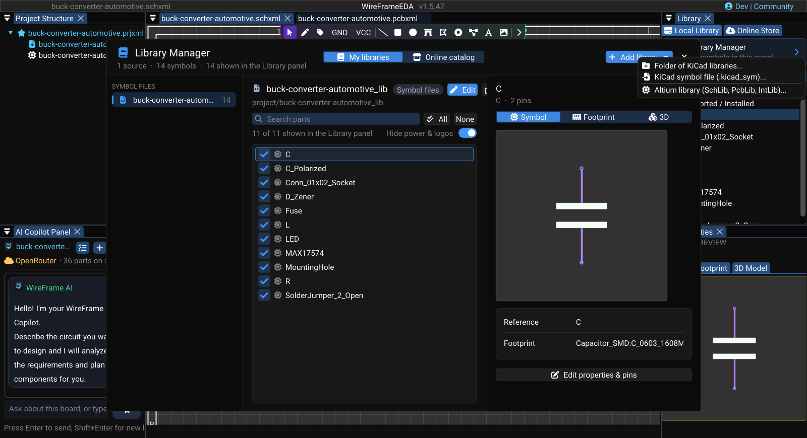

# Supported File Formats

This page lists the formats WireFrame opens directly, the formats it imports through a specific command, and what it writes.

## WireFrame project files

| Extension | Purpose |
|---|---|
| `.prjxml` | WireFrame project and its document references |
| `.schxml` | WireFrame schematic document |
| `.pcbxml` | WireFrame PCB document |

Keep the project and referenced files together when moving or archiving a design. Their internal schema may evolve, so edit them through WireFrame rather than by hand.

## Project import

Use **File → Import → KiCad Project** for:

| Extension | Source |
|---|---|
| `.kicad_pro` | Current KiCad project |
| `.pro` | Legacy KiCad project |

The importer reads the documents available from the selected KiCad project. Review imported symbols, footprints, nets, layers, and board outline before continuing.

!!! note "Not supported"
    Altium `.PrjPcb` and Eagle projects cannot be imported. Altium *libraries* can — see below.

## Library sources

Open **View → Local Library Manager** for supported library workflows:

| Format | Use |
|---|---|
| `.kicad_sym` | KiCad symbol library |
| `.kicad_mod` | KiCad footprint |
| `.SchLib` | Altium symbol library import |
| `.PcbLib` | Altium footprint library import |
| `.IntLib` | Altium integrated library import |
| `.LibPkg` | Altium library package import |

Imported library data must be reviewed against the source datasheet before use. Eagle `.lbr`, `.sch`, and `.brd` import are not part of the current library manager.

## PCB outline import

With a PCB active, use **File → Import → CAD Outline (.svg / .dxf)...**.

| Format | Read as |
|---|---|
| `.svg` | Board outline, or graphics on Edge.Cuts / Top Silk / Top Cu; size from the **Scale** field. The **Import CAD (SVG)** toolbar button reads SVG too |
| `.dxf` (ASCII) | Board outline only (**Import as BOARD OUTLINE**); size from `$INSUNITS`. `LINE`, `LWPOLYLINE`, `POLYLINE`, `CIRCLE`, `ARC`, `SPLINE` are read; blocks (`INSERT`) and binary DXF are not, and are named in the verdict |

The board shape is saved in the `.pcbxml`. See [Board Shape and Outline](../pcb/board-outline.md).

| Assembly | Extension | Contains |
|---|---|---|
| Multi-board assembly | `.asmxml` | Which board projects make up a product, where each sits in the stack, and how they are wired to each other — see [Enclosure Fit and Multi-Board Products](../advanced/enclosure-and-assembly.md) |

## Fabrication and documentation outputs

Depending on the selected export workflow, WireFrame can produce:

| Format | Written by | Purpose |
|---|---|---|
| Gerber X2 (`.GTL`, `.GBL`, `.G1`…, `.GTS`, `.GBS`, `.GTP`, `.GBP`, `.GTO`, `.GBO`, `.GKO`, `.GM1`–`.GM4`) | Fabrication package | Copper, mask, paste, silkscreen, outline, and documentation layers |
| Excellon drill (`Drill_PTH.DRL`, `Drill_NPTH.DRL`) | Fabrication package | Plated and non-plated drilling data |
| IPC-D-356A (`.d356`) | Fabrication package | Netlist for bare-board electrical test |
| Gerber job file (`.gbrjob`) | Fabrication package | Stackup and file list |
| CSV (`BOM.csv`, `BOM_Grouped.csv`, `PickAndPlace.csv`) | Fabrication package | Bill of materials and component positions |
| `README.txt`, `Drill_Report.txt` | Fabrication package | Package inventory and drill summary |
| `.zip` | Fabrication package | All of the above in one archive |
| PDF | **Export Schematic to PDF...**, **Print PCB to PDF (1:1)...** | Schematic documentation; one true-scale PDF per PCB layer |
| `.kicad_mod`, `.kicad_sym` | Footprint and Symbol Library Editors | Library parts |

An exported file is not self-validating. Inspect the package, confirm the saved board revision, and follow the [Fabrication and Export](../pcb/fabrication-and-export.md) checklist.

### Image — Supported import commands

!!! note "Image capture brief"
    1. **Prepare:** Open a clean release-build workspace with fictional or public sample data and prepare the requested state.
    2. **Build the frame:** Capture the v1.5.47 **File → Import** submenu with KiCad Project and CAD Outline visible. Use a second inset of Local Library Manager showing the Altium library importer.
    3. **Clean the frame:** Close unrelated panels and tooltips, move the pointer away from key text, and hide credentials, usernames, customer data, and private paths.
    4. **Capture and finish:** Capture a native-resolution PNG, crop without cutting titles or primary actions, and add at most three subtle callouts without altering engineering content.
    5. **Approve:** Check the image at 100% zoom for current labels, readable evidence, correct release branding, and absence of sensitive information.

<!-- wf:shot id=supported-import-commands
caption: 'Library Manager → Add library: KiCad folders and files, and Altium libraries'
setup:
- open_project
- ensure_schematic
- wait: 1
- menu:
  - View
  - Local Library Manager
- wait: 2
- click: //Library Manager/{fa:plus}  Add library  {fa:caret-down}
- wait: 1
brief_sha256: 3364480ac0fba1a9
-->
<!-- wf:out id=supported-import-commands sha=3d1b072c7b9c -->

<!-- /wf:out -->

## Related guidelines

- [Projects and Files](../projects.md)
- [Library Import and Management](../libraries/library-converter.md)
- [Fabrication and Export](../pcb/fabrication-and-export.md)
