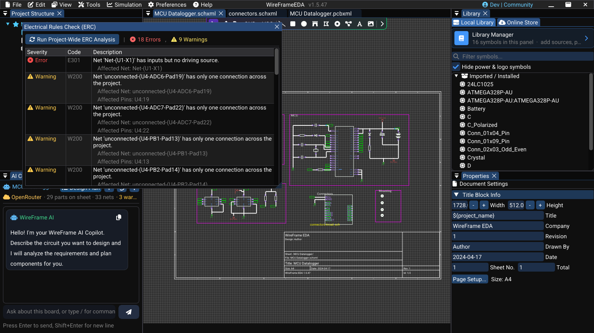

# ERC — Electrical Rules Check

The Electrical Rules Check (ERC) scans your schematic for common connectivity and electrical errors **before** you convert to PCB. Catching problems early saves time and prevents hard-to-trace issues downstream.

---

## Why Run ERC?

| Benefit | Example |
|---|---|
| **Detect floating pins** | An MCU input pin left unconnected picks up noise |
| **Find missing connections** | A power pin never wired to VCC |
| **Catch driver conflicts** | Two output pins shorted together |
| **Prevent duplicate IDs** | Two components both named `R1` — causes BOM and netlist confusion |

---

## Running the ERC

1. Open any schematic of the project.
2. Select **Tools → Electrical Rules Check (ERC)**. The **Electrical Rules Check (ERC)** panel opens.
3. Select **Run Project-Wide ERC Analysis**. Every sheet of the project is checked together, so a net that continues on another sheet through a label is not reported as open.
4. The panel shows the number of **Errors** and **Warnings** and a table of results.

### Image — ERC results and highlighted issue

!!! note "Image capture brief"
    1. **Prepare:** Open a clean release-build workspace with fictional or public sample data and prepare the requested state.
    2. **Build the frame:** Capture the v1.5.47 ERC panel with a small mix of errors and warnings. Keep one result selected and its affected pin or net visible on the canvas.
    3. **Clean the frame:** Close unrelated panels and tooltips, move the pointer away from key text, and hide credentials, usernames, customer data, and private paths.
    4. **Capture and finish:** Capture a native-resolution PNG, crop without cutting titles or primary actions, and add at most three subtle callouts without altering engineering content.
    5. **Approve:** Check the image at 100% zoom for current labels, readable evidence, correct release branding, and absence of sensitive information.

<!-- wf:shot id=erc-results-and-highlighted-issue
caption: 'ERC on the KLP4e datalogger as published: 18 errors, 9 warnings, each with its net and pins'
setup:
- open_project
- ensure_schematic
- wait: 1
- canvas_fit
- menu:
  - Tools
  - Electrical Rules Check (ERC)
- wait: 1
- click: //Electrical Rules Check (ERC)/{fa:sync} Run Project-Wide ERC Analysis
- wait: 1
- action:
    action: mouse_move_to
    x: 1000
    y: 12
brief_sha256: 4c536a2fc4099df8
-->
<!-- wf:out id=erc-results-and-highlighted-issue sha=21c7e3e998de -->

<!-- /wf:out -->

---

## Reading the Results

Each row has a **Severity** (**Error** or **Warning**), a **Code**, and a **Description**. Where it applies, the row also lists the **Affected Net** and the **Affected Pins** as `designator:pin`, for example `U4:19` — pin 19 of U4.

The picture above is the [KLP4e datalogger](https://github.com/futureshocked/KLP4e_MCU-Datalogger) exactly as it is published, and it is a good lesson in reading ERC: a finished, working board still reports 18 errors and 9 warnings. The first rows are typical:

- **E301 on `Net-(U1-X1)`** — pin X1 of the DS1337 real-time clock is an *input*, and the 32.768 kHz crystal on that net is *passive*, so nothing on the net counts as a driver. An oscillator pin is driven by the crystal circuit, not by an output pin: check the datasheet, then accept the result.
- **W200 on `unconnected-(U4-ADC6-Pad19)`, `…ADC7-Pad22`, `…PB1-Pad13`** — ATmega328P pins left unused. Each sits alone on its net. That is fine for spare GPIO, but every one of them deserves a look: it is exactly how a forgotten connection looks too.

| Code | Severity | Meaning | How to fix |
|---|---|---|---|
| **E101** | Error | **Duplicate designator** — two components share a designator, possibly on different sheets | Rename one in **Properties → Designator** |
| **E102** | Error | **Multiple output drivers** — two or more output pins drive the same net | Separate the outputs, use open-drain/open-collector parts, or add buffering |
| **E301** | Error | **No driving source** — a net has inputs but nothing drives it | Connect the source, or the pull-up/pull-down the datasheet asks for |
| **E302** | Error | **Critical pin unconnected** — an unconnected pin of a resistor, capacitor, inductor, or diode, or a passive, input, output, power, or bidirectional pin | Wire it, or remove the part if it is not used |
| **W200** | Warning | **Net with only one connection** across the project — usually a label or wire that goes nowhere | Add the matching label at the destination, or complete the wire |
| **W301** | Warning | **Pin unconnected** — a pin of another or unknown type is left open | Connect it, or confirm in the datasheet that it may float |

Pins whose type is *no connect* are never reported. Two outputs are reported only when both are definite outputs: bidirectional pins sharing a bus (SWDIO, I²C) are expected.

## Fixing Issues

1. Read the **Affected Pins** of the row — for example `U4:19` is pin 19 of U4.
2. Find the part on the sheet and correct the connection, value, or designator.
3. Select **Run Project-Wide ERC Analysis** again.

Repeat **Run → locate → correct → Run** until no error remains. Review warnings individually before PCB conversion.

### Short video — Fix and re-run ERC

!!! note "Video production brief"
    1. **Prepare:** Use a public schematic with one deliberate, safe ERC issue and no unrelated errors.
    2. **Opening shot (2–3 s):** Show the ERC result selected and its affected pin or net highlighted.
    3. **Action shot (8–10 s):** Navigate to the issue, make the single correction, and run ERC again.
    4. **Result shot (4–5 s):** Hold on the refreshed results with that violation removed.
    5. **Deliver:** Export an approximately **20-second** 1080p MP4 and retain the demo project for reproducibility.

<!-- wf:video id=fix-and-re-run-erc
caption: Remove the SDA label at U2 and ERC goes from 18 to 19 errors; undo, re-run, and it is back to
  18
setup:
- open_project
- ensure_schematic
- wait: 1
- canvas_fit:
    box:
    - 250
    - 1040
    - 1350
    - 1460
- menu:
  - Tools
  - Electrical Rules Check (ERC)
- wait: 1
- drag_at:
    from:
    - 300
    - 72
    to:
    - 1120
    - 412
- click: //Electrical Rules Check (ERC)/{fa:sync} Run Project-Wide ERC Analysis
- wait: 1
- action:
    action: mouse_move_to
    x: 1000
    y: 12
steps:
- wait: 2
- canvas_click: NetLabel_2
- wait: 1
- keys:
  - Delete
- wait: 1
- click: //Electrical Rules Check (ERC)/{fa:sync} Run Project-Wide ERC Analysis
- action:
    action: mouse_move_to
    x: 1000
    y: 12
- wait: 2.5
- keys:
  - Ctrl
  - Z
- wait: 1
- click: //Electrical Rules Check (ERC)/{fa:sync} Run Project-Wide ERC Analysis
- action:
    action: mouse_move_to
    x: 1000
    y: 12
- wait: 3
brief_sha256: d657ce8f2cad2a1b
-->
<!-- wf:out id=fix-and-re-run-erc sha=d63ff38cbf89 -->
<video controls muted playsinline preload="metadata" src="../../assets/wf/docs/schematic/erc/fix-and-re-run-erc.mp4" title="Remove the SDA label at U2 and ERC goes from 18 to 19 errors; undo, re-run, and it is back to 18"></video>
<!-- /wf:out -->

In the video, the `SDA` net label next to the U2 EEPROM is deleted on purpose. Its pin is now alone, and the count goes from 18 to 19 errors. ++ctrl+z++ puts the label back, and the next run is back to 18 — the way to confirm that a change fixed what you meant and nothing else.

---

## Pitfalls

**What ERC catches**

- A pin connected to nothing at all (E302 / W301), a label that leads nowhere (W200), two outputs fighting (E102), an input with no driver (E301), the same designator twice (E101).
- Across sheets: a net carried by labels to another sheet is followed, so it is not reported as open.

**What it does not catch — check these yourself**

- **Power inputs that are not powered.** There is no "power input not driven" rule: E301 counts *input* pins only, and `power_in` pins are not checked for a source. If the `GND` symbol under the ATmega328P is deleted, its three ground pins stay wired to each other but leave the `GND` net — and ERC still reports 18 errors. Before layout, click a ground or supply wire and check that the highlighted net reaches its source.
- **Wrong values or wrong parts.** ERC looks at connections, not at what a resistor is worth or whether the footprint matches the symbol. That is the job of the [AI review](../ai/index.md) and of the [footprint check](../libraries/symbols-library.md).
- **A connection that should not exist.** Two nets accidentally joined by a label with the same name are, for ERC, one valid net.

---

## ERC Before PCB Conversion

!!! important "Always run ERC before converting to PCB"
    Unresolved ERC errors can propagate into the PCB as missing connections, incorrect net mappings, or orphan footprints. Running ERC first ensures a clean netlist transfer.

---

## See Also

- [Wiring & Nets](wiring-and-nets.md) — fix connectivity issues found by ERC.
- [Properties & Attributes](properties-and-attributes.md) — fix missing values and designators.
- [DFM & DRC](../pcb/dfm-and-drc.md) — the PCB-side equivalent of ERC.
