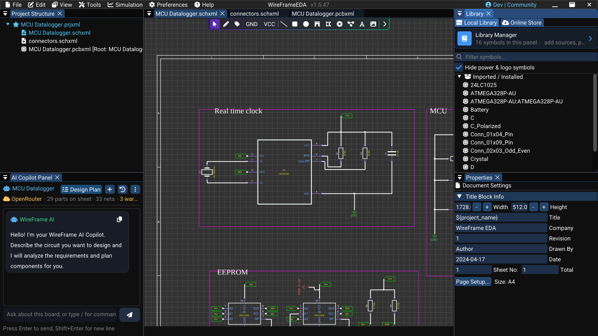

# Graphics and Annotations

Use schematic graphics and text to explain circuit intent, group related sections, and record design constraints. They support documentation but do not create an electrical connection unless the selected tool is explicitly electrical.

## Choose the correct tool

| Tool | Use it for |
|---|---|
| **Draw Line** (++shift+l++), **Draw Rectangle** (++r++), **Draw Circle** (++e++), **Draw Arc** (++a++), **Draw Polygon** (++o++) | Visual grouping or explanatory shapes |
| **Place Text** (++t++) | Notes, limits, test points, and design intent |
| **Net Harness** (++h++) | A drawn line that marks a bundle of signals; it does not connect nets |
| **Junction** (++j++) | Explicit electrical meeting point of wires |
| **Import Image** | A PNG, JPG, or BMP picture (a logo, a block diagram) placed at the centre of the view |

Do not use a graphic line as a wire. If two pins must be electrically connected, use the Wire tool and verify the result with net highlighting or ERC.

## Create and edit an annotation

1. Select the graphic or text tool.
2. Place its points or bounds on the sheet.
3. Press ++esc++ when the shape is complete.
4. Select it and use **Properties → Graphic Object** to set **Content** (text), **Size**, **Color**, or **Thickness**.
5. Save and inspect the PDF result if the annotation is part of release documentation.

### Short video — Add a circuit note and grouping box

!!! note "Video production brief"
    1. **Prepare:** Open a clean schematic block with space for one short constraint note and grouping rectangle.
    2. **Opening shot (2 s):** Hold on the unannotated block and relevant drawing tools.
    3. **Action shot (8–11 s):** Add the text note, draw the rectangle, then edit one property of each through **Properties**.
    4. **Result shot (3–4 s):** Select each object normally so current handles and selection styling are visible.
    5. **Deliver:** Export a **15–20 second** 1080p MP4 and replace older media if tools or handles differ.

<!-- wf:video id=add-a-circuit-note-and-grouping-box
caption: Place a text note under the 32.768 kHz crystal Y1 and draw a grouping rectangle around it
setup:
- open_project
- ensure_schematic
- wait: 1
- canvas_fit:
    refs:
    - Y1
    - U1
    margin: 0.35
- action:
    action: mouse_move_to
    x: 1000
    y: 12
steps:
- wait: 1
- click: //SchematicToolbarWindow/{fa:font}
- wait: 0.5
- canvas_click:
  - 200
  - 650
- wait: 1
- click: //SchematicToolbarWindow/{fa:square}
- wait: 0.5
- canvas_click:
  - 195
  - 505
- wait: 0.5
- canvas_click:
  - 300
  - 615
- wait: 1
- keys:
  - Escape
- action:
    action: mouse_move_to
    x: 1000
    y: 12
- wait: 2
brief_sha256: f82d656a0bf9c147
-->
<!-- wf:out id=add-a-circuit-note-and-grouping-box sha=90830286b292 -->
<video controls muted playsinline preload="metadata" src="../../assets/wf/docs/schematic/graphics-and-annotations/add-a-circuit-note-and-grouping-box.mp4" title="Place a text note under the 32.768 kHz crystal Y1 and draw a grouping rectangle around it"></video>
<!-- /wf:out -->

The KLP4e datalogger is a good model: every functional block on its main sheet — *Real time clock*, *MCU*, *EEPROM*, *Connectors*, *Mounting* — sits inside a rectangle with a title in large text. Imported from KiCad, those rectangles and titles come in as WireFrame graphics, drawn exactly where the author put them.

## Annotation guidelines

- State measurable constraints, not vague comments.
- Keep notes outside symbol pins and wires.
- Use consistent font size and restrained color.
- Include voltage, current, tolerance, or test conditions when relevant.
- Avoid duplicating information that is already controlled by a component property.
- Confirm that release-critical notes remain readable in exported PDF.

## Dimensions

The schematic editor has no dimension tool. Record required distances as text, and place real dimensions on the PCB with the **Measure** tool (++m++).

### Image — Documented schematic block

!!! note "Image capture brief"
    1. **Prepare:** Open a clean release-build workspace with fictional or public sample data and prepare the requested state.
    2. **Build the frame:** Capture one functional block with a clean grouping shape and a concise constraint note. Keep electrical wires visually distinct from annotations.
    3. **Clean the frame:** Close unrelated panels and tooltips, move the pointer away from key text, and hide credentials, usernames, customer data, and private paths.
    4. **Capture and finish:** Capture a native-resolution PNG, crop without cutting titles or primary actions, and add at most three subtle callouts without altering engineering content.
    5. **Approve:** Check the image at 100% zoom for current labels, readable evidence, correct release branding, and absence of sensitive information.

<!-- wf:shot id=documented-schematic-block
caption: 'The KLP4e real-time clock block as its author drew it: a grouping rectangle titled Real time
  clock around U1, its crystal and pull-ups'
setup:
- open_project
- ensure_schematic
- wait: 1
- canvas_fit:
    refs:
    - Y1
    - U1
    - R1
    - R2
    - C1
    margin: 0.12
- wait: 1
- action:
    action: mouse_move_to
    x: 1000
    y: 12
brief_sha256: 5ead5ed9c76d8a4c
-->
<!-- wf:out id=documented-schematic-block sha=3c09411ccc43 -->

<!-- /wf:out -->

## Related guidelines

- [Wiring and Nets](wiring-and-nets.md)
- [Properties and Attributes](properties-and-attributes.md)
- [Templates and Title Block](templates.md)
