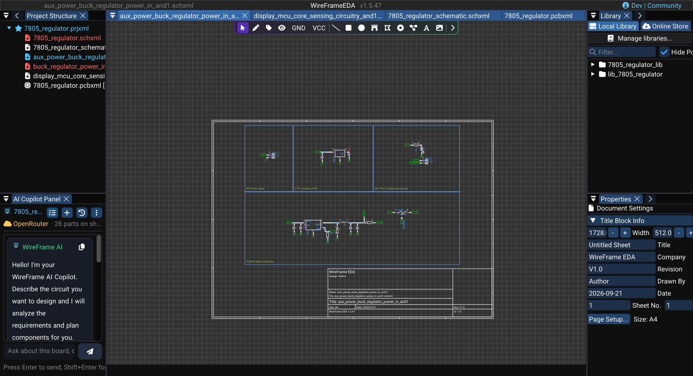

# Schematic Templates & Title Block

WireFrame includes a template system for schematic sheets — customizable page borders, title blocks, revision fields, and company branding. Templates ensure professional, consistent documentation across all your schematic pages.

---

## Title Block

Every schematic sheet has a **title block** in the lower-right corner. It displays metadata from the page settings:

### Image — Completed schematic title block

!!! note "Image capture brief"
    1. **Prepare:** Open a clean release-build workspace with fictional or public sample data and prepare the requested state.
    2. **Build the frame:** Capture an entire schematic page with its lower-right title block readable. Use sample project metadata rather than a customer or unreleased product name.
    3. **Clean the frame:** Close unrelated panels and tooltips, move the pointer away from key text, and hide credentials, usernames, customer data, and private paths.
    4. **Capture and finish:** Capture a native-resolution PNG, crop without cutting titles or primary actions, and add at most three subtle callouts without altering engineering content.
    5. **Approve:** Check the image at 100% zoom for current labels, readable evidence, correct release branding, and absence of sensitive information.

<!-- wf:shot id=completed-schematic-title-block
caption: A whole schematic page with its title block
setup:
- open_project
- ensure_schematic
- wait: 1
- canvas_click:
  - 100
  - 100
- keys:
  - Home
- wait: 1
- action:
    action: mouse_move_to
    x: 1000
    y: 12
brief_sha256: 34762e309e0ad239
-->
<!-- wf:out id=completed-schematic-title-block sha=90eee1d4ffc9 -->

<!-- /wf:out -->

### Editing the title block

1. Click on **empty canvas** (deselect everything).
2. The **Properties** panel shows **Document Settings → Title Block Info**:

| Field | Description | Example |
|---|---|---|
| **Width** / **Height** | Size of the title block | |
| **Title** | Design title | "Power Supply Rev B" |
| **Company** | Organization name | "WireFrame Labs" |
| **Revision** | Version identifier | "1.2" |
| **Date** | Design date | "2026-03-23" |
| **Drawn By** | Author name | "A. Engineer" |
| **Sheet No.** / **Total** | Current / total sheets | "1" / "3" |

Changes in the Properties panel apply **immediately** — the title block updates on the canvas. **Size** shows the paper size; **Page Setup...** opens the **Page Settings** dialog for paper size, border colour, comments, and logo.

### Image — Title-block properties

!!! note "Image capture brief"
    1. **Prepare:** Open a clean release-build workspace with fictional or public sample data and prepare the requested state.
    2. **Build the frame:** Capture **Properties → Document Settings → Title Block Info** beside the title block it updates. Make the title, revision, date, author, and sheet number readable.
    3. **Clean the frame:** Close unrelated panels and tooltips, move the pointer away from key text, and hide credentials, usernames, customer data, and private paths.
    4. **Capture and finish:** Capture a native-resolution PNG, crop without cutting titles or primary actions, and add at most three subtle callouts without altering engineering content.
    5. **Approve:** Check the image at 100% zoom for current labels, readable evidence, correct release branding, and absence of sensitive information.

<!-- wf:shot id=title-block-properties
caption: Properties → Document Settings → Title Block Info beside the title block
setup:
- open_project
- ensure_schematic
- wait: 1
- keys:
  - Home
- wait: 0.5
- click_at:
  - 700
  - 700
- wait: 0.5
- action:
    action: mouse_move_to
    x: 1000
    y: 12
brief_sha256: 0cfe94e2682e4ca2
-->
<!-- wf:out id=title-block-properties sha=af1c10742287 -->

<!-- /wf:out -->

---

## Page Setup

Open **File → Page Settings...** or **Page Setup...** in the Properties panel. The **Page Settings** dialog has two parts:

- **Paper Size & Colors** — **Format** (**A4 (297x210mm)**, **A3 (420x297mm)**, **A2 (594x420mm)**, or **Custom** with **Width / Height**), **Border Color** with the **Presets** red, white, cyan, and orange.
- **Title Block Information** — **Width** and **Height** of the block, **Title (Auto)**, **Company**, **Revision**, **Drawn By**, **Date**, **Comment 1**–**Comment 4**, and **Sheet No. (Auto)** / **Total Sheets (Auto)**. In a project, the sheet number and total come from the order of the schematics in the project.
- **Logo Image** — **Import Logo...** for PNG, JPG, JPEG, or BMP artwork; **Clear Logo** removes it.

Select **OK** to apply and save, or **Cancel** to close without changes.

### Image — Page Settings modal

!!! note "Image capture brief"
    1. **Prepare:** Open a clean release-build workspace with fictional or public sample data and prepare the requested state.
    2. **Build the frame:** Capture the complete **Page Settings** modal for a schematic. Include paper size, title-block metadata, border-color presets, **Import Logo**, **Clear Logo** when available, and the **OK**/**Cancel** footer. Use fictional company data. Suggested size: **1000 × 900 px**.
    3. **Clean the frame:** Close unrelated panels and tooltips, move the pointer away from key text, and hide credentials, usernames, customer data, and private paths.
    4. **Capture and finish:** Capture a native-resolution PNG, crop without cutting titles or primary actions, and add at most three subtle callouts without altering engineering content.
    5. **Approve:** Check the image at 100% zoom for current labels, readable evidence, correct release branding, and absence of sensitive information.

<!-- wf:shot id=page-settings-modal
caption: Page Settings for a schematic sheet
setup:
- open_project
- ensure_schematic
- wait: 1
- menu:
  - File
  - Page Settings...
- wait: 1
- action:
    action: mouse_move_to
    x: 1000
    y: 12
brief_sha256: a3c155b78bae985c
-->
<!-- wf:out id=page-settings-modal sha=63bbcf4ea2bf -->

<!-- /wf:out -->

### Paper size

WireFrame supports standard paper sizes and custom dimensions:

| Size | Dimensions |
|---|---|
| A4 | 297 × 210 mm |
| A3 | 420 × 297 mm |
| A2 | 594 × 420 mm |
| Custom | User-defined width × height |

Choose the paper size under **Format** in the **Page Settings** dialog.

### Grid settings

The dot grid on the schematic canvas helps with alignment:

- Components and wires snap to the grid.
- **Preferences → Grid & Snap** sets **Show grid**, **Crosshair at cursor**, **Snap to grid**, and the **Grid step** (the visible grid and the snap grid are one value). Hold ++alt++ to place something off-grid without turning snapping off; ++shift+g++ shows or hides the grid.

---

## Sheet template behavior

WireFrame constructs the visual elements of the schematic page from its settings:

- **Page border** — drawn from the paper size dimensions with margins.
- **Title block frame** — structured table with labeled cells.
- **Comments** — up to four comment lines in the title block for notes such as revision history.

The template is automatically rendered as part of the schematic canvas and included in **PDF exports**.

---

## Tips

!!! tip "Consistent documentation"
    Fill in the title block fields for every schematic sheet in your project. This information appears in PDF exports and helps team members identify documents.

!!! info "Title block in exports"
    When you select **File → Export → Export Schematic to PDF**, the title block is included with the sheet. Review the exported PDF for readable text, borders, and revision data.

---

## See Also

- [Properties & Attributes](properties-and-attributes.md) — editing page settings in the Properties panel.
- [Fabrication & Export](../pcb/fabrication-and-export.md) — PDF export includes the title block.
