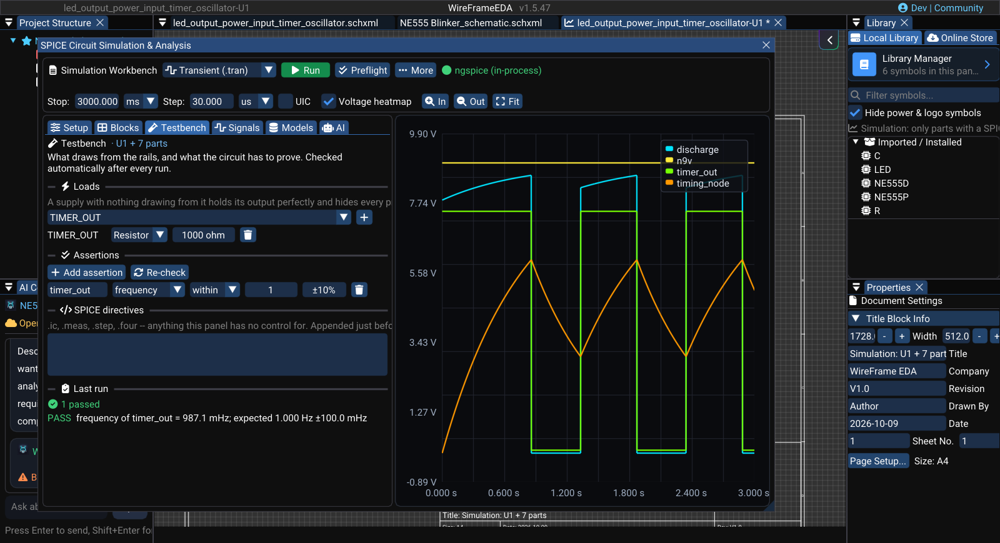

# Testbenches and Measurements

A waveform tells you what happened. A testbench lets you record what the circuit should do and asks WireFrame to check it after every run. A testbench belongs to the simulation it is written in; the sheets of the design never see its loads or checks.

## A simple verification workflow

Add the expected load, choose a signal, define an acceptable limit, and run the simulation. Treat **Pass** as evidence for that requirement, **Fail** as a circuit or setup issue to investigate, and **Not measured** as an incomplete check.

### Image — Testbench with load and assertion

!!! note "Image capture brief"
    1. **Prepare:** Copy the NE555 blinker's block into a simulation, add a 9 V supply, and set a 3 s transient.
    2. **Build the frame:** Capture the **Testbench** tab with one load and one assertion, plus a visible **Last run** result, beside the waveform.
    3. **Clean the frame:** Move the pointer away from key text.
    4. **Approve:** Check the image at 100% zoom for current labels and a readable verdict.

<!-- wf:shot id=testbench-with-load-and-assertion
caption: 'The Testbench of the NE555 blinker''s simulation: a 1 kΩ load on the timer output and a frequency
  check that passes'
project: samples/ne555-blinker/NE555 Blinker.prjxml
setup:
- open_project
- ensure_schematic
- wait: 1
- keys:
  - F5
- wait: 2
- click_match:
    window: SPICE Circuit Simulation
    pattern: ^.*Simulate a Block of This Sh.*$
    timeout: 3
- wait: 2
- click_match:
    window: Simulate a Block
    pattern: ^.*Copy to New Simulation$
    timeout: 3
- wait: 4
- click_match:
    window: SPICE Circuit Simulation
    pattern: ^[^A-Za-z]* Add$
    timeout: 5
- wait: 1
- action:
    action: mouse_move_to
    x: 240
    y: 600
- scroll: -3
- wait: 0.5
- type:
    ref: //SPICE Circuit Simulation & Analysis/**/##DC
    text: '9'
- keys:
  - Tab
- click_at:
  - 350
  - 112
- wait: 0.5
- click: //##Combo_00/{fa:wave-square} Transient (.tran)
- wait: 0.5
- type:
    ref: //SPICE Circuit Simulation & Analysis/**/##StopTime
    text: '3000'
- keys:
  - Tab
- wait: 0.5
- drag_at:
    from:
    - 430
    - 500
    to:
    - 660
    - 500
    seconds: 1
- wait: 0.5
- tab: Testbench
- wait: 0.5
- click_at:
  - 300
  - 348
- wait: 0.5
- click_match:
    window: '##Combo'
    pattern: ^[Tt][Ii][Mm][Ee][Rr]_[Oo][Uu][Tt]$
    timeout: 3
- wait: 0.3
- click_at:
  - 582
  - 348
- wait: 0.5
- click: //SPICE Circuit Simulation & Analysis/**/{fa:plus} Add assertion
- wait: 0.5
- type:
    ref: //SPICE Circuit Simulation & Analysis/**/##Signal
    text: timer_out
- keys:
  - Tab
- click_at:
  - 237
  - 464
- wait: 0.5
- click: //##Combo_00/frequency
- wait: 0.3
- type:
    ref: //SPICE Circuit Simulation & Analysis/**/##Target
    text: '1'
- keys:
  - Tab
- type:
    ref: //SPICE Circuit Simulation & Analysis/**/##Tol
    text: '10'
- keys:
  - Tab
- click_at:
  - 489
  - 112
- wait: 12
- action:
    action: mouse_move_to
    x: 1000
    y: 12
brief_sha256: 4f4413eebcc797d7
-->
<!-- wf:out id=testbench-with-load-and-assertion sha=b55a38e0c01a -->

<!-- /wf:out -->

Open the Simulation Workbench and select the **Testbench** tab. The heading names the circuit it applies to.

## Add a load

Real circuits must power something. An output with no load can look better than it will in the final product.

1. Under **Loads**, choose the output net.
2. Click **Add**.
3. Enter the load required by your design.
4. Run the simulation again.

Use values taken from the product requirement, connected device, or component datasheet.

## Add an acceptance check

1. Under **Assertions**, click **Add**.
2. Choose the signal to check.
3. Choose a measurement.
4. Select **Within**, **At most**, or **At least**.
5. Enter the required value and tolerance.
6. Run the simulation.

### Common measurements

| Measurement | Example use |
|---|---|
| Minimum / Maximum | Make sure a rail never leaves its safe range |
| Peak-to-peak | Check total ripple or signal swing |
| Mean | Check the average DC output |
| RMS / AC RMS | Check signal level or ripple without the DC component |
| Frequency / Period | Verify an oscillator or clock |
| Duty cycle | Verify a PWM output |
| Rise / Fall time | Check switching speed |
| Overshoot | Check startup or edge quality |

## Exclude startup from a steady-state check

Assertions measure the whole record of the last run. When a requirement applies only after startup:

- measure it between the A/B cursors: under **Signals → Measurements**, tick **Measure between cursors**, enable the cursors in **Setup → View**, and place them after the circuit has settled; or
- add a `.meas` directive with a `FROM`/`TO` window under **Testbench → SPICE directives**.

For example, check the average `VOUT` after the regulator has settled instead of including its initial rise from 0 V.

## Understand the result

| Result | Meaning | What to do next |
|---|---|---|
| **Pass** | The measured value meets your limit | Keep the check and continue |
| **Fail** | The measured value is outside your limit | Inspect the waveform, source, load, and circuit |
| **Not measured** | WireFrame could not calculate the requested value | Check the selected signal, analysis, and measurement window |

!!! important
    **Not measured** is not a pass. Also, WireFrame does not assume what a “good” value should be—you must enter the requirement you want to verify.

## Ask Copilot for help

When Copilot is connected, select **Ask why** beside a failed or unmeasured result. Copilot receives the current signal, testbench, and result so it can help you investigate.

Review the explanation against the waveform and datasheet before changing the circuit.

## Before moving to PCB

- Use the same supply voltage and load expected in the final product.
- Add checks for every important output.
- Separate startup requirements from steady-state requirements.
- Resolve every **Fail** and **Not measured** result.
- Save a CSV when you need to share verification evidence.
