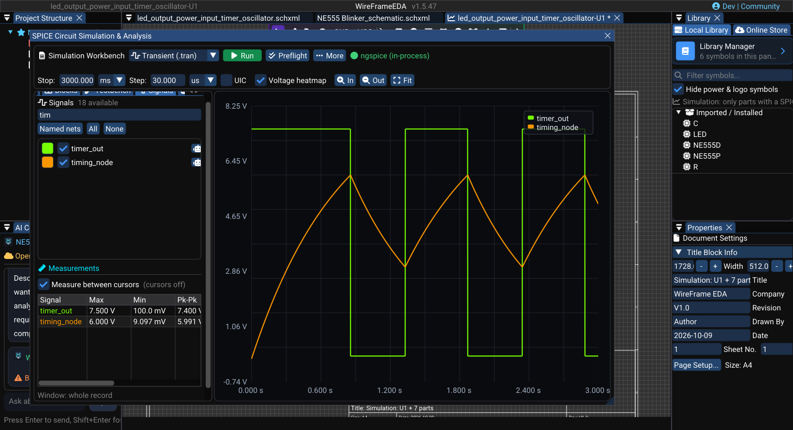

# Waveform Viewer

The waveform area displays results from the latest completed simulation. Use it to compare selected signals, inspect timing and amplitude, and support testbench decisions.

## Select traces

Open **Signals** in the Simulation Workbench and select the nets to display. The plot updates from the available result data.

Use:

- **Named nets** for important labeled signals;
- **All** for broad debugging;
- **None** before building a focused comparison.

You can also mark a net directly on the schematic: choose **Probe Signal** on the schematic toolbar (++v++) and click a wire, pin, net label, or power symbol. A probe marker is placed on that net.

### Image — Waveform Viewer with two signals

!!! note "Image capture brief"
    1. **Prepare:** Open a clean release-build workspace with fictional or public sample data and prepare the requested state.
    2. **Build the frame:** Capture a real transient result with two clearly named signals, grid and legend enabled, and readable axes. Remove the former ASCII waveform mockup. Suggested size: **1400 × 760 px**.
    3. **Clean the frame:** Close unrelated panels and tooltips, move the pointer away from key text, and hide credentials, usernames, customer data, and private paths.
    4. **Capture and finish:** Capture a native-resolution PNG, crop without cutting titles or primary actions, and add at most three subtle callouts without altering engineering content.
    5. **Approve:** Check the image at 100% zoom for current labels, readable evidence, correct release branding, and absence of sensitive information.

<!-- wf:shot id=waveform-viewer-with-two-signals
caption: NE555 blinker, 3 s transient — timer output, timing capacitor, discharge and the 9 V rail
project: samples/ne555-blinker/NE555 Blinker.prjxml
setup:
- open_project
- ensure_schematic
- wait: 1
- keys:
  - F5
- wait: 2
- click_at:
  - 385
  - 760
- wait: 1
- action:
    action: mouse_move_to
    x: 240
    y: 600
- scroll: -3
- wait: 0.5
- type:
    ref: //SPICE Circuit Simulation & Analysis/##DC
    text: '9'
- keys:
  - Tab
- click_at:
  - 430
  - 112
- wait: 0.5
- click: //##Combo_00/{fa:wave-square} Transient (.tran)
- wait: 0.5
- type:
    ref: //SPICE Circuit Simulation & Analysis/##StopTime
    text: '3000'
- keys:
  - Tab
- type:
    ref: //SPICE Circuit Simulation & Analysis/##TimeStep
    text: '1'
- keys:
  - Tab
- wait: 0.5
- click_at:
  - 489
  - 112
- wait: 12
- action:
    action: mouse_move_to
    x: 1000
    y: 12
brief_sha256: d51ef6102daa4dbb
-->
<!-- wf:out id=waveform-viewer-with-two-signals sha=0812c6f13f55 -->

<!-- /wf:out -->

## View controls

| Control | Purpose |
|---|---|
| **Auto-scale results** | Fit available traces to the current plot |
| **Grid** | Show measurement reference lines |
| **Legend** | Identify displayed traces |
| **A/B cursors** | Compare two points on a trace |

Disable auto-scale when you need a stable visual range across repeated runs. Re-enable it when new data falls outside the current view.

## Use A/B cursors

1. Enable **A/B cursors**.
2. Place cursor A at the first event.
3. Place cursor B at the second event.
4. Read the displayed time and amplitude differences.
5. Record the measurement or add an equivalent testbench assertion when it must be checked repeatedly.

### Short video — Measure a waveform with A/B cursors

!!! note "Video production brief"
    1. **Prepare:** Load a clean transient result with one stable periodic signal and readable axes.
    2. **Opening shot (1–2 s):** Hold on the waveform with cursors disabled and one period centered.
    3. **Action shot (5–8 s):** Enable **A/B cursors**, place A on the first equivalent edge, and place B on the next equivalent edge.
    4. **Result shot (2–3 s):** Hold on both cursors and the readable time delta.
    5. **Deliver:** Export a **10–15 second** 1080p MP4 with a visible pointer and no unnecessary zoom animation.

<!-- wf:video id=measure-a-waveform-with-a-b-cursors
caption: Turn on A/B cursors and drag them onto two rising edges of the timer output
project: samples/ne555-blinker/NE555 Blinker.prjxml
setup:
- open_project
- ensure_schematic
- wait: 1
- keys:
  - F5
- wait: 2
- click_at:
  - 385
  - 760
- wait: 1
- action:
    action: mouse_move_to
    x: 240
    y: 600
- scroll: -3
- wait: 0.5
- type:
    ref: //SPICE Circuit Simulation & Analysis/##DC
    text: '9'
- keys:
  - Tab
- click_at:
  - 430
  - 112
- wait: 0.5
- click: //##Combo_00/{fa:wave-square} Transient (.tran)
- wait: 0.5
- type:
    ref: //SPICE Circuit Simulation & Analysis/##StopTime
    text: '3000'
- keys:
  - Tab
- type:
    ref: //SPICE Circuit Simulation & Analysis/##TimeStep
    text: '1'
- keys:
  - Tab
- wait: 0.5
- click_at:
  - 489
  - 112
- wait: 12
- action:
    action: mouse_move_to
    x: 1000
    y: 12
steps:
- wait: 1
- click_at:
  - 240
  - 792
- wait: 1.5
- drag_at:
    from:
    - 682
    - 500
    to:
    - 818
    - 500
- wait: 1
- drag_at:
    from:
    - 1032
    - 500
    to:
    - 1055
    - 500
- wait: 3
brief_sha256: 8929a337f0cc6ab5
-->
<!-- wf:out id=measure-a-waveform-with-a-b-cursors sha=90402b5fb199 -->
<video controls muted playsinline preload="metadata" src="../../assets/wf/docs/simulation/waveform-viewer/measure-a-waveform-with-a-b-cursors.mp4" title="Turn on A/B cursors and drag them onto two rising edges of the timer output"></video>
<!-- /wf:out -->

## Interpret common analyses

### Transient

Check startup, delay, rise/fall time, overshoot, ripple, duty cycle, and settling behavior over time.

### AC

Check gain and phase across frequency. Confirm that the selected engine and model support the intended AC behavior.

### DC sweep

Check how an output or operating point changes with a swept source or parameter.

### Operating point

Check steady node voltages and branch currents without interpreting them as time-domain traces.

## Compare results safely

- keep source, load, model version, scope, and analysis settings identical;
- do not compare traces from different runs unless the settings are recorded;
- use assertions for release criteria instead of judging only by visual shape;
- exclude startup from steady-state measurements when appropriate;
- export data when another reviewer needs evidence.

## Ask Copilot

Use the robot action beside a signal or open the **AI** tab and select **Explain waveform results**. State the expected behavior and the relevant time window. Verify the response against the plotted data and testbench limits.

## See also

- [Running a Simulation](running-simulation.md)
- [Testbenches and Measurements](testbenches-and-measurements.md)
- [Simulation Engines and Models](engines-and-models.md)
