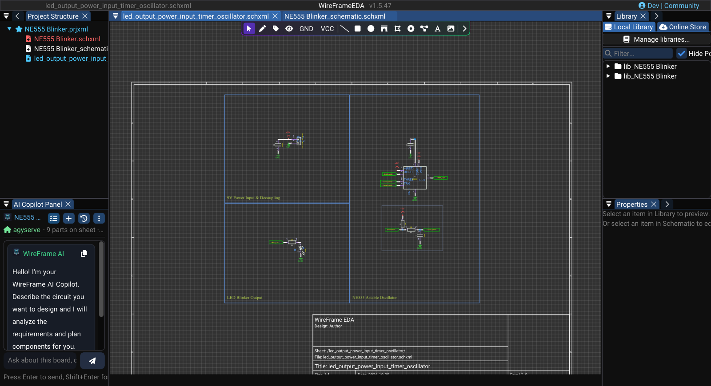
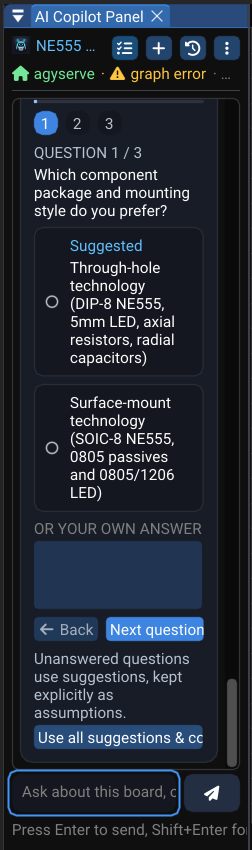
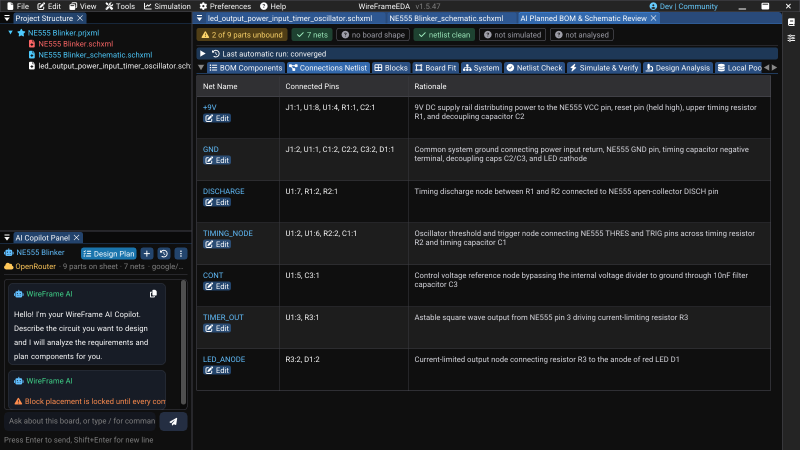
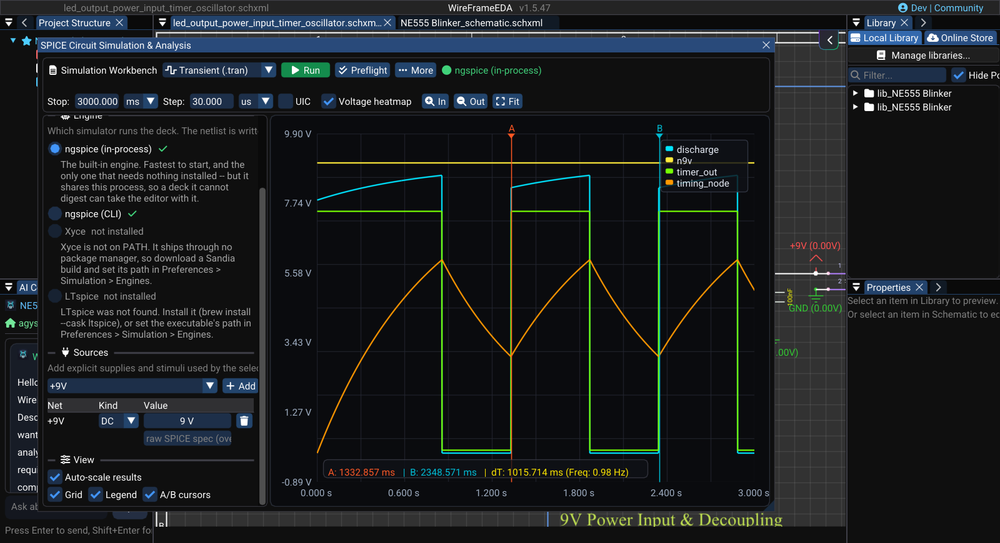

# Tutorial: AI-Assisted Circuit Design

This tutorial uses AI Copilot to prepare a small NE555 LED blinker, review its proposed design, resolve missing library assets, and verify measurable behavior. AI output remains a proposal until you review and validate it.

### Image — Finished AI-assisted example

!!! note "Image capture brief"
    1. **Prepare:** Open a clean release-build workspace with fictional or public sample data and prepare the requested state.
    2. **Build the frame:** Capture the final schematic, routed PCB, and AI Copilot panel in one v1.5.47 workspace. Use a sample project and ensure no API key or private path is visible.
    3. **Clean the frame:** Close unrelated panels and tooltips, move the pointer away from key text, and hide credentials, usernames, customer data, and private paths.
    4. **Capture and finish:** Capture a native-resolution PNG, crop without cutting titles or primary actions, and add at most three subtle callouts without altering engineering content.
    5. **Approve:** Check the image at 100% zoom for current labels, readable evidence, correct release branding, and absence of sensitive information.

<!-- wf:shot id=finished-ai-assisted-example
caption: 'The finished NE555 blinker: schematic generated from the reviewed plan, with the Copilot beside
  it'
project: samples/ne555-blinker/NE555 Blinker.prjxml
setup:
- open_project
- ensure_schematic
- wait: 1
- canvas_click:
  - -5000
  - -5000
- keys:
  - Home
- panel: ai
- wait: 1.5
- action:
    action: mouse_move_to
    x: 1000
    y: 12
brief_sha256: a79bc0ededcd8271
-->
<!-- wf:out id=finished-ai-assisted-example sha=8d5ef477e6a1 -->

<!-- /wf:out -->

## Before you start

You need a new project, an AI endpoint configured in **Preferences → AI Assistant** (an OpenRouter key, or the local agyserve preset), suitable component libraries, and a simulation engine (ngspice is built in). Save the project before starting the request, then open **View → AI Copilot Chat** (++ctrl+space++).

## 1. State measurable requirements

Send a prompt such as:

> Design a 9 V NE555 astable LED blinker. Target 1 Hz, use a red LED, include current limiting and supply decoupling, and identify every assumption that needs my confirmation.

Include voltage, frequency, tolerances, package preferences, connector requirements, and board constraints when known. If Copilot asks a question, answer it before accepting a BOM; unanswered choices become risky assumptions.

### Image — Prompt and clarification

!!! note "Image capture brief"
    1. **Prepare:** Open a clean release-build workspace with fictional or public sample data and prepare the requested state.
    2. **Build the frame:** Capture the initial requirement and one clarification exchange in AI Copilot. The prompt must include supply voltage and target frequency.
    3. **Clean the frame:** Close unrelated panels and tooltips, move the pointer away from key text, and hide credentials, usernames, customer data, and private paths.
    4. **Capture and finish:** Capture a native-resolution PNG, crop without cutting titles or primary actions, and add at most three subtle callouts without altering engineering content.
    5. **Approve:** Check the image at 100% zoom for current labels, readable evidence, correct release branding, and absence of sensitive information.

<!-- wf:shot id=prompt-and-clarification
caption: The NE555 request, then the first clarifying question
project: none
setup:
- pick_folder: tutorials
- menu:
  - File
  - New
  - New Project (.prjxml)...
- wait: 1
- type:
    text: NE555 Blinker
- click_at:
  - 634
  - 485
- wait: 2
- menu:
  - File
  - New
  - New Schematic (.schxml)
- wait: 1
- save_file: tutorials/NE555 Blinker.schxml
- keys:
  - Ctrl
  - S
- wait: 2
- panel: ai
- wait: 1
- type:
    ref: //AI Copilot Panel/##ChatInput
    text: Design a 9 V NE555 astable LED blinker. Target 1 Hz, use a red LED, include current limiting
      and supply decoupling, and identify every assumption that needs my confirmation.
- keys:
  - Enter
- wait_for:
    ref: //AI Copilot Panel/Use all suggestions & continue
    timeout: 580
    scroll_in: //AI Copilot Panel
- menu:
  - View
  - Project Structure
- action:
    action: mouse_move_to
    x: 120
    y: 500
- scroll: -400
- wait: 1
- action:
    action: mouse_move_to
    x: 1000
    y: 12
capture:
  window: AI Copilot Panel
  padding: 4
brief_sha256: fcd5386ecc342a33
-->
<!-- wf:out id=prompt-and-clarification sha=be5bbdfddf08 -->

<!-- /wf:out -->

## 2. Review the proposed design

Open **Design Plan** in the AI Copilot panel. In the **AI Planned BOM & Schematic Review** window (the *Component Review*), work through the tabs:

1. **BOM Components** — verify part identity, value, rating, package, and availability.
2. **Connections Netlist** — compare every NE555 pin and LED polarity with the datasheet.
3. **Blocks** — confirm that timing, output, power, and decoupling functions are present.
4. **Netlist Check** — resolve pin and connectivity findings.
5. **Simulate & Verify** — readiness checks and **Run Simulation**.
6. **Design Analysis** — resolve warnings before applying changes.
7. **Local Pool Settings** — decide which approved local assets may be reused.

Do not approve a component merely because its name matches. Package, pin numbering, ratings, and model pin order must also match.

### Image — Component Review tabs

!!! note "Image capture brief"
    1. **Prepare:** Open a clean release-build workspace with fictional or public sample data and prepare the requested state.
    2. **Build the frame:** Capture the complete review window with all seven tabs visible and one BOM item selected. Do not fabricate a separate schematic preview if the release UI does not show one.
    3. **Clean the frame:** Close unrelated panels and tooltips, move the pointer away from key text, and hide credentials, usernames, customer data, and private paths.
    4. **Capture and finish:** Capture a native-resolution PNG, crop without cutting titles or primary actions, and add at most three subtle callouts without altering engineering content.
    5. **Approve:** Check the image at 100% zoom for current labels, readable evidence, correct release branding, and absence of sensitive information.

<!-- wf:shot id=component-review-tabs
caption: Connections Netlist — every net of the NE555 blinker with the pins it joins and why
project: samples/ne555-blinker/NE555 Blinker.prjxml
setup:
- open_project
- panel: ai
- wait: 2
- click: //AI Copilot Panel/{fa:tasks} Design Plan
- wait: 2
- &id001
  action:
    action: mouse_move_to
    x: 1000
    y: 12
- tab: Connections Netlist
- wait: 1
- *id001
brief_sha256: d76ed8651b6d7381
-->
<!-- wf:out id=component-review-tabs sha=e52215effc29 -->

<!-- /wf:out -->

## 3. Fix or create a missing component when required

For a card marked **Not in Pool**, try **Create** first — it searches WireFrame's published library for the exact part. If it is not there, repair or build the part in the AI panel:

```text
/fix U1 build the symbol and footprint from the datasheet
```

Attach the manufacturer's PDF with **Attach datasheet...**, review the plan Copilot shows, and select **Apply**. To build every missing part at once, ask in the chat — for example *"fix the parts that cannot be used yet"*.

Before continuing, check pin count, pin names, electrical types, pad numbering, dimensions, pitch, orientation marker, and symbol-to-footprint mapping, then **Confirm this component**. Follow [Fix or Create a Component](../ai/component-generator.md) for the complete acceptance checklist.

### Short video — Resolve a missing component

!!! note "Video production brief"
    1. **Prepare:** Use a public eight-pin component, an approved public datasheet, and a card marked **Not in Pool**.
    2. **Opening shot (2–3 s):** Hold on the missing card and its `/fix` hint.
    3. **Action shot (12–18 s):** Type `/fix U1 …` in the AI panel, attach the prepared datasheet, show the plan, select **Apply**, show one real progress state, then cut across the wait.
    4. **Review shot (8–10 s):** Open the generated symbol and footprint, compare pin 1 and at least three readable pin-to-pad numbers, then return to the refreshed card.
    5. **Deliver:** Export a **25–35 second** 1080p MP4; hide the API key, local paths, and any proprietary datasheet content.

## 4. Add explicit simulation requirements

Open **Simulate & Verify** or the Simulation Workbench and define a transient run long enough to show several cycles. Add signals for the output and timing capacitor, then create assertions for the acceptable frequency range and output behavior.

A visual waveform that “looks right” is not a pass criterion. Use the A/B cursors or a measurement to confirm the period, and keep the engine, model revision, sources, loads, and assertion results with the review.

### Image — Measured transient result

!!! note "Image capture brief"
    1. **Prepare:** Open a clean release-build workspace with fictional or public sample data and prepare the requested state.
    2. **Build the frame:** Capture output and timing-capacitor traces with A/B cursors spanning one period. Show the assertion result and engine used in the same release example where possible.
    3. **Clean the frame:** Close unrelated panels and tooltips, move the pointer away from key text, and hide credentials, usernames, customer data, and private paths.
    4. **Capture and finish:** Capture a native-resolution PNG, crop without cutting titles or primary actions, and add at most three subtle callouts without altering engineering content.
    5. **Approve:** Check the image at 100% zoom for current labels, readable evidence, correct release branding, and absence of sensitive information.

<!-- wf:shot id=measured-transient-result
caption: 'Measured result: one period of the timer output between the A and B cursors'
project: samples/ne555-blinker/NE555 Blinker.prjxml
setup:
- open_project
- ensure_schematic
- wait: 1
- keys:
  - F5
- wait: 2
- click_at:
  - 385
  - 760
- wait: 1
- action:
    action: mouse_move_to
    x: 240
    y: 600
- scroll: -3
- wait: 0.5
- type:
    ref: //SPICE Circuit Simulation & Analysis/##DC
    text: '9'
- keys:
  - Tab
- click_at:
  - 430
  - 112
- wait: 0.5
- click: //##Combo_00/{fa:wave-square} Transient (.tran)
- wait: 0.5
- type:
    ref: //SPICE Circuit Simulation & Analysis/##StopTime
    text: '3000'
- keys:
  - Tab
- type:
    ref: //SPICE Circuit Simulation & Analysis/##TimeStep
    text: '1'
- keys:
  - Tab
- wait: 0.5
- click_at:
  - 489
  - 112
- wait: 12
- &id001
  action:
    action: mouse_move_to
    x: 1000
    y: 12
- click_at:
  - 240
  - 792
- wait: 1
- drag_at:
    from:
    - 682
    - 500
    to:
    - 818
    - 500
- drag_at:
    from:
    - 1032
    - 500
    to:
    - 1055
    - 500
- wait: 1
- *id001
brief_sha256: c270ffd33ab631a2
-->
<!-- wf:out id=measured-transient-result sha=32043ce35a8d -->

<!-- /wf:out -->

## 5. Apply, place, and route

Apply only the reviewed proposal. Run ERC on the generated schematic, then use **Tools → Update Schematic to PCB**. Review footprint orientation and board constraints, then type `/layout` in AI Copilot for an assisted placement and routing proposal — nothing changes until you select **Apply to the board**.

After any assisted placement or routing:

- Confirm connectors, controls, indicators, mounting holes, and keepouts are practical.
- Check that every ratsnest connection is resolved intentionally.
- Inspect vias, layer changes, clearances, and return paths.
- Run DFM/DRC and correct every release-blocking violation.

See [Placement and Routing Assistant](../ai/auto-placer-router.md).

### Short video — Review an assisted PCB result

!!! note "Video production brief"
    1. **Prepare:** Keep one assisted PCB proposal ready with a visible, safe manual adjustment still required.
    2. **Opening shot (2–3 s):** Show the proposal and current ratsnest count before approval.
    3. **Action shot (12–18 s):** Apply the proposal, move the chosen footprint or route segment manually, and inspect the remaining ratsnest connections.
    4. **Verification shot (6–9 s):** Run DFM/DRC and hold on the genuine clean summary or clearly explain any remaining issue in-frame.
    5. **Deliver:** Export a **25–35 second** 1080p MP4; the story must show review and correction, never a one-click “fully approved” claim.

## 6. Prepare release output

Save the verified revision, generate the fabrication package, and inspect representative Gerber and drill outputs. Check the BOM, IPC-D-356A, and manifest before archiving the package.

The tutorial is complete only when the schematic, generated library assets, simulation evidence, PCB checks, and fabrication archive all refer to the same saved revision.

## Related guidelines

- [AI Copilot](../ai/index.md)
- [AI Design Agent](../ai/design-agent.md)
- [Running a Simulation](../simulation/running-simulation.md)
- [DFM and DRC](../pcb/dfm-and-drc.md)
- [Fabrication and Export](../pcb/fabrication-and-export.md)
