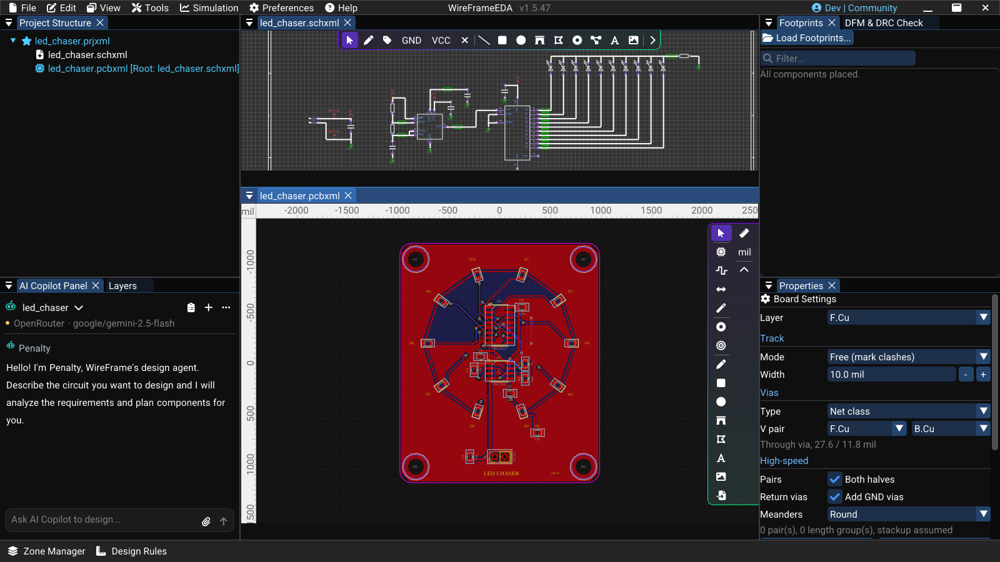
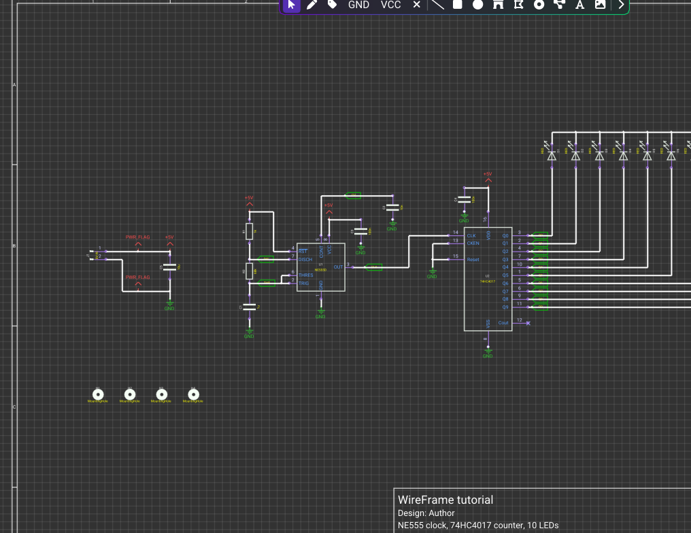
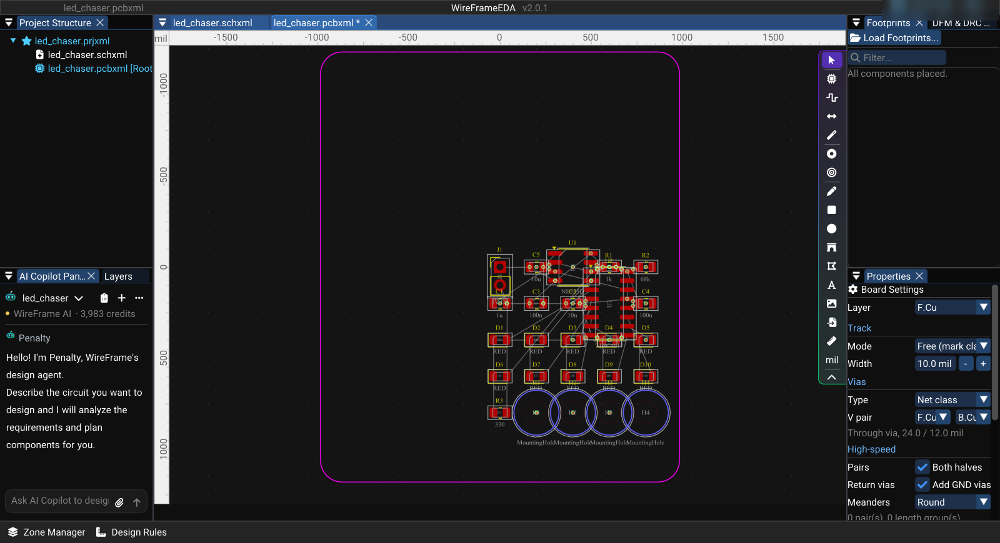
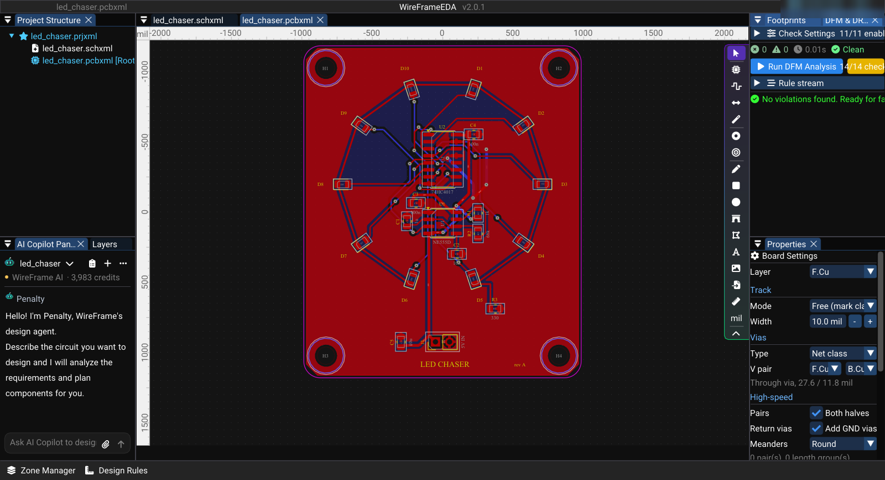

# Tutorial: An LED Chaser Board

This tutorial builds one complete board: an NE555 clock steps a 74HC4017 decade counter, and ten LEDs set in a ring light one after another. It has 25 parts — enough to practise every step of the workflow on a board you could order: project, libraries, schematic, ERC, PCB update, board outline, placement, routing, DFM/DRC, and the fabrication package. Allow about an hour.

### Image — Finished tutorial project

!!! note "Image capture brief"
    1. **Prepare:** Open the finished sample, `samples/led-chaser/3-routed`, with no unrelated documents open.
    2. **Build the frame:** Dock the schematic above the routed board so both show at once, each fitted to its view, with **Project Structure** visible.
    3. **Clean the frame:** Close unrelated panels and tooltips, move the pointer away from key text, and hide credentials, usernames, customer data, and private paths.
    4. **Capture and finish:** Capture a native-resolution PNG of the whole window.
    5. **Approve:** Check the image at 100% zoom: both documents of one project, the LED ring, and no ratsnest left on the board.

<!-- wf:shot id=finished-tutorial-project
caption: 'The finished LED chaser: its schematic above, the routed two-layer board below'
project: samples/led-chaser/3-routed/led_chaser.prjxml
setup:
- open_project
- ensure_schematic
- ensure_pcb
- wait: 2
- drag_at:
    from:
    - 640
    - 36
    to:
    - 800
    - 515
    seconds: 2
- wait: 1
- drag_at:
    from:
    - 800
    - 445
    to:
    - 800
    - 300
    seconds: 1
- wait: 1
- ensure_schematic
- canvas_fit:
    refs:
    - J1
    - C5
    - U1
    - R1
    - C1
    - C2
    - U2
    - D1
    - D10
    - R3
    margin: 0.03
- ensure_pcb
- canvas_fit:
    margin: 0.03
- wait: 1.5
brief_sha256: d88bc6ee62f5ceaf
-->
<!-- wf:out id=finished-tutorial-project sha=3ee1aff45217 -->

<!-- /wf:out -->

The finished project is in the documentation's samples, [`samples/led-chaser`](https://github.com/CaSauCoin/wireframe-docs/tree/main/samples/led-chaser), at three stages — `1-schematic`, `2-placed`, and `3-routed`. Open one with **File → Open Project** to compare it with your own work.

## How the circuit works

- **U1, the clock.** The NE555 runs as an astable oscillator. C1 charges through R1 and R2 and discharges through R2 alone, so the output toggles at f ≈ 1.44 / ((R1 + 2·R2)·C1) = 1.44 / ((1 kΩ + 136 kΩ) × 1 µF) ≈ 10.5 Hz. C2 (10 nF) steadies its CONT pin; RESET is tied to +5 V.
- **U2, the counter.** The 74HC4017 has ten outputs, Q0–Q9, and exactly one of them is high at a time; every rising edge on CLK moves it on, and after Q9 it starts again at Q0. CKEN and RESET are tied to GND so it counts freely. Cout (pin 12) is not used.
- **D1–D10, the ring.** Each output drives one LED's anode. Only one LED is lit at a time, so all ten cathodes share one resistor, R3, to GND: with a 5 V supply and a red LED dropping about 2.0 V, I ≈ (5 − 2.0) / 330 Ω ≈ 9 mA — a little less in practice, because the output itself drops a few tenths of a volt. That is well inside the 74HC4017's output rating. At about 10 steps a second, the light goes round the ring once a second.
- **Supply.** 5 V comes in on the 2-pin header J1. C5 (10 µF) holds up the input; C3 and C4 (100 nF) decouple each IC right at its supply pins.

## The parts

| Ref | KiCad symbol | Value | Footprint |
|---|---|---|---|
| J1 | `Connector:Conn_01x02_Pin` | `5V IN` | `Connector_PinHeader_2.54mm:PinHeader_1x02_P2.54mm_Vertical` |
| U1 | `Timer:NE555D` | `NE555D` | `Package_SO:SOIC-8_3.9x4.9mm_P1.27mm` |
| U2 | `4xxx:4017` | `74HC4017` | `Package_SO:SOIC-16_3.9x9.9mm_P1.27mm` |
| R1, R2, R3 | `Device:R` | `1k`, `68k`, `330` | `Resistor_SMD:R_0805_2012Metric` |
| C1, C2, C3, C4, C5 | `Device:C` | `1u`, `10n`, `100n`, `100n`, `10u` | `Capacitor_SMD:C_0805_2012Metric` |
| D1–D10 | `Device:LED` | `RED` | `LED_SMD:LED_0805_2012Metric` |
| H1–H4 | `Mechanical:MountingHole` | — | `MountingHole:MountingHole_3.2mm_M3` |

Add `+5V`, `GND`, and two `PWR_FLAG` symbols from the `power` library. The `4017` symbol is drawn for the CD4017; the 74HC4017 has the same pinout, and at 5 V it drives an LED much harder than a CD4017 can, so give the symbol the value `74HC4017`.

| Net | Connects |
|---|---|
| `+5V` | J1.1, C5.1, U1.4 (RESET), U1.8 (VCC), R1.1, C3.1, U2.16 (VDD), C4.1 |
| `GND` | J1.2, C5.2, U1.1, C1.2, C2.2, C3.2, U2.8 (VSS), U2.13 (CKEN), U2.15 (RESET), C4.2, R3.2 |
| `DIS` | U1.7 (DISCH), R1.2, R2.1 |
| `THR` | U1.2 (TRIG), U1.6 (THRES), R2.2, C1.1 |
| `CV` | U1.5 (CONT), C2.1 |
| `CLK` | U1.3 (OUT), U2.14 (CLK) |
| `Q0` … `Q9` | U2 pins 3, 2, 4, 7, 10, 1, 5, 6, 9, 11 → the anode (pin 2) of D1 … D10 |
| `LED_K` | the cathode (pin 1) of D1 … D10, R3.1 |
| — | U2.12 (Cout): a no-connect flag |

## Before you start

1. Create the project: **File → New → New Project (.prjxml)...**, choose an empty folder, type `led_chaser` under **Enter Project Name**, and select **Create**.
2. Make the parts available. The symbols are in KiCad's `Device`, `Timer`, `4xxx`, `Connector`, `Mechanical`, and `power` libraries, and the footprints in `Resistor_SMD`, `Capacitor_SMD`, `LED_SMD`, `Package_SO`, `Connector_PinHeader_2.54mm`, and `MountingHole`. Add them in **View → Local Library Manager** (see [Placing Components](../schematic/placing-components.md#prepare-the-library)). The sample's KiCad source, `samples/led-chaser/kicad`, carries every footprint the board uses in its `footprints` folder.

### Short video — Create the tutorial project

!!! note "Video production brief"
    1. **Prepare:** Start from an empty workspace with the start-up notifications gone.
    2. **Opening shot (1–2 s):** Start on **File → New → New Project (.prjxml)**.
    3. **Action shot (3–5 s):** Choose the folder, type `led_chaser`, and confirm with **Create**.
    4. **Result shot (2–3 s):** Hold on the new project in **Project Structure**.
    5. **Deliver:** Export a short 1080p MP4 and keep every path in the frame free of user names.

<!-- wf:video id=create-the-tutorial-project
caption: File → New → New Project, the folder, the name led_chaser, Create
project: none
setup:
- wait: 8
steps:
- wait: 1
- pick_folder: Projects
- menu:
  - File
  - New
  - New Project (.prjxml)...
- wait: 1.5
- type:
    text: led_chaser
    enter: true
- wait: 3
brief_sha256: 4f9268199d486c1b
-->
<!-- wf:out id=create-the-tutorial-project sha=118294fccc3f -->
<video controls muted playsinline preload="metadata" src="../assets/wf/docs/tutorial/index/create-the-tutorial-project.mp4" title="File → New → New Project, the folder, the name led_chaser, Create"></video>
<!-- /wf:out -->

## 1. Draw the schematic

1. Right-click `led_chaser` in **Project Structure** → **Add New Schematic**, type `led_chaser` in **Create New File**, and select **Create**: the sheet is `led_chaser.schxml`.
2. In the **Library** panel (**Local Library** tab), type each part's name in **Filter...** and **drag** it onto the sheet. Untick **Hide power & logo symbols** to find `PWR_FLAG`. Rotate a part with ++space++ while you place it.
3. Select each part and fill **Properties → General → Info**: **Designator** and **Value** from the table above. Check **Linked Footprint**; if it is empty, use **Link Footprint & Save to File** and pick the footprint from the table.
4. Lay the sheet out in three groups, left to right — the supply, the clock, the counter with its LEDs — and wire each group with ++w++: click a pin, click to add corners, and click the other pin to finish. To end on another wire or a free point, double-click.
5. Draw the ten LEDs standing up in a row, anode at the bottom. Wire **Q0** — the top output on the symbol — to the leftmost LED, **Q1** to the next one, and so on to the right: then no two wires cross. Join the ten cathodes with one wire along the top, and take it through R3 to GND.
6. Press ++g++ for each **GND** symbol and ++p++ for each supply symbol; set the supply's **Value** to `+5V`. Put one `PWR_FLAG` on the `+5V` wire and one on the `GND` wire next to J1.
7. Press ++n++ and name the nets that a person will look for on the board: `CLK`, `DIS`, `THR`, `CV`, `LED_K`, and `Q0` to `Q9` on the counter's outputs. The board's nets take these names, so a ratsnest line or a DFM message says `Q3` instead of a generated name.
8. Press ++q++ and click the end of U2 pin 12 (Cout) to mark it as left open on purpose.
9. Save (++ctrl+s++).

Check the LED orientation against the table: the anode (pin 2) goes to the counter, the cathode (pin 1) to the shared `LED_K` net.

!!! tip "Why PWR_FLAG"
    J1's pins are *passive*, so nothing on the sheet is typed as driving `+5V` or `GND`, while both ICs have *power input* pins on them. Without the flags ERC reports **Input Power pin not driven by any Output Power pins** on both rails. A `PWR_FLAG` says the rail is supplied — here, by the header.

### Image — Completed schematic

!!! note "Image capture brief"
    1. **Prepare:** Open `samples/led-chaser/1-schematic`.
    2. **Build the frame:** Fit the whole circuit — supply, clock, counter, the LED row, and the mounting holes — at a resolution where every designator, value, pin number, and net label reads at 100% zoom.
    3. **Clean the frame:** Crop to the drawing; leave out panels, tooltips, and the empty part of the sheet.
    4. **Capture and finish:** Capture a native-resolution PNG.
    5. **Approve:** Check at 100% zoom: the staircase from Q0–Q9 to D1–D10 has no crossing wire, both PWR_FLAGs are on their rails, and U2 pin 12 carries its no-connect flag.

<!-- wf:shot id=completed-schematic
caption: The LED chaser schematic — supply and PWR_FLAGs, the NE555 clock, the 74HC4017 with its ten LEDs,
  and the mounting holes
project: samples/led-chaser/1-schematic/led_chaser.prjxml
size:
- 3840
- 2160
setup:
- open_project
- ensure_schematic
- wait: 1.5
- canvas_fit:
    refs:
    - J1
    - C5
    - U1
    - R1
    - C1
    - C2
    - U2
    - D1
    - D10
    - R3
    - H1
    - H4
    margin: 0.02
- wait: 1
capture:
  rect:
    x: 720
    y: 520
    w: 2480
    h: 1100
brief_sha256: 1c1aa1a61701ba4f
-->
<!-- wf:out id=completed-schematic sha=f908993fe7d6 -->

<!-- /wf:out -->

## 2. Check the schematic

Select **Tools → Electrical Rules Check (ERC)**. The window checks every sheet when it opens and groups what it finds by rule; **Run ERC** checks again after an edit. Click a row to see why it matters and how to fix it — the sheet moves to the place it names. A clean schematic reads **ERC clean: nothing to report on any sheet.**

Typical first-time findings on this board:

- **Pin not connected** — a wire stops short of a pin, or was never drawn. Draw it to the pin's end. If a pin is meant to stay open, like Cout, give it a no-connect flag (++q++).
- **Unconnected wire endpoint** — a wire ends in empty space a little short of where it was aimed. Drag its end onto the pin or wire, or delete it.
- **Input Power pin not driven by any Output Power pins** — a `PWR_FLAG` is missing (see the tip above).

Run the check again after each fix. A drawing that *looks* connected is not enough: ERC reads the connections, not the picture.

### Short video — Fix one ERC issue

!!! note "Video production brief"
    1. **Prepare:** In `samples/led-chaser/1-schematic`, delete the wire that joins the `CLK` net to U2 pin 14, so ERC has one real problem to show. Turn **Snap to grid** off first (**Preferences → Grid & Snap**): the sample comes from KiCad, whose pins sit on a 1.27 mm grid that the default snap step misses.
    2. **Opening shot (2 s):** Open the ERC window with the error rows readable, and move it down so the gap on the sheet stays in view.
    3. **Action shot (6–8 s):** Select the U2 pin 14 row so the sheet shows the pin, then draw the missing wire with ++w++ from the pin to the loose wire end, double-clicking on it to finish.
    4. **Result shot (2–3 s):** Select **Run ERC** and hold on the clean result: **ERC clean: nothing to report on any sheet.**
    5. **Deliver:** Export a short 1080p MP4 with the error text readable before the correction.

<!-- wf:video id=fix-one-erc-issue
caption: 'ERC lists the broken clock wire: U2 pin 14 (CLK) is not connected. The row shows the pin, W
  draws the missing wire, and Run ERC comes back clean.'
project: samples/led-chaser/1-schematic/led_chaser.prjxml
setup:
- open_project
- ensure_schematic
- wait: 1.5
- menu:
  - Preferences
  - Preferences...
- wait: 1
- click_at:
  - 398
  - 379
- wait: 0.5
- click_at:
  - 1256
  - 441
- wait: 0.3
- click_at:
  - 1244
  - 786
- wait: 0.5
- canvas_fit:
    refs:
    - U1
    - U2
    - C3
    - C4
    margin: 0.12
- canvas_click:
  - 1333.5
  - 762
- keys:
  - Delete
- wait: 1
steps:
- wait: 1
- menu:
  - Tools
  - Electrical Rules Check (ERC)
- wait: 2
- drag_at:
    from:
    - 400
    - 72
    to:
    - 400
    - 520
    seconds: 1
- wait: 1.5
- click_at:
  - 300
  - 643
- wait: 2.5
- keys:
  - W
- canvas_click:
  - 1397
  - 762
- wait: 0.6
- canvas_click:
    target:
    - 1270
    - 762
    double: true
- wait: 0.5
- keys:
  - Escape
- wait: 1
- click: //Electrical Rules Check (ERC)/{fa:play} Run ERC
- wait: 0.5
- action:
    action: mouse_move_to
    x: 1000
    y: 12
- wait: 2.5
brief_sha256: 52723884434238f7
-->
<!-- wf:out id=fix-one-erc-issue sha=3427ebcdfd44 -->
<video controls muted playsinline preload="metadata" src="../assets/wf/docs/tutorial/index/fix-one-erc-issue.mp4" title="ERC lists the broken clock wire: U2 pin 14 (CLK) is not connected. The row shows the pin, W draws the missing wire, and Run ERC comes back clean."></video>
<!-- /wf:out -->

## 3. Bring the parts onto the board

1. With the schematic active, select **Tools → Update Schematic to PCB**. With no board in the project yet, WireFrame creates `led_chaser.pcbxml`, makes this sheet its root, and brings in the 25 footprints in a grid, joined by ratsnest lines. A notification says the board has no outline yet.
2. Give the board its shape: **File → Import → CAD Outline (.svg / .dxf)...**, choose [`led_chaser_outline.dxf`](https://github.com/CaSauCoin/wireframe-docs/raw/main/samples/led-chaser/led_chaser_outline.dxf) (50 × 60 mm, 3 mm corners), tick **Import as BOARD OUTLINE**, and untick **Center to Mouse Cursor** so the board is centred on the origin. The verdict reads **Board: 50.00 x 60.00 mm, 0 cutout(s)**; select **Import**. The holes come from H1–H4, so the outline has none. Other ways to set the shape are in [Board Outline](../pcb/board-outline.md).

!!! note "A board added by hand"
    If you add the board yourself first with **Add New PCB**, it has no root schematic yet, and **Update Schematic to PCB** stops with *No Root Schematic mapped for this PCB*. Right-click the board in **Project Structure** → **Set Root Schematic** → `led_chaser.schxml`, then update.

### Image — PCB after schematic update

!!! note "Image capture brief"
    1. **Prepare:** Open `samples/led-chaser/1-schematic`, run **Update Schematic to PCB**, and import `led_chaser_outline.dxf` as the board outline, centred on the origin.
    2. **Build the frame:** Fit the whole board: the 50 × 60 mm outline, the 25 footprints in their update grid, and the ratsnest.
    3. **Clean the frame:** Wait for the notifications to go; move the pointer away.
    4. **Capture and finish:** Capture a native-resolution PNG of the whole window.
    5. **Approve:** The outline is closed and centred, every footprint is present, and no track exists yet.

<!-- wf:shot id=pcb-after-schematic-update
caption: Right after Update Schematic to PCB and the outline import — 25 footprints in a grid, the ratsnest,
  and the 50 × 60 mm board
project: samples/led-chaser/1-schematic/led_chaser.prjxml
setup:
- open_project
- ensure_schematic
- wait: 1.5
- menu:
  - Tools
  - Update Schematic to PCB
- wait: 3
- ensure_pcb
- wait: 1
- open_file: samples/led-chaser/led_chaser_outline.dxf
- menu:
  - File
  - Import
  - CAD Outline (.svg / .dxf)...
- wait: 2
- check: //Import CAD File/Import as BOARD OUTLINE (shape, cutouts and mounting holes)
- click: //Import CAD File/Center to Mouse Cursor
- wait: 0.5
- click: //Import CAD File/Import
- wait: 6
- keys:
  - Home
- wait: 1
brief_sha256: 1994162bd8e78464
-->
<!-- wf:out id=pcb-after-schematic-update sha=65bdc76f3354 -->

<!-- /wf:out -->

## 4. Place the parts

Select each footprint and type its position into **Properties → Footprint Properties → Transform** (**X** and **Y** in mil, with mm beside them; **Rotation** in degrees). (0, 0) is the centre of the board and Y grows downward. The LEDs sit on a circle of 18 mm radius around (0, −5 mm), 36° apart, each with its anode pad facing the centre; the gaps at the top and bottom of the ring leave room for the supply to come in.

| Part | X (mm) | Y (mm) | X (mil) | Y (mil) | Rotation |
|---|---|---|---|---|---|
| D1 | 5.56 | −22.12 | 219 | −871 | 108° |
| D2 | 14.56 | −15.58 | 573 | −613 | 144° |
| D3 | 18.00 | −5.00 | 709 | −197 | 180° |
| D4 | 14.56 | 5.58 | 573 | 220 | −144° |
| D5 | 5.56 | 12.12 | 219 | 477 | −108° |
| D6 | −5.56 | 12.12 | −219 | 477 | −72° |
| D7 | −14.56 | 5.58 | −573 | 220 | −36° |
| D8 | −18.00 | −5.00 | −709 | −197 | 0° |
| D9 | −14.56 | −15.58 | −573 | −613 | 36° |
| D10 | −5.56 | −22.12 | −219 | −871 | 72° |
| U2 | 0.00 | −9.50 | 0 | −374 | 0° |
| C4 | 5.60 | −14.00 | 220 | −551 | 0° |
| U1 | 0.00 | 2.00 | 0 | 79 | 0° |
| C3 | −4.80 | −1.60 | −189 | −63 | 0° |
| R1 | 6.40 | 0.20 | 252 | 8 | −90° |
| R2 | 6.40 | 3.90 | 252 | 154 | −90° |
| C1 | −6.40 | 1.70 | −252 | 67 | −90° |
| C2 | 2.60 | 7.60 | 102 | 299 | 0° |
| R3 | 9.50 | 17.50 | 374 | 689 | 0° |
| J1 | −1.27 | 23.50 | −50 | 925 | −90° |
| C5 | −7.50 | 23.50 | −295 | 925 | −90° |
| H1 | −21.00 | −26.00 | −827 | −1024 | 0° |
| H2 | 21.00 | −26.00 | 827 | −1024 | 0° |
| H3 | −21.00 | 26.00 | −827 | 1024 | 0° |
| H4 | 21.00 | 26.00 | 827 | 1024 | 0° |

Then add ground on both layers: **View → Zone Manager → GND plane ▾ → Top and bottom**, then **Refill**.

## 5. Route and inspect

1. Click **F.Cu** in the **Layers** panel.
2. Route the decoupling capacitor at the counter first, so it sits right at the pin it serves: press ++x++, click C4 pad 1, and click U2 pin 16. ++esc++ ends a route; ++backspace++ takes back the last corner. While you route, the readout beside the pointer shows the net, its class, the width, and the clearance.
3. Draw the cathode ring by hand — it is the board's signature: from D6's cathode to D7's, and on round the ring to D5, then to R3 pad 1. Leave the ring open at the bottom, between D5 and D6, so the supply can come in from J1.
4. Let **Auto-route** do the rest: drag a selection box over the whole board and press ++ctrl+shift+w++ (**Auto-route selection**). It routes on both layers with vias, around the copper already there, as one undo step. The notification says how many connections it routed and names each one it left, with the reason. On this board it leaves one: U2 pin 15 to `GND`, for the ground pour, which picks the pin up when the pours are refilled (**View → Zone Manager → Refill**). Route anything else it leaves by hand (see [Route Assist](../pcb/routing.md#route-assist)), and let [DFM/DRC](#6-run-dfmdrc) confirm that nothing is unconnected.
5. Nets named `GND` or starting with `+` (`+5V`) use the **Power** class — 20 mil tracks, 15 mil clearance; the others use **Default** — 10 mil tracks, 6 mil clearance (see [Design Rules](../pcb/design-rules.md)). The LEDs draw under 10 mA, so either is ample.

After routing, check the LED and connector orientation, that the silkscreen reads, and that no ratsnest line is left.

### Short video — Route the LED chaser

!!! note "Video production brief"
    1. **Prepare:** Open `samples/led-chaser/2-placed`: parts placed, the cathode ring drawn, every other connection still a ratsnest line.
    2. **Opening shot (2 s):** Hold on C4 and U2 pin 16 and the ratsnest line between them.
    3. **Action shot (8–12 s):** Route that connection by hand with ++x++, then box-select the board and press ++ctrl+shift+w++.
    4. **Result shot (3–4 s):** Hold on the routed board with the Auto-route notification readable.
    5. **Deliver:** Export a short 1080p MP4 and keep the route geometry readable.

<!-- wf:video id=route-the-led-chaser
caption: 'C4 to U2 pin 16 routed by hand, then Auto-route (Ctrl+Shift+W): 26 of 27 connections, the last
  GND pin left to the ground pour'
project: samples/led-chaser/2-placed/led_chaser.prjxml
setup:
- open_project
- ensure_pcb
- wait: 2
- canvas_fit:
    refs:
    - C4
    - U2
    - C3
    margin: 0.25
steps:
- wait: 1.5
- keys:
  - X
- canvas_click: pad:C4.1
- wait: 0.8
- canvas_click: pad:U2.16
- wait: 0.8
- keys:
  - Escape
- wait: 1.5
- canvas_fit:
    margin: 0.3
- wait: 1
- canvas_box:
    refs:
    - H1
    - H2
    - H3
    - H4
    - J1
    - U1
    - U2
    - D1
    - D5
    - D8
    margin: 150
- wait: 1
- keys:
  - Ctrl
  - Shift
  - W
- wait: 6
- keys:
  - Escape
- canvas_fit:
    margin: 0.04
- wait: 3
brief_sha256: 28cdc790b934ecdc
-->
<!-- wf:out id=route-the-led-chaser sha=e61e520c8281 -->
<video controls muted playsinline preload="metadata" src="../assets/wf/docs/tutorial/index/route-the-led-chaser.mp4" title="C4 to U2 pin 16 routed by hand, then Auto-route (Ctrl+Shift+W): 26 of 27 connections, the last GND pin left to the ground pour"></video>
<!-- /wf:out -->

## 6. Run DFM/DRC

Open **Tools → DFM & DRC Check Panel...** and select **Run DFM Analysis**. Click each error to jump to it, fix it, and run again until no error is left. Review each warning; record why an accepted warning is fine rather than hiding it. On the finished sample the panel reads **Clean** and **No violations found. Ready for fabrication!**

### Image — Clean DFM/DRC result

!!! note "Image capture brief"
    1. **Prepare:** Open `samples/led-chaser/3-routed`.
    2. **Build the frame:** Fit the routed board, open the **DFM & DRC Check** panel, and run the analysis so its clean summary is readable beside the board.
    3. **Clean the frame:** Close unrelated panels and tooltips, move the pointer away from key text, and hide credentials, usernames, customer data, and private paths.
    4. **Capture and finish:** Capture a native-resolution PNG of the whole window.
    5. **Approve:** The summary shows no error, and the board shows no ratsnest.

<!-- wf:shot id=clean-dfm-drc-result
caption: The routed LED chaser with the DFM & DRC Check panel after a run — nothing to fix
project: samples/led-chaser/3-routed/led_chaser.prjxml
setup:
- open_project
- ensure_pcb
- wait: 2
- keys:
  - Home
- panel: dfm
- focus: DFM & DRC Check
- wait: 1
- click: //DFM & DRC Check/{fa:play} Run DFM Analysis
- wait: 2
- wait_for: //DFM & DRC Check/{fa:play} Run DFM Analysis
- wait: 0.5
brief_sha256: f459d5fd6d5e5f48
-->
<!-- wf:out id=clean-dfm-drc-result sha=19c524a67103 -->

<!-- /wf:out -->

## 7. Generate the fabrication package

1. Save the board.
2. Select **File → Export → Fabrication Outputs (Gerber/Drill/BOM)...**. The **Fabrication & Assembly Output** window names the board, its size, its copper layers, and its revision.
3. Set **Revision** to `A`. It is written into every file, so two revisions cannot be mixed.
4. Select **Generate & verify package**. WireFrame refills the copper pours, writes every file, then reads each file back and checks it against the board object by object: **The package matches the design** means every pad, via, track, opening, and hole the board has is in the files, and nothing else is.
5. Read the **Files** tab — copper, solder mask, paste, silkscreen, board outline, drill, and the BOM and placement files for assembly — and the **Preview** tab, which draws the Gerber and drill files themselves, layer by layer.
6. Select **Save package (.zip)...** (or **Save to folder...**). Before you order, open the package in a full Gerber viewer as well (KiCad GerbView, gerbv, or your manufacturer's viewer).

### Short video — Verify the fabrication package

!!! note "Video production brief"
    1. **Prepare:** Open `samples/led-chaser/3-routed` with the routed board in view.
    2. **Opening shot (2–3 s):** Open the fabrication output window and set the revision to `A`.
    3. **Action shot (8–12 s):** Generate and verify the package, then open the **Files** tab and the **Preview** tab.
    4. **Result shot (3–4 s):** Hold on the preview with the verification summary readable.
    5. **Deliver:** Export a short 1080p MP4. Do not save the package on camera — the save path would show the machine's folders.

<!-- wf:video id=verify-the-fabrication-package
caption: 'Revision A, Generate & verify package: the package matches the design; its files, then the Gerber
  preview'
project: samples/led-chaser/3-routed/led_chaser.prjxml
setup:
- open_project
- ensure_pcb
- wait: 2
- keys:
  - Home
- wait: 1
steps:
- wait: 1
- menu:
  - File
  - Export
  - Fabrication Outputs (Gerber/Drill/BOM)...
- wait: 2
- click_at:
  - 333
  - 425
- keys:
  - End
- keys:
  - Backspace
- type:
    text: A
    enter: true
- wait: 1
- click: '**/{fa:cogs}  Generate & verify package'
- wait: 6
- click_at:
  - 775
  - 256
- wait: 3
- click_at:
  - 683
  - 256
- wait: 4
brief_sha256: ef5c8aec0190aec9
-->
<!-- wf:out id=verify-the-fabrication-package sha=ed0170e49337 -->
<video controls muted playsinline preload="metadata" src="../assets/wf/docs/tutorial/index/verify-the-fabrication-package.mp4" title="Revision A, Generate &amp; verify package: the package matches the design; its files, then the Gerber preview"></video>
<!-- /wf:out -->

## Completion checklist

- Project, schematic, and PCB are saved in the project folder.
- The LEDs' polarity is right (anode to the counter); every symbol has its footprint.
- ERC reports nothing; DFM/DRC shows no error.
- No ratsnest line is left, and both GND pours are filled.
- The package was generated and verified at revision `A`, and you have looked at it in a Gerber viewer.

## Continue learning

- [Projects and Files](../projects.md)
- [Wiring and Nets](../schematic/wiring-and-nets.md)
- [Electrical Rules Check](../schematic/erc.md)
- [Board Outline](../pcb/board-outline.md)
- [Routing](../pcb/routing.md)
- [Fabrication and Export](../pcb/fabrication-and-export.md)
- [AI-Assisted Design](ai-design.md)
