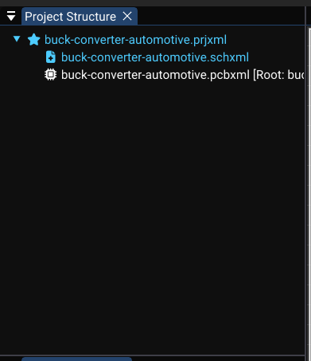

# User Interface Overview

WireFrame uses dockable panels around the active schematic or PCB editor. Available tools and panels change with the active document type.

### Image — Main window

!!! note "Image capture brief"
    1. **Prepare:** Open the sample project with the default layout and the PCB active.
    2. **Build the frame:** Capture the whole window and add callouts for the menu bar, Project Structure, editor tabs, Library/Footprints, Properties, Layers, and AI Copilot.
    3. **Clean the frame:** Close unrelated panels and tooltips, move the pointer away from key text, and hide credentials, usernames, customer data, and private paths.
    4. **Capture and finish:** Capture a native-resolution PNG, crop without cutting titles or primary actions, and add at most three subtle callouts without altering engineering content.
    5. **Approve:** Check the image at 100% zoom for current labels, readable evidence, correct release branding, and absence of sensitive information.

## Main menus

### File

Use **File** to:

- **New** — **New Project (.prjxml)...**, **New Schematic (.schxml)** (++ctrl+n++), **New PCB (.pcbxml)**;
- **Open File...** (++ctrl+o++) and **Open Project (.prjxml)...** (++ctrl+p++);
- **Import** — **KiCad Project (.kicad_pro, .pro)...** and, with a PCB active, **CAD Outline (.svg / .dxf)...**;
- **Save** (++ctrl+s++) and **Save As...** (++ctrl+shift+s++);
- **Export** — **Export Schematic to PDF...**, **Print PCB to PDF (1:1)...**, **Fabrication Outputs (Gerber/Drill/BOM)...**;
- **Page Settings...** for the active schematic;
- **Close Document**, **Close Project**, and **Exit**.

Commands that do not apply to the active document are disabled.

### Edit

Use **Edit** for **Undo**, **Redo**, **Cut**, **Copy**, **Paste**, and **Delete** in the active editor. The shortcuts shown follow your key bindings.

### View

Use **View** to show or hide:

- Project Structure;
- Editor Panel;
- Component Library;
- Properties;
- Local Library Manager;
- AI Copilot Chat;
- PCB Layers;
- Zone Manager — see [Zone Manager](pcb/zones-and-planes.md#zone-manager);
- Design Rules — see [Design Rules](pcb/design-rules.md);
- 3D Viewer (++3++);
- Performance HUD — a frame-time overlay; see the FAQ entry *The canvas feels slow or stutters* under [Schematic and PCB](faq.md#schematic-and-pcb).

### Tools

Use **Tools** for **Symbol Library Editor**, **PCB Footprint Editor**, **Auto Wire**, **Update Schematic to PCB** (a submenu when the project has several PCBs), **Electrical Rules Check (ERC)**, **DFM & DRC Check Panel...**, **Fabrication Output...**, and **Gerber Viewer...**. Commands that do not apply to the active document are disabled.

### Simulation

Use **Simulation** for the **SPICE Simulation Panel**, **Pre-flight Validation Checklist**, and **SPICE Model Editor**.

### Preferences

**Preferences...** (++ctrl+comma++) opens the Preferences dialog — see [the categories below](#current-preferences-categories). Use **Reset to Default Layout** only when you intend to discard the saved docking layout.

### Help and account

The **Help** menu has **Documentation** (this guide), **Report a Bug...**, **Request a Feature...** (see [Reporting an issue](faq.md#reporting-an-issue)), **Download Latest Version** — or **Update to v…** when a newer version exists — and **About WireFrame EDA**.

The account menu at the right end of the menu bar shows your name and mode, for example *Engineer | Community*. WireFrame runs in community mode — free local use, and **Login is optional**. The menu offers **Star repository**, **Donate / Buy me a coffee**, **Check for Updates**, and **Clear saved login**.

## Docking layout

Drag a panel by its title to dock it to another edge or tab group. Preferences can enable detachable multi-monitor panels and companion-panel behavior.

### Short video — Rearrange and restore panels

!!! note "Video production brief"
    1. **Prepare:** Reset to a known layout and choose one panel that can be moved without covering the design.
    2. **Opening shot (1–2 s):** Hold on the original docked layout with panel titles readable.
    3. **Action shot (6–10 s):** Move and dock the panel, demonstrate the detachable state when available, then invoke the current saved/default layout restore action.
    4. **Result shot (3–4 s):** Hold on the restored layout matching the opening state.
    5. **Deliver:** Export a **12–18 second** 1080p MP4 and replace media with obsolete **View** or **Preferences** labels.

<!-- wf:video id=rearrange-and-restore-panels
caption: Close a panel, then Preferences → Reset to Default Layout
setup:
- open_project
- wait: 1
steps:
- wait: 1
- click_at:
  - 1447
  - 36
- wait: 2
- menu:
  - Preferences
  - Reset to Default Layout
- wait: 3
brief_sha256: 194ebbf4934e46ed
-->
<!-- wf:out id=rearrange-and-restore-panels sha=2cc8c768f500 -->
<video controls muted playsinline preload="metadata" src="../assets/wf/docs/ui-overview/rearrange-and-restore-panels.mp4" title="Close a panel, then Preferences → Reset to Default Layout"></video>
<!-- /wf:out -->

## Project Structure

The Project Structure panel lists the open projects with their schematics and PCBs. Standalone files appear separately. Click a file to open it; ++shift++ / ++ctrl++ (++cmd++ on macOS) select several.

Right-click the **project** for **Add New Schematic**, **Add New PCB**, **Rename Project**, **Open in Explorer**, and **Close Project**. Right-click a **file** for:

| Item | What it does |
|---|---|
| **Open**, **Reload** | Open it, or read it again from disk |
| **Rename**, **Open in Explorer** | Rename the file, or show it in the system file manager |
| **Set Root Schematic ▸** *(PCB only)* | Choose which schematic sheet this board is built from, or **None (Clear Mapping)** |
| **Exclude from Project** / **Un-Exclude from Project** | Keep the file listed but leave it out of the project's design |
| **Remove from List** | Take the file out of the project; the file stays on disk |
| **Delete...** | Delete the file from disk after a confirmation. **This cannot be undone**; open tabs of the file close and unsaved changes are lost. ++delete++ does the same for the selected files |

### Image — Current Project Structure

!!! note "Image capture brief"
    1. **Prepare:** Compare the existing asset with the current release UI and list every changed label or control before recapturing.
    2. **Build the frame:** Capture a current project tree with multiple schematics and one PCB. Replace older images if icons or group labels differ. Suggested size: **420 × 720 px**.
    3. **Clean the frame:** Close unrelated panels and tooltips, move the pointer away from key text, and hide credentials, usernames, customer data, and private paths.
    4. **Capture and finish:** Capture a native-resolution PNG, crop without cutting titles or primary actions, and add at most three subtle callouts without altering engineering content.
    5. **Approve:** Check the image at 100% zoom for current labels, readable evidence, correct release branding, and absence of sensitive information.

<!-- wf:shot id=current-project-structure
caption: Current Project Structure
planned_by: agyserve · gemini-3.8-flash-high
planned_at: '2026-10-05'
setup:
- open_project
- open: '**/{fa:star} 7805_regulator.prjxml'
- wait: 1.0
capture:
  window: Project Structure
  padding: 8
brief_sha256: b38c0f17fbfead10
-->
<!-- wf:out id=current-project-structure sha=b7da15508f75 -->

<!-- /wf:out -->

## Editor panel

The center editor displays the active schematic or PCB. Common actions include:

- mouse wheel to zoom;
- middle-drag or the configured pan action to move the view;
- click or box selection;
- context menu for object-specific actions;
- shortcuts shown in the active key map.

Toolbars change when switching between schematic and PCB documents.

## Component Library

With a **schematic** active, the **Library** panel has two tabs:

- **Local Library** — symbols from your library sources. **Filter...** searches, **Hide Power/Logo** hides power symbols and logos, and **Manage libraries...** opens the Library Manager. Drag a symbol onto the sheet to place it.
- **Online Store** — WireFrame's online component catalog. **Install** downloads a part with its symbol, footprint, and 3D model; **Drag to schematic** places an installed part.

With a **PCB** active, the panel becomes **Footprints**: the design's footprints that are not on the board yet, a **Filter...** box, and **Load Footprints...** to add a `.kicad_mod` file. Drag a row onto the board to place it.

Use **View → Local Library Manager** to add or remove library sources — see [Library Import and Management](libraries/library-converter.md).

## Properties

Properties follow the current selection:

- a **library symbol** selected in the Library panel shows a preview with **Symbol**, **Footprint**, and **3D Model** tabs;
- a **schematic component** shows **Component Properties** with **General**, **3D Model**, and **Pins** tabs;
- **empty schematic canvas** shows **Document Settings** (title block);
- a **PCB footprint** shows **Footprint Properties** — reference, value, position, rotation, **Flip Layer (F)**;
- **traces, vias, holes, and graphics** show their own settings;
- **nothing selected on a PCB** shows **Board Settings** — active layer, track width, via type, high-speed options, corner style, and the rules of the active net.

**Ctrl+E** brings the Properties panel back if it is hidden.

## PCB Layers

The **Layers** panel sets the copper stackup, the active layer, and each layer's visibility, lock, and colour. Hiding a layer changes the view, not the board data. Confirm the active copper layer before routing or adding vias — see [Layers and Views](pcb/layers-and-views.md).

## Notifications and logs

Status messages and notification overlays report saves, imports, checks, and failures. Read the full message before repeating an action. For simulation, also inspect **Last run** and the simulation log.

### Short video — Notification and status feedback

!!! note "Video production brief"
    1. **Prepare:** Choose a safe save/import action and a reproducible warning that does not modify or delete user data.
    2. **Opening shot (1 s):** Start on a clean workspace with no notification visible.
    3. **Action shot (4–6 s):** Trigger the successful action and hold its notification, then trigger the non-destructive warning after the first overlay clears.
    4. **Result shot (2–3 s):** Hold on the warning long enough to read its message and severity styling.
    5. **Deliver:** Export an **8–12 second** 1080p MP4; replace the clip if the current overlay design differs.

<!-- wf:video id=notification-and-status-feedback
caption: An action reports back in a notification
setup:
- open_project
- ensure_schematic
- wait: 1
steps:
- wait: 1
- menu:
  - Tools
  - Update Schematic to PCB
- wait: 5
brief_sha256: 5081b018a987adf6
-->
<!-- wf:out id=notification-and-status-feedback sha=3468c19a4b87 -->
<video controls muted playsinline preload="metadata" src="../assets/wf/docs/ui-overview/notification-and-status-feedback.mp4" title="An action reports back in a notification"></video>
<!-- /wf:out -->

## Current Preferences categories

| Category | Includes |
|---|---|
| **General** | Display units (**Mil** / **Millimeter**), autosave and its interval |
| **Appearance** | Theme mode (dark / light), accent colour, interface font, font file, and font size |
| **Workspace** | **Detachable panels** (drag panels onto another monitor), **Companion panels follow their editor**, **Default layout**, **Restore on launch**, **Layout presets** |
| **Grid & Snap** | **Show grid**, **Crosshair at cursor**, **Snap to grid** (hold ++alt++ to place off-grid), **Grid step** |
| **Editing** | **Rotate step** for both editors; **Default trace width (mil)** for new boards |
| **Keyboard Shortcuts** | Key bindings — see [Keyboard Shortcuts](advanced/shortcuts.md) |
| **Simulation** | **Default analysis**, **Transient defaults** (stop time, time step), **Engines** (ngspice is built in; Xyce, LTspice, and an external ngspice are optional) |
| **Libraries** | Library Manager, online catalog, loaded sources, and the library cache folder |
| **3D Viewer** | Materials of the 3D board preview: solder mask, trace under mask, pad plating, silkscreen |
| **AI Assistant** | Provider, endpoint, API key, design and fast models — see [AI Copilot](ai/index.md#configure-ai-access) |
| **Updates** | Version, licence tier, and the update check |

A search box at the top finds settings by keyword.

Select **OK** to keep changes or **Cancel** to discard pending dialog changes.

## See also

- [Getting Started](getting-started.md)
- [Keyboard Shortcuts](advanced/shortcuts.md)
- [Configuration and Session Storage](reference/config-and-session.md)
